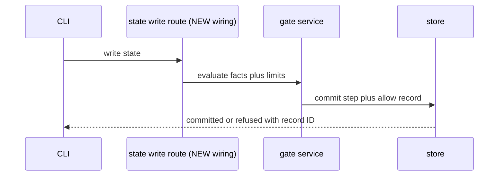
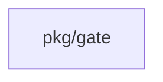
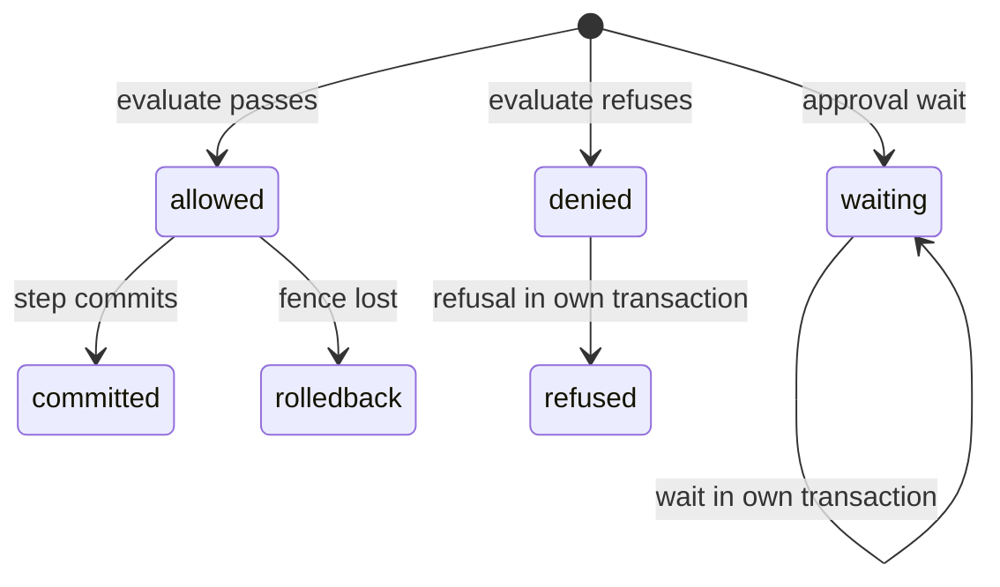
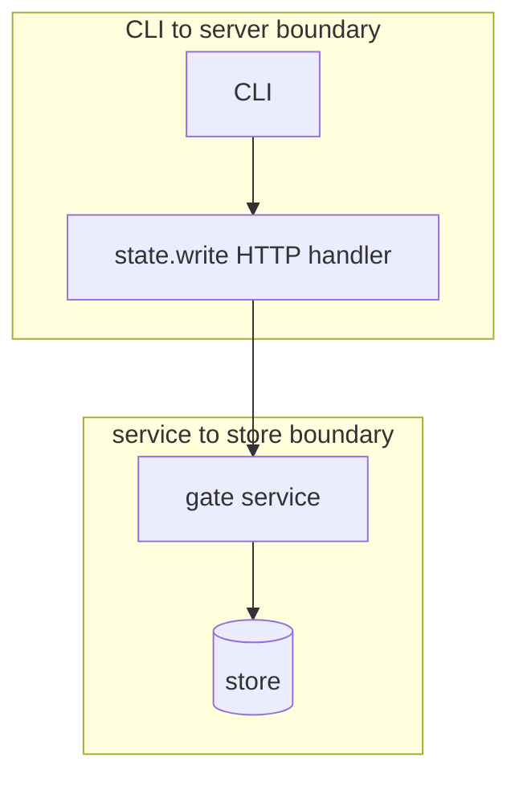

## Context

State writes run through the state.write guard before the store transaction commits. The fact builder, the record writer, the approval evaluation and the access check stay in pkg/gate.

## Decisions

1. **Facts from the stored states.** Build state facts from the fence-bound old state and the new state carried by the operation. A missing or client-encrypted body gives state.available false with a recorded reason and no resource count.
2. **Record in the step transaction.** Write the allow record in the same store transaction as the step and name the record ID in the audit entry. Write a refusal or wait record in its own transaction. If the refusal record cannot commit, fail closed with gate.unavailable.
3. **Defaults and limits.** Evaluate approval defaults at state.write with the same combiner for one requirement. Wire gate.LimitedAuthorizer on every route for unit, namespace, collection and installation objects. A break-glass session skips access limits while gates hold. Above 10000 counted resources mark the facts truncated and fail threshold comparisons closed.

## Structure

The unexported guard type of pkg/gate is built only by its constructor, which checks that the fact schema, the record store and the authorizer are set.

## Risks

- Large states raise fact build time; cap counted resources at 10000.
- A concurrent write changes the stored state; the fence check in the same transaction rolls back the step and the allow record.

## Layers (defense in depth)

| Layer | Guard | Hostile test |
| --- | --- | --- |
| port adapter | Fact builder maps missing or client-encrypted bodies to state.available false and caps counts. | Send a client-encrypted state and a 20000-resource state to the fact builder. |
| service | Service checks fixed controls and writes step and allow record in one transaction. | Remove the manual-lock check; the fixed control test fails. |
| HTTP handler | Handler runs the limited authorizer on each route. | Call a route with a forbid limit; it returns 403 gate.limited. |

## Diagrams

After this change:

Modules that the change touches, and their imports on main:

New imports of this change (each one allowed by the module rules):

- `internal/api/tfe` imports `pkg/gate`

States on main in the touched packages:

States and transitions after this change:

## Quality attributes

| Attribute | Target | Unit | Scope |
| --- | --- | --- | --- |
| counted resources per evaluation | 10000 | entries | state.write fact document |

## Threat model

Data flow and trust boundaries:

| Boundary | STRIDE | Threat | Layer | Guard | Hostile test |
| --- | --- | --- | --- | --- | --- |
| CLI to server boundary | E | A caller with grants but a forbid access limit writes state at a route. | boundary check | Handler allowlists the operation kind. | Send an unknown operation kind; the handler rejects it. |
| CLI to server boundary | E | A caller with grants but a forbid access limit writes state at a route. | encode or contain | Record holds facts and SHA-256, no raw state. | Inspect the stored record for raw bytes. |
| CLI to server boundary | E | A caller with grants but a forbid access limit writes state at a route. | limit | Counted resources cap at 10000. | Send 20000 resources; no panic. |
| CLI to server boundary | E | A caller with grants but a forbid access limit writes state at a route. | authorize at point of use | Handler runs the limited authorizer before grants alone allow. | Call with a forbid limit and valid grants; 403 gate.limited. |
| CLI to server boundary | E | A caller with grants but a forbid access limit writes state at a route. | fail closed | Record store down gives gate.unavailable. | Break the record store; 503 and no state change. |
| service to store boundary | T | A concurrent write makes the record describe a state that did not commit. | boundary check | Service validates the fence-bound old-state version. | Send facts from a stale old state; rollback. |
| service to store boundary | T | A concurrent write makes the record describe a state that did not commit. | encode or contain | Record stores no raw state bytes. | Inspect the record. |
| service to store boundary | T | A concurrent write makes the record describe a state that did not commit. | limit | Truncated counts fail threshold comparisons closed. | Evaluate a threshold gate on a truncated count; result is error. |
| service to store boundary | T | A concurrent write makes the record describe a state that did not commit. | authorize at point of use | Service rechecks fence and fixed controls in the commit transaction. | Hold a manual lock after the first check; commit refuses. |
| service to store boundary | T | A concurrent write makes the record describe a state that did not commit. | fail closed | Service rolls back step and allow record on fence loss. | Lose the fence; nothing commits. |

## Contracts

**gate decision record**

- Invariant: The record holds the fact document SHA-256 and the version of each evaluated gate.
- Invariant: An allow record commits only with its step.
- `State facts from both states`: pre: The caller holds the old and new states.; The fence holds the namespace and failover version.. Post: The fact document holds state.available and the reason when the body is missing.; Facts bind to the committed old-state version..

## Failure modes

| Step | Failure | Retry | State after |
| --- | --- | --- | --- |
| Build state facts | Body cannot be read | No retry; record state.available false with reason. | The write continues under the gates that apply. |
| Commit step with allow record | Fence lost before commit | No retry; roll back and return the fence error. | No step and no allow record committed. |
| Write refusal record | Refusal store write fails | No retry; fail closed with gate.unavailable. | No state changed. |

## Change impact (computed from main)

Tests:

- `internal/expr/owned_internal_test.go` names `gate.ErrRuleFailed`
- `internal/expr/hostile_test.go` names `gate.ErrRuleFailed`
- `internal/expr/timeout_internal_test.go` names `gate.ErrRuleFailed`

ADRs:

- `docs/adr/0114-the-policy-port-and-its-default-adapters.md` names `gate.ErrRuleFailed`
- `docs/adr/0112-blueprints-the-document-versions-and-expr.md` names `gate.ErrRuleFailed`
- `docs/adr/0223-access-limits-cedar-forbid-policies-for-each-scope.md` names `gate.ErrRuleFailed`
