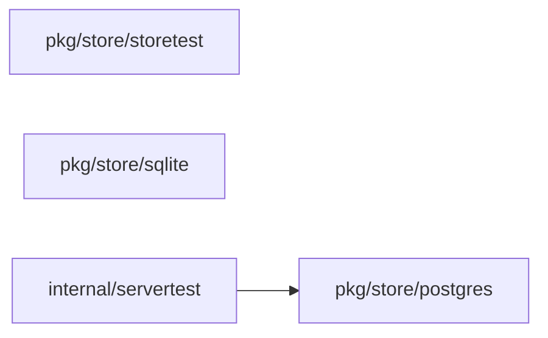

## Context

Test-only fixture cost in store suites. Request paths and stored data do not change.

## Decisions

1. **Reuse fixtures instead of fresh stores per case.** Reuse one migrated template copy per package and one built export per hostile-body group, then copy per case and vary only the approvers row in the staged copy.
2. **Isolate copies and fail package setup closed.** Make template copies with unique names per package run, checkpoint SQLite before copy, hold no sessions on the PostgreSQL template, serialize template build with a package-level once guard, clean up each copy, and keep one fresh-store migration path per dialect that still runs full migrations.

## Structure

No production structure change. Only test fixture setup changes in pkg/store/storetest and package tests.

## Risks

- Reuse across cases can leak state between subtests if the copy step is shallow or not reset.

## Diagrams

Modules that the change touches, and their imports on main:

## Quality attributes

| Attribute | Target | Unit | Scope |
| --- | --- | --- | --- |
| test wall time | <=45 | s | pkg/store/sqlite without -race on 4 vCPU |
| test wall time | reduced versus 9464ad0 baseline with unchanged assertions | s | pkg/store/postgres without -race on 4 vCPU |
