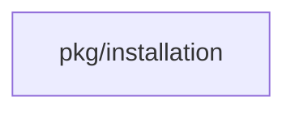

## Context

A store without installation.MinimumChecker skips the binary minimum check at restore start, worker check and readiness. The same silent-skip pattern exists for a nil maintenance service, for the store-check setup without restore rows, and for the purge backlog gauge setup in sweep.go.

## Decisions

1. **Fail at construction with ErrMissingOption.** Check the store interface in dustpan.NewServer and return an error that wraps the existing ErrMissingOption when installation.MinimumChecker is absent, the same pattern newDeletedSweeper uses. Apply the same refusal to a nil maintenance service, to a store without the restore rows that the store check needs, and to a store without the purge records that the backlog gauge needs. Keep the per-call assertions so a store swapped after construction still returns the minimum-check error.
2. **Cover MinimumChecker in storetest.** Add storetest cases for CheckBinaryMinimum: binary at minimum passes, binary below minimum is refused, version read failure returns an error. Both SQL adapters run the same suite.

## Structure

Runtime guard in NewServer, not an unexported type. No structure makes this bug class impossible because the store is an interface supplied by the embedder. The constructor asserts installation.MinimumChecker and wraps the existing ErrMissingOption, so no server value is produced for a store that lacks the check.

## Risks

- A third-party store that lacks MinimumChecker fails at startup after this change. The error names the missing interface and the embedder adds the method.

## Diagrams

Modules that the change touches, and their imports on main:

## Quality attributes

| Attribute | Target | Unit | Scope |
| --- | --- | --- | --- |
| none affected | Construction-time interface assertion only with no request-path change |  |  |

## Contracts

**Server construction**

- Invariant: A constructed server holds a store that exposes installation.MinimumChecker.
- Invariant: A constructed server holds a maintenance service and store-check rows and purge-record support.
- `NewServer`: pre: Caller supplies the store used for installation data.. Post: Refusal wraps ErrMissingOption when MinimumChecker is absent.; Success leaves restore start, worker check and readiness able to call CheckBinaryMinimum..

**MinimumChecker conformance**

- Invariant: CheckBinaryMinimum reports whether the binary meets the minimum that the database requires.
- `CheckBinaryMinimum`: pre: Caller passes a context for the version read.. Post: Nil return when the binary meets the minimum.; Error return when the binary is below the minimum or when the version read fails..
