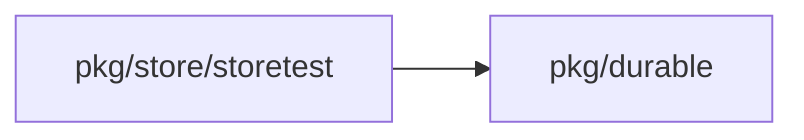

## Context

The shared store conformance suite must lock the rule that the cancel check wins over a recorded-step check in the durable step paths.

## Decisions

1. **Canceled operation with recorded step returns ErrCanceled.** Add one case in pkg/store/storetest for a live operation with CancelRequested set and one step recorded. The case expects the existing sentinel ErrCanceled on the RecordStep path and on the restore peek path reached through the existing restore operation path. The first task confirms the existing Store port calls for cancel and RecordStep and the PostgreSQL wiring of the suite. The change builds after restore-loses-its-own-claim so the restore peek wiring matches.

## Structure

No new type. The case uses the existing durable operation, the existing step fence and the existing ErrCanceled sentinel.

## Risks

- A dialect adapter returns a step error instead of ErrCanceled when both cancel and a recorded step hold.

## Diagrams

Modules that the change touches, and their imports on main:

States on main in the touched packages:

## Quality attributes

| Attribute | Target | Unit | Scope |
| --- | --- | --- | --- |
| none affected | conformance test only, no runtime behavior change |  |  |

## Failure modes

| Step | Failure | Retry | State after |
| --- | --- | --- | --- |
| RecordStep on a live operation with cancel requested and a recorded step | The adapter checks the step first and returns a step error | The caller retries and gets the same step error, so the cancel is never seen | The operation stays live with cancel requested; the new case fails the adapter |
| Restore peek on a live operation with cancel requested and a recorded step | The adapter checks the step first and returns a step error | The caller retries and gets the same step error | The operation stays live with cancel requested; the new case fails the adapter |
