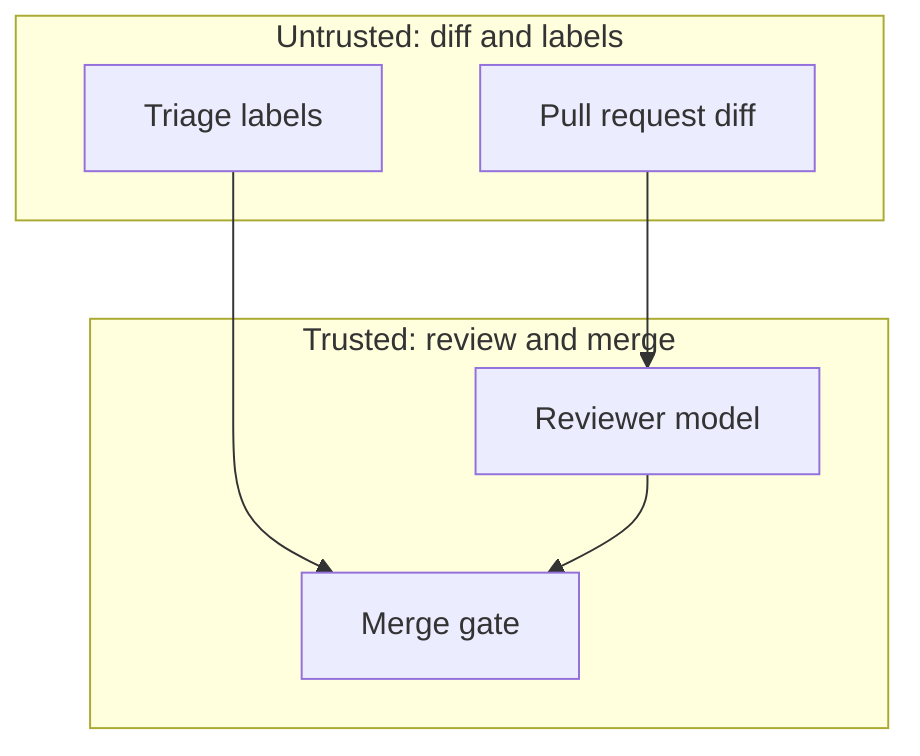

## Context

Reviewer-only rules live in a review conversation and the overnight loop misses them. The rules become one guide page that the loop reads before it opens a pull request.

## Decisions

1. **Guide text first.** Add the NEW file docs/guides/agent-review-loop.md with the fixed security checklist, the audit cadence, the proposal marking, the triage labels and branch hygiene. Require e2e in CI and the listed gates through the guide. Add no product code in this change.
2. **Checklist review blocks merge.** A diff that touches secrets, identity, routes, errors, migrations, limits, locks or crypto needs a checklist review by a different model that posts a PR review. A blocking finding stops the merge until a person clears it.
3. **Proposals stay RFCs until owner accepts.** The loop never writes an ADR. It writes an RFC or a proposed decision marked agent-drafted. An ADR is written only after the project owner accepts the decision.

## Structure

No code structure changes. The guide states each rule as text so a later change can turn each rule into a gate type with its own constructor.

## Risks

- Cloud loop and local session edit the same guide page

## Layers (defense in depth)

| Layer | Guard | Hostile test |
| --- | --- | --- |
| boundary check | Checklist review at the pull request boundary by a different model than the implementer. | Send a diff with a sensitive output in a list and confirm the reviewer posts a blocking finding. |
| limit | Audit every 20 merges or every 12 hours from a fresh context and file issues for new misses. | Replay 20 merges with one planted miss and confirm the audit files one issue. |

## Quality attributes

| Attribute | Target | Unit | Scope |
| --- | --- | --- | --- |
| none affected | guide text only, no product behavior change |  |  |

## Threat model

Data flow and trust boundaries:

| Boundary | STRIDE | Threat | Layer | Guard | Hostile test |
| --- | --- | --- | --- | --- | --- |
| Untrusted: diff and labels | T | Prompt injection in diff text tricks the reviewer, or a forged label skips a person. | boundary check | Allowlist of trigger paths for secrets, identity, routes, errors, migrations, limits, locks and crypto. | Submit a diff outside the list with a planted secret and confirm the checklist still triggers on secret content. |
| Untrusted: diff and labels | T | Prompt injection in diff text tricks the reviewer, or a forged label skips a person. | encode or contain | Render diff text as data only, never as instructions to the reviewer. | Send a diff with instruction text in a comment and confirm the reviewer ignores it and reviews the code. |
| Untrusted: diff and labels | T | Prompt injection in diff text tricks the reviewer, or a forged label skips a person. | limit | One review per pull request and one audit marker at a time. | Start two audits at once and confirm the loser stops without filing duplicate issues. |
| Untrusted: diff and labels | T | Prompt injection in diff text tricks the reviewer, or a forged label skips a person. | authorize at point of use | Only a person clears a blocking finding or a ready-for-human label. | Send an agent request to clear a blocking finding and confirm the server refuses it. |
| Untrusted: diff and labels | T | Prompt injection in diff text tricks the reviewer, or a forged label skips a person. | fail closed | On reviewer failure or unknown label, block the merge and mark ready-for-human. | Disable the reviewer and confirm the pull request stays unmerged. |
| Trusted: review and merge | E | Agent forges proposal marking or clears ready-for-human to skip a person. | boundary check | Reviewer runs on a different model than the implementer and posts a PR review. | Run implementer and reviewer on the same model id and confirm the gate refuses the review. |
| Trusted: review and merge | E | Agent forges proposal marking or clears ready-for-human to skip a person. | encode or contain | Store last audited commit and agent-drafted marking in fixed fields, not free text. | Send a proposal with forged marking text in the body and confirm only frontmatter counts. |
| Trusted: review and merge | E | Agent forges proposal marking or clears ready-for-human to skip a person. | limit | Audit every 20 merges or every 12 hours, with a bounded issue batch. | Queue 200 merges at once and confirm one audit runs with a bounded batch. |
| Trusted: review and merge | E | Agent forges proposal marking or clears ready-for-human to skip a person. | authorize at point of use | Check person identity before clearing a blocking finding. | Send a service token to clear a finding and confirm the server refuses it. |
| Trusted: review and merge | E | Agent forges proposal marking or clears ready-for-human to skip a person. | fail closed | On audit or review error, fail closed and keep the pull request unmerged. | Force an audit error and confirm the last audited commit does not advance. |

## Failure modes

| Step | Failure | Retry | State after |
| --- | --- | --- | --- |
| Checklist review of a sensitive diff | Reviewer model is unavailable or posts no review. | Retry once, then mark the pull request ready-for-human and stop the merge. | Pull request stays unmerged and waits for a person. |
| Fresh-context audit every 20 merges or 12 hours | Audit run fails or two audits start at once. | Retry once with a single audit marker. The loser stops. | Last audited commit stays unchanged until one audit succeeds. |
