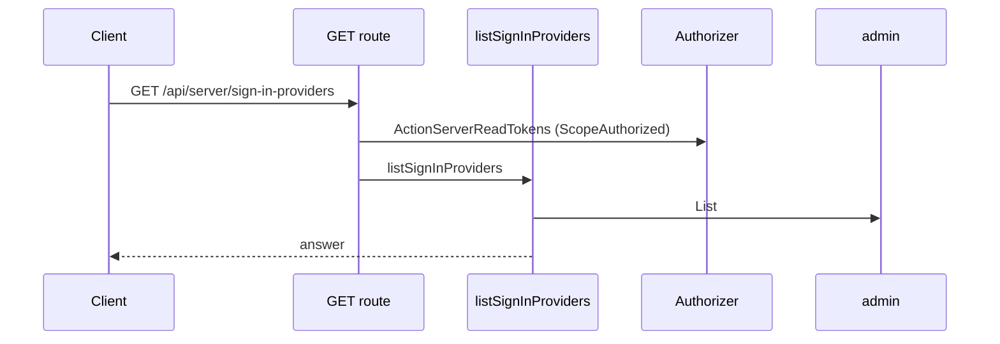
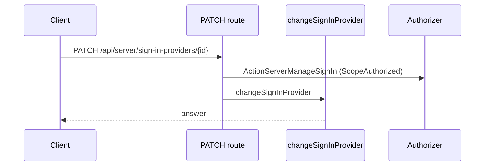
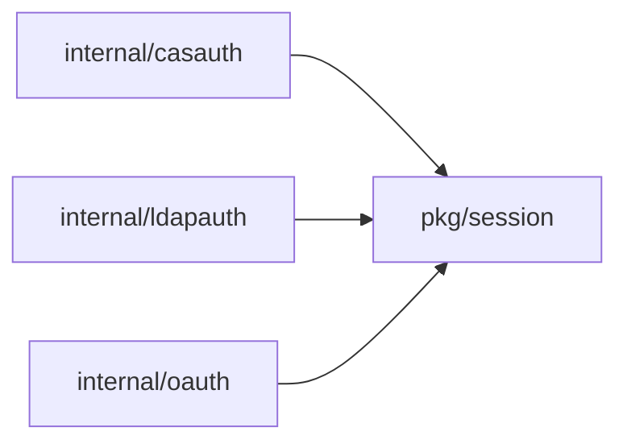
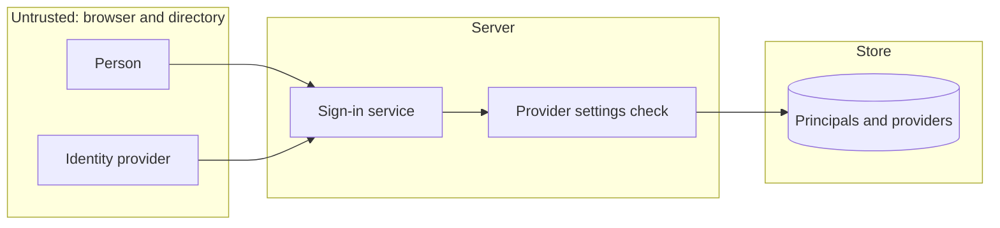

## Context

Sign-in finds a principal by exact subject only. A reused mutable value gives the old principal to a new person. The fix is one subject-source check shared by save, load and sign-in.

## Decisions

1. **Allowlist per method.** CAS: a named attribute that is not on the deny list. Header: jwt mode with sub only. LDAP: entryUUID or objectGUID. OAuth: sub.
2. **One check, three points.** The check runs at provider save on the merged settings, at provider load (restore and import included) and at each sign-in. A failure at load turns the provider off.
3. **Existing providers.** A stored provider with a mutable source stays off. The administrator turns it on by a PATCH that saves an allowed source.

## Structure

Each adapter settings type gets an unexported subject-source field. Only its constructor sets it, and the constructor accepts only the allowlist of its method. Save, load and sign-in all call that constructor.

## Risks

- Existing CAS, LDAP and OAuth configs stop working until the administrator saves an immutable source.
- Old principals stay as orphans with their grants until an administrator deletes them.

## Layers (defense in depth)

| Layer | Guard | Hostile test |
| --- | --- | --- |
| boundary check | The settings constructor refuses a mutable source on save. | Save CAS with no attribute, CAS with mail, LDAP uid, OAuth email and header plain; each is refused. |
| load check | The same constructor runs when a provider loads, including after a restore. | Restore a backup that holds a CAS provider with no attribute; the provider is off. |
| authorize at point of use | The adapter refuses an assertion with an empty or missing subject. | Send a CAS answer without the attribute and an LDAP entry without entryUUID; each is refused. |

## Diagrams

Today: `/api/server/sign-in-providers` on main (from the route table and the handler body, route row internal/api/server/providers.go:156, handler internal/api/server/providers.go:179).

Today: `PATCH /api/server/sign-in-providers/{provider}` on main (from the route table and the handler body, route row internal/api/server/providers.go:168, handler internal/api/server/providers.go:312).

Modules that the change touches, and their imports on main:

## Quality attributes

| Attribute | Target | Unit | Scope |
| --- | --- | --- | --- |
| audit volume | 1 fail-closed audit entry at most for each provider and each hour | entries per hour | each provider |

## Threat model

Data flow and trust boundaries:

| Boundary | STRIDE | Threat | Layer | Guard | Hostile test |
| --- | --- | --- | --- | --- | --- |
| Untrusted: browser and directory | S | A new person gets a reused user name and signs in as the old principal. | boundary check | The settings constructor accepts only an immutable subject source. | Save CAS with no attribute; the save is refused. |
| Untrusted: browser and directory | S | A new person gets a reused user name and signs in as the old principal. | encode or contain | Sign-in looks up by the exact subject only. | Sign in with a reused name under an ID source; a new principal is made. |
| Untrusted: browser and directory | S | A new person gets a reused user name and signs in as the old principal. | limit | One audit entry for each provider and each hour. | Send 1000 failed sign-ins; the log gets 1 entry. |
| Untrusted: browser and directory | S | A new person gets a reused user name and signs in as the old principal. | authorize at point of use | The adapter refuses an empty subject. | Send an LDAP entry with no entryUUID; the sign-in is refused. |
| Untrusted: browser and directory | S | A new person gets a reused user name and signs in as the old principal. | fail closed | A stored mutable provider stays off. | Restore a mutable provider; each sign-in answers `sign-in.unavailable`. |
| Store | T | A restore or a database write brings back a mutable provider. | boundary check | The constructor runs at provider load. | Load a row with LDAP uid; the provider is off. |
| Store | T | A restore or a database write brings back a mutable provider. | encode or contain | The subject source is an unexported field set only by the constructor. | Compile test: no other package sets the field. |
| Store | T | A restore or a database write brings back a mutable provider. | limit | The deny list is fixed in code. | Save CAS with mail; the save is refused. |
| Store | T | A restore or a database write brings back a mutable provider. | authorize at point of use | The sign-in service re-checks the source. | Call sign-in with a provider that skipped load; it is refused. |
| Store | T | A restore or a database write brings back a mutable provider. | fail closed | An unknown source value means off. | Load a row with an unknown source; the provider is off. |

## Change impact (computed from main)

Tests:

- `pkg/backup/restore_ops_fake_test.go` names `Method.Strip`
- `internal/headerauth/headerauth_test.go` names `Method.Strip`
- `internal/headerauth/headerauth_test.go` names `headerauth.PeerOf`

ADRs:

- `docs/adr/0253-dev-data-does-not-reach-a-production-installation.md` names `Method.Strip`
