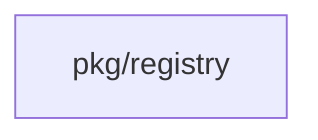
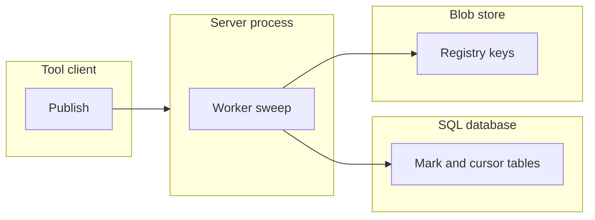

## Context

The first registry slice deletes staged files only during a later stage in the same namespace. A namespace that uploads once keeps its files. A refused publish leaves content blobs with no reference. The change adds one installation task. The age is fixed at 24 hours in code.

## Decisions

1. **One durable scheduled sweep.** One schedule row of the installation claims the due tick on one instance and starts one durable run. The run pages namespaces, then staged keys by stored age, then content keys by reference. It records the last key of each page in a control table. Each delete checks the fencing token. A takeover resumes from the last key.
2. **Ordering of the reference check and a publish.** Each content key has one row in a control table, made on first use. A publish locks that row (SELECT FOR UPDATE on PostgreSQL, the write lock of the transaction on SQLite) in the same transaction that inserts the release reference. The sweep takes the same row lock in the transaction that counts references and writes the mark. The database orders the two. If the publish commits first, the sweep sees the reference and keeps the blob. If the sweep commits its mark first, the publish sees the live mark, waits for the delete or the expiry, and copies the blob again.
3. **Delete in the store and the mark.** The store delete is outside SQL. The sweep keeps the mark until the store delete returns success, then removes the mark in a new transaction. A publish that meets a live mark never trusts the blob: it copies the blob again after the mark clears, and a copy of identical content bytes is safe if the delete ran before it or after, because the publish writes the blob and then reads it back by key before it commits the reference. If the store delete succeeds and the mark removal fails, the mark expires after 1 hour, the next run finds no blob and removes the mark. If the store delete fails, the mark stays and the next run retries.
4. **Staged row creation time and moved flag.** The baseline of each dialect adds a created_at_ms column, set on the database clock at the upload, and a moved flag on the staged row. A publish sets the moved flag in its own transaction. The sweep re-reads the row in its delete transaction and keeps a moved file. A key with no row is an unknown key: it is deleted only when its listing age is above 24 hours.
5. **Maintenance mode and restore.** The sweep makes no write in maintenance mode. The mark table and the cursor are control tables outside the restore swap. The metric has installation-wide counters with no namespace label.

## Structure

Unexported type registrySweeper with unexported fields clock, pageSize and ageLimit. Only newRegistrySweeper makes it. It rejects a page size below 1 and a negative age. Marks and content-key rows key on the namespace ID and the content hash, not on a name.

## Risks

- A reference check that misses a table deletes a live blob. The conformance suite pins the reference set.
- A full listing of a large store stalls the run. A page limit bounds each transaction.
- Two instances run one tick. The claim and the fencing token keep one winner.
- A stale mark delays a publish. The 1-hour expiry bounds the delay.

## Layers (defense in depth)

| Layer | Guard | Hostile test |
| --- | --- | --- |
| port adapter | The blob delete and the key listing accept only keys of the registry prefix. | TestRegistrySweepRefusesForeignPrefix: a key outside the registry prefix is never deleted. |
| service | The delete step checks the fencing token, the reference count, the mark and the maintenance state in its own transaction, under the content-key row lock. | TestRegistrySweepStaleTokenDeletesNothing: a run with an old token deletes no key. |
| publish path | A publish locks the content-key row and refuses to reference a blob with a live mark. | TestRegistrySweepPublishRace: a publish and a mark with no prior lock run at the same time and the release stays readable. |

## Diagrams

Modules that the change touches, and their imports on main:

## Quality attributes

| Attribute | Target | Unit | Scope |
| --- | --- | --- | --- |
| Sweep page latency | 1000 | keys per page transaction at most | one registry sweep step |
| Staged file lifetime | 25 | hours at most after creation with a sweep interval of 1 hour | each namespace |
| Mark delay of a publish | 1 | hour at most | one publish that meets a live mark |

## Threat model

Data flow and trust boundaries:

| Boundary | STRIDE | Threat | Layer | Guard | Hostile test |
| --- | --- | --- | --- | --- | --- |
| Server process to blob store | T | The sweep deletes a live blob or a key outside the registry prefix. | boundary check | Only keys of the registry prefix pass the listing and delete. | TestRegistrySweepRefusesForeignPrefix |
| Server process to blob store | T | The sweep deletes a live blob or a key outside the registry prefix. | encode or contain | Keys are built from the namespace ID and the content hash by one constructor, never from a name or a path join of input. | TestRegistrySweepKeyTraversalRefused |
| Server process to blob store | T | The sweep deletes a live blob or a key outside the registry prefix. | limit | A page size bounds the keys of one step and one transaction. | TestRegistrySweepManyKeysConformance |
| Server process to blob store | T | The sweep deletes a live blob or a key outside the registry prefix. | authorize at point of use | The delete transaction re-checks references and the mark under the content-key row lock. | TestRegistrySweepPublishRace |
| Server process to blob store | T | The sweep deletes a live blob or a key outside the registry prefix. | fail closed | A store or SQL error keeps the blob. | TestRegistrySweepDeleteFailureRetries |
| Server process to SQL database | D | A stale instance deletes after a takeover, or a sweep runs in maintenance mode. | boundary check | The step rejects a run ID or a cursor that the claim does not own. | TestRegistrySweepForeignCursorRefused |
| Server process to SQL database | D | A stale instance deletes after a takeover, or a sweep runs in maintenance mode. | encode or contain | All SQL uses placeholders; the cursor key is bound as a value. | TestRegistrySweepCursorKeyIsBound |
| Server process to SQL database | D | A stale instance deletes after a takeover, or a sweep runs in maintenance mode. | authorize at point of use | The fencing token is checked in each delete transaction. | TestRegistrySweepStaleTokenDeletesNothing |
| Server process to SQL database | D | A stale instance deletes after a takeover, or a sweep runs in maintenance mode. | limit | A page size bounds each transaction. | TestRegistrySweepManyKeysConformance |
| Server process to SQL database | D | A stale instance deletes after a takeover, or a sweep runs in maintenance mode. | fail closed | Maintenance mode makes no delete. | TestRegistrySweepMaintenancePause |

## Failure modes

| Step | Failure | Retry | State after |
| --- | --- | --- | --- |
| Claim of the due schedule row | Two instances claim the same tick | The conditional update lets one win; the other waits for the next tick | One run exists |
| Write of a mark | The instance stops after the mark | The mark expires after 1 hour and the next run starts again | Blob kept, stale mark ignored |
| Store delete | The store returns an error | The durable step retries with backoff | Blob and mark stay until the retry |
| Mark removal | The store delete succeeded and the mark removal fails | The mark expires after 1 hour; the next run finds no blob and removes it | No blob, no live mark |
| Page listing | The listing fails | The page runs again with backoff | Cursor at the last good key, no delete from the failed page |
| Takeover | The claim lease ends in the middle of a run | A new instance resumes from the cursor | The old token deletes nothing more |
