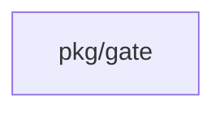

## Context

Gate conditions refuse hidden group references because no schema exposes a Group-typed attribute. The new test guards that fact without changing production code.

## Decisions

1. **Schema guard test.** Add NEW pkg/gate/schema_guard_test.go with TestNoGateSchemaHasGroupAttribute that loads each gate schema through the existing pkg/gate schema source, walks every entity attribute and context field including nested records, sets, unions, resolved common types, and parent chains, and fails on Group, Set of Group, or an entity type that reaches Group through its parent chain. The failure message names the group-literal rule that holdsGroupLiteral enforces.
2. **Completeness check.** Store the explicit expected list of gate schema IDs in the NEW test file and assert the loaded set equals that list, so a schema added without updating the list fails the guard instead of passing silently.
3. **Permanent negative proof.** Add a permanent table test in the NEW test file with in-memory schemas that covers Group, Set of Group, nested record holding Group, union holding Group, common type resolving to Group, and a parent chain that reaches Group, plus a passing schema with no Group reference.

## Structure

No production structure change. The guard is a test that reads the existing gate schemas through the gate schema source already used by pkg/gate; no new unexported type is needed because no production value is built.

## Risks

- A new gate schema added without updating the expected ID list fails the guard by design; the failure reports the new ID to review.

## Diagrams

Modules that the change touches, and their imports on main:

## Quality attributes

| Attribute | Target | Unit | Scope |
| --- | --- | --- | --- |
| none affected | 0 user-visible changes | count | test suite only |

## Contracts

**gate**

- Invariant: No gate schema entity attribute or context field exposes a Group reference.
- `holdsGroupLiteral`: pre: Gate schemas are loaded for the guard.. Post: Group-literal refusal keeps working while the schema guard passes..
