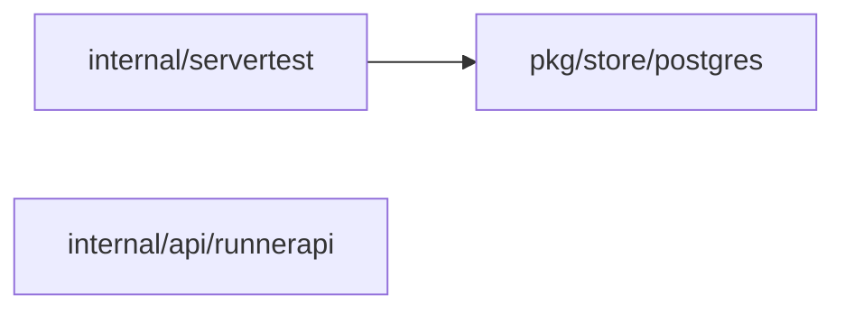

## Context

Two tests fail only under full-suite load with race: TestRestoreLeavesAuditEntryAfterSwap in pkg/store/postgres and TestJoinIsRefused in internal/api/runnerapi. The store refuses an online-name join through Runner.CanRejoin with a 2 minute offline window.

## Decisions

1. **Diagnose then isolate in test code.** Reproduce both flakes under load, record the colliding name or invisible row and the clock values, then give each run a unique name and a fixed clock per subtest. Change only test files.
2. **Mutation check.** Break the guarded behavior in a scratch copy, show each test fails, then restore it. The production guard stays unchanged.

## Structure

No new structure. No production type changes.

## Risks

- Isolation hides a product defect. The diagnose-first task and the mutation check guard this risk.

## Diagrams

Modules that the change touches, and their imports on main:

## Quality attributes

| Attribute | Target | Unit | Scope |
| --- | --- | --- | --- |
| none affected | Test-only fix with no change to user-visible behavior |  |  |
