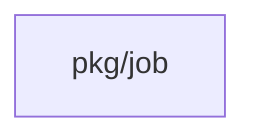
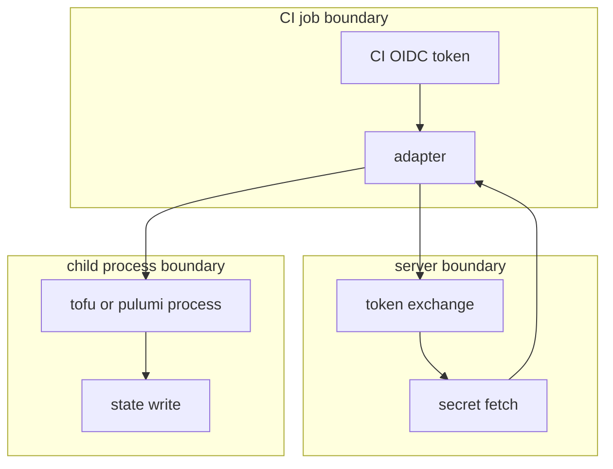

## Context

A team runs OpenTofu or the Pulumi CLI in its own CI. Main holds the one credential-variable rule IsCredentialEnv. Research fixes the adapter shape before any route or store work.

## Decisions

1. **Design first, no implementation.** The note at NEW docs/research/ci-runner-secrets.md covers: CI order, OIDC exchange shape on the runner exchange base, injection only into the child process, a run record of names and versions only, fingerprint approach without kept values, ephemeral and write-only guidance with tool versions, token refresh with 15-minute lifetime per run and open-run cleanup, warn versus refuse at state.write, fingerprint transport as hashes only, derived-value and plan-file boundary, and audit of each fetch and denial. No REST route and no store change.
2. **Reuse credential rule.** The note starts from pkg/job IsCredentialEnv and records whether a CI-specific allowlist is needed for names such as TF_VAR_* with a minimum 12-character floor per value.

## Structure

No new structure in this research change. A later RFC names the unexported type and constructor that makes a secret leak into state impossible.

## Risks

- A static OpenDustpan secret stored in CI
- A secret value reaches state through a data source or TF_VAR
- Fingerprints keep values or miss short and common values
- An expired or revoked token during a long apply leaves a run open
- A CI log shows an injected value; a fork pull request job gets secrets

## Diagrams

Modules that the change touches, and their imports on main:

## Quality attributes

| Attribute | Target | Unit | Scope |
| --- | --- | --- | --- |
| none affected | Research note only; no runtime path changes |  |  |

## Threat model

Data flow and trust boundaries:

| Boundary | STRIDE | Threat | Layer | Guard | Hostile test |
| --- | --- | --- | --- | --- | --- |
| CI job boundary | S | Forged CI OIDC token or fork pull request job claims secrets of a unit | boundary check | Allow only named CI issuers and audiences, reject fork jobs for secret scopes | Send a forged OIDC token and a fork job token to the exchange and expect refusal. |
| CI job boundary | S | Forged CI OIDC token or fork pull request job claims secrets of a unit | encode or contain | Secrets only in the child process environment, masked in logs | Read the job environment and logs after injection and expect no value. |
| CI job boundary | S | Forged CI OIDC token or fork pull request job claims secrets of a unit | limit | 15-minute lifetime per run with refresh before expiry | Replay an expired token mid-apply and expect refusal and a flagged open run. |
| CI job boundary | S | Forged CI OIDC token or fork pull request job claims secrets of a unit | authorize at point of use | Exchange checks the unit grant of the workload before any fetch | Request secrets for a unit with no grant and expect denial. |
| CI job boundary | S | Forged CI OIDC token or fork pull request job claims secrets of a unit | fail closed | Deny the fetch on any exchange error and write an audit entry | Send a malformed exchange request and expect denial with no partial data. |
| child process boundary | I | Injected secret value lands in state through a data source or TF_VAR | boundary check | Only declared variable names pass IsCredentialEnv and the declared list | Request an undeclared name and expect refusal before injection. |
| child process boundary | I | Injected secret value lands in state through a data source or TF_VAR | encode or contain | Fingerprints are in-memory salted hashes for the run only | Dump adapter memory and the run record and expect no plain value. |
| child process boundary | I | Injected secret value lands in state through a data source or TF_VAR | limit | Minimum 12-character floor per value excludes short and common values | Inject a two-character value and expect no verdict on unrelated state. |
| child process boundary | I | Injected secret value lands in state through a data source or TF_VAR | authorize at point of use | Leak check runs at state.write for the unit of the run | Write state for a unit the run may not write and expect refusal. |
| child process boundary | I | Injected secret value lands in state through a data source or TF_VAR | fail closed | Warn or refuse on a match; state sealing stays on | Bypass the leak check and expect sealed storage with no plain text. |
