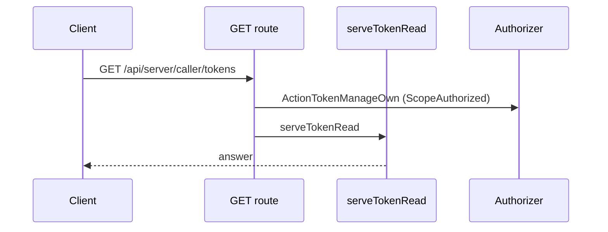
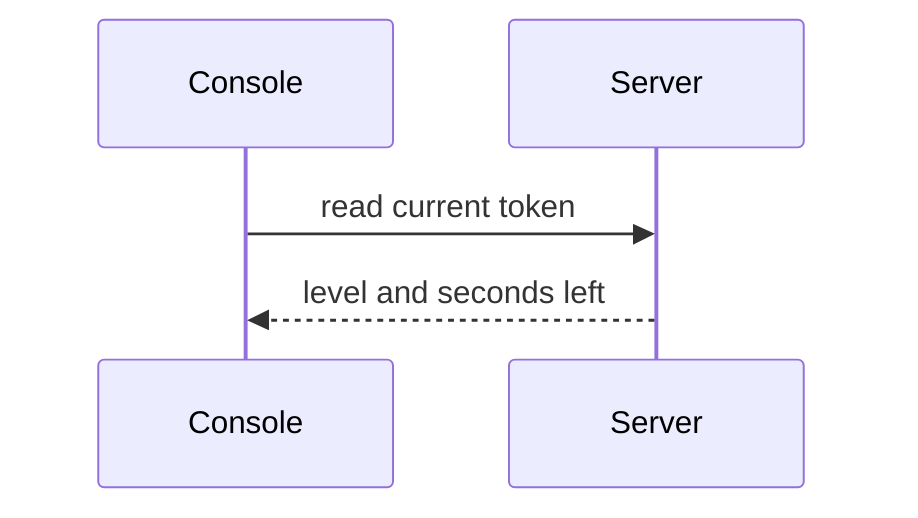
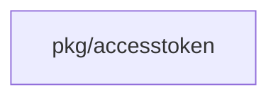
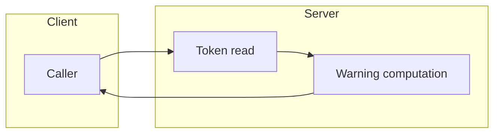

## Context

The enforcement part owns expiry and disable. This part adds a read-only warning state to existing token reads.

## Decisions

1. **Read-only warning.** The token read computes the level from expiry, server clock and the two thresholds. No write path changes.
2. **No new route.** The fields ride on the existing token reads. Each keeps its action and audit entry.
3. **Boundary rule.** Boundaries are inclusive. Urgent wins when both windows match. A threshold of 0 disables that window.

## Structure

unexported expiryWarning value made only by newWarningState, which checks the expiry and the thresholds

## Risks

- A client that ignores the field shows no warning.
- The real CLIs may show no warning until the carriage question is answered.

## Diagrams

Today: `GET /api/server/caller/tokens` on main (from the route table and the handler body, route row internal/api/server/tokens.go:543, handler internal/api/server/tokens.go:232).

After this change:

Modules that the change touches, and their imports on main:

## Quality attributes

| Attribute | Target | Unit | Scope |
| --- | --- | --- | --- |
| correctness | 100% of reads at the 14-day and 3-day boundaries give the right level | percent of test reads | token reads under /api/server/caller/tokens |
| observability | 100% of listed tokens carry a level and seconds left | percent of listed tokens | token list reads under /api/server/tokens |

## Threat model

Data flow and trust boundaries:

| Boundary | STRIDE | Threat | Layer | Guard | Hostile test |
| --- | --- | --- | --- | --- | --- |
| API response | I | The warning field leaks a secret value or reveals a token of another principal. | boundary check | The read takes the token ID from the path and checks it. | A request with a malformed token ID is refused. |
| API response | I | The warning field leaks a secret value or reveals a token of another principal. | encode or contain | The warning type holds only the level, the expiry and the seconds left. | The response of a token read holds no secret value. |
| API response | I | The warning field leaks a secret value or reveals a token of another principal. | limit | The list read returns only tokens in the reach of the caller. | A list read does not show a token of another principal. |
| API response | I | The warning field leaks a secret value or reveals a token of another principal. | authorize at point of use | Each read checks the token read action on the token. | A read without the grant gets 403 and no warning. |
| API response | I | The warning field leaks a secret value or reveals a token of another principal. | fail closed | An invalid expiry gives an error, not a level. | A record with a corrupt expiry gives an error and no warning. |

## Contracts

**expiry warning state**

- Invariant: The level derives only from the expiry, the server clock and the two thresholds.
- Invariant: No write path changes expiry or disable state.
- `newWarningState`: pre: The expiry is a valid time or absent.; The thresholds are non-negative.. Post: Returns level none, early, urgent or expired with the seconds left.; Expired gives zero seconds left..

## Failure modes

| Step | Failure | Retry | State after |
| --- | --- | --- | --- |
| Developer reads the token and then runs the CLI. | The token expires between the read and the use. | Create a new token and run the command again. | The old read shows a stale level; the next read shows expired. |
| Administrator changes the thresholds. | A read uses the old thresholds. | Read the token again. | The next read uses the new thresholds. |
