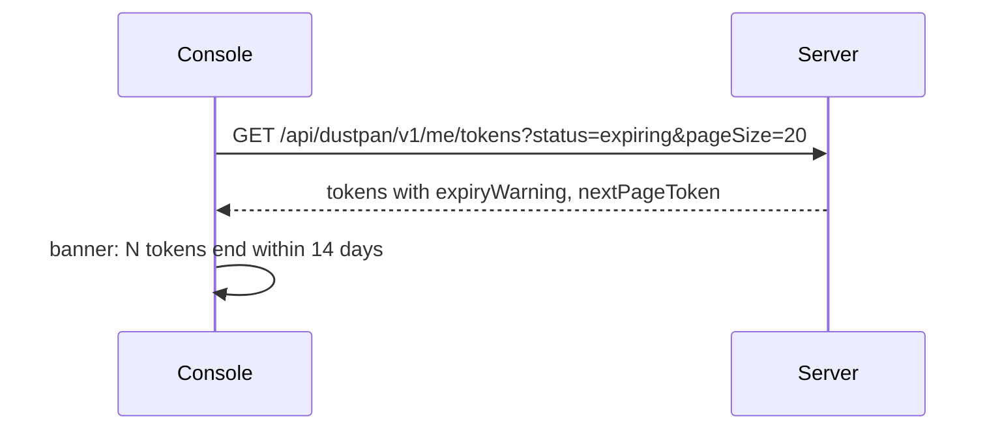
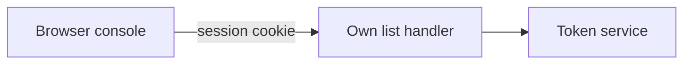

## Context

The server and the CLI warn already. The console banner exists but reads the old own-list path with query names that the new route refuses. This change fixes the console side and ties the server side to it with tests. It adds no server field.

## Decisions

1. **One route for the page and the banner.** The console reads `GET /api/dustpan/v1/me/tokens` for both. The banner asks `status=expiring&pageSize=20`.
2. **No total.** The route answers no `total` by design of main. The banner counts the items of the page and says "at least N" when `nextPageToken` is set.
3. **The server clock decides.** The banner uses `expiryWarning` and `expiresInDays` of the answer, never the clock of the browser.
4. **Fail closed in the view.** A response that fails the runtime check of the console gives the error state, not a partial banner.

## Contract

No new field. The own list answer used by the console:

```json
{"tokens":[{"id":"tok-...","expiresAt":"...","expiresInDays":3,"expiryWarning":"imminent","status":"active"}],"nextPageToken":""}
```

Query: `status` (active, expiring, ended; NEW on this route, from the enforcement change), `pageSize`, `pageToken`.

## Structure

The console keeps one client function for the own list. The page, the banner and the filter control call it. No second route exists to drift.

## Risks

- The enforcement change must land first, or `status=expiring` gives 400 and the console shows its error state.
- A console pull request and a server pull request merge in order: the console change reads only routes that the released server serves (the rule of the console repository).

## Layers (defense in depth)

| Layer | Guard | Hostile case | Test |
| --- | --- | --- | --- |
| port adapter | none: the change reads tokens through the existing service | not applicable | not applicable |
| service | The own list holds only the tokens of the caller | `status=expiring` with a `principal` name | 400, and no token of another person (covered by the enforcement change) |
| HTTP handler | `expiryWarning` holds one of three values | Each token state of the table | The value is none, soon or imminent for every state (passes on main, guards) |
| console client | Every response is validated at runtime | A token with `expiryWarning` "urgent", a missing `tokens`, a non-numeric `expiresInDays` | Tested in the console change (the console already maps an unknown value to "other") |
| console view | Text is rendered as text | A token name with markup | The banner shows the text, not HTML |

## Diagrams



## Quality attributes

| Attribute | Target | Unit | Scope |
| --- | --- | --- | --- |
| Extra requests for the banner | 1 | request for each page view | the access tokens page |

## Threat model



| Boundary | STRIDE | Threat | Layer | Guard | Hostile test |
| --- | --- | --- | --- | --- | --- |
| Console to handler | I | A person sees the tokens of another person | authorize at point of use | The service scopes the list to the caller | `principal` name gives 400 |
| Handler to console | T | A hostile value in the answer renders as markup | encode or contain | Text rendering, runtime validation | Name with markup |

## Failure modes

| Step | Failure | Retry | State after |
| --- | --- | --- | --- |
| banner load | 400, 401, 403 or a network error | The person reloads | The page shows the error state, and the list is unaffected |
