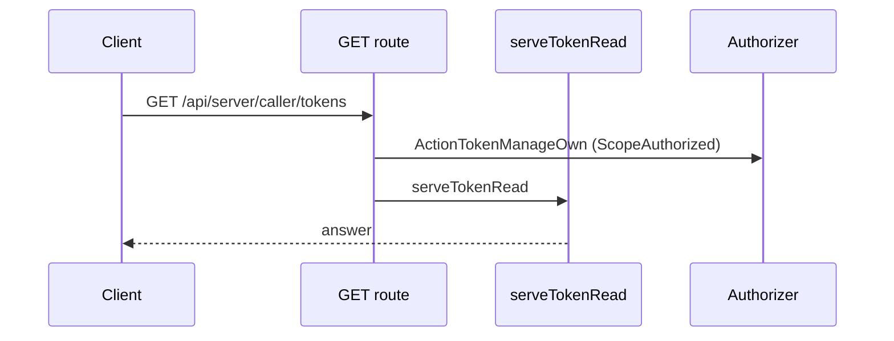
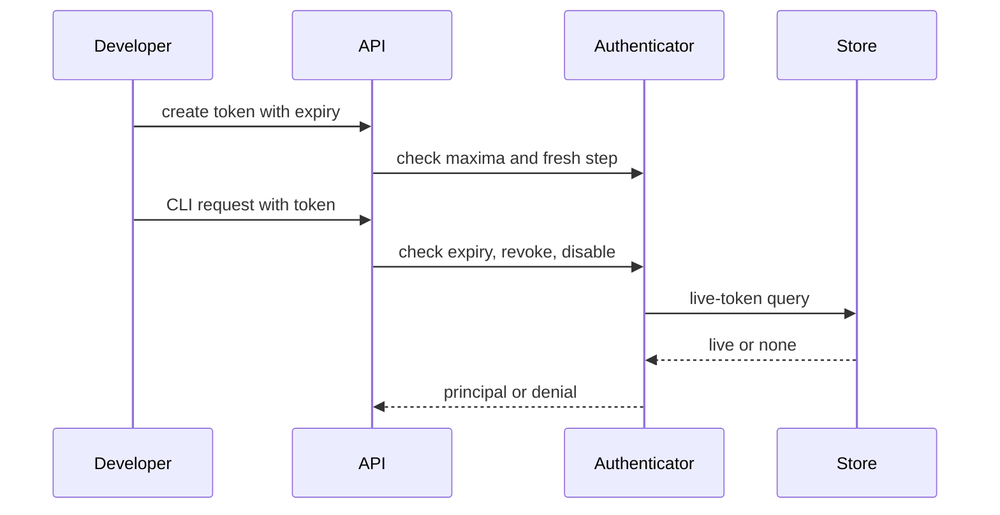
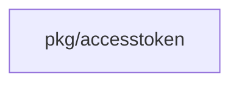
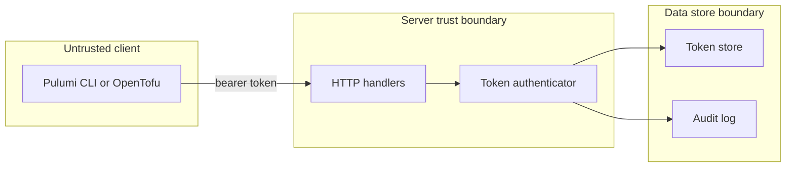

## Context

Token authentication is security code. Enforcement must fail closed at every layer so an expired, revoked, or idle token never authenticates even if one layer is bypassed.

## Decisions

1. **One authenticator checks every request.** Enforcement lives in the token authenticator, not in each CLI adapter. The Pulumi, TFE-compatible, and tool-neutral handlers call one authenticator that checks expiry, revocation, and disable before it returns the principal. The authenticator reads the installation maximum and the namespace maximum from the settings resource at create and rotation time and never hard-codes 365 days.
2. **Last-used write does not fail authentication.** Last-used update is a separate write that never blocks authentication. A failure to record use leaves the token usable and the next request retries the write. The inactivity sweep re-reads last-used time in the same transaction and skips a token used after the sweep cut-off, with one winner per token row across replicas.
3. **Fixed overlap stays visible without a new setting.** The 10-minute rotation overlap is a fixed constant with a named constructor argument and a visible effective value in the settings resource. No administrator setting changes it. Revocation of the old token ends it at once inside the overlap.

## Structure

Unexported type `liveToken` with unexported field `live bool` and constructor `newAccessToken` that takes installation and namespace lifetime limits plus the fixed overlap and checks expiry against the applicable limit; only the constructor makes a live token.

## Risks

- Last-used writes on every request contend on the token row under load; the write runs outside the authentication transaction with a bounded retry.
- Clock skew between instances is bounded by strict expiry comparison with no grace window; a token at or past expiry never authenticates.

## Layers (defense in depth)

| Layer | Guard | Hostile test |
| --- | --- | --- |
| service | Authenticator rejects expired, revoked, and disabled tokens and checks installation and namespace maxima at create and rotation time. | Send an expired token, a revoked token, and an idle-disabled token directly to the authenticator and check each gives denial. |
| port adapter | Store live-token query returns only live tokens and applies the fence in the same transaction for state writes. | Insert an expired row and a disabled row, then query the live-token view and check neither row returns. |
| HTTP handler | HTTP handlers map denial to 401 with a stable error code and no secret in the body, and record the refusal without storing the presented token value. | Send a request with an expired bearer token to the Pulumi and TFE routes and check each answers 401. |

## Diagrams

Today: `GET /api/server/caller/tokens` on main (from the route table and the handler body, route row internal/api/server/tokens.go:543, handler internal/api/server/tokens.go:232).

After this change:

Modules that the change touches, and their imports on main:

## Quality attributes

| Attribute | Target | Unit | Scope |
| --- | --- | --- | --- |
| Authentication latency added by the expiry, revoke and disable checks | 5 | milliseconds at p99 over the live-token query | each token-authenticated request on one server process |
| Refusal of an ended token | 100 | percent of requests past expiry, revoke or disable answered 401 | Pulumi, TFE-compatible and tool-neutral routes |

## Threat model

Data flow and trust boundaries:

| Boundary | STRIDE | Threat | Layer | Guard | Hostile test |
| --- | --- | --- | --- | --- | --- |
| HTTP handler to authenticator | S | Stale or forged token authenticates after expiry, revocation, or inactivity disable | boundary check | Reject expired, revoked, and disabled tokens; never store the presented value | Replay an expired bearer token after clock advance |
| HTTP handler to authenticator | S | Stale or forged token authenticates after expiry, revocation, or inactivity disable | encode or contain | Store and compare only the hash of the token value; log the token ID, never the value | Send a token with CR, LF and a 10000-byte value and check the logs and audit entries hold no token text |
| HTTP handler to authenticator | S | Stale or forged token authenticates after expiry, revocation, or inactivity disable | limit | Map denial to 401 without secret in body; aggregate unknown-token refusals | Flood unknown tokens and check audit-log size stays bounded |
| HTTP handler to authenticator | S | Stale or forged token authenticates after expiry, revocation, or inactivity disable | authorize at point of use | The authenticator checks the live state of the token row at each request and each store query returns only live tokens | Revoke a token between two requests and check the second request answers 401 |
| HTTP handler to authenticator | S | Stale or forged token authenticates after expiry, revocation, or inactivity disable | fail closed | An error or an unknown state in the token read denies the request | Make the store read fail and check the request answers 401 and not success |

## Failure modes

| Step | Failure | Retry | State after |
| --- | --- | --- | --- |
| authenticated request | Last-used write fails | Request still succeeds; next request retries the write; sweep re-reads time in the same transaction | token stays live with stale last-used time until a write succeeds |
| inactivity sweep | Sweep races a fresh use | Sweep re-reads last-used time in the same transaction and skips the token; next tick re-evaluates | token stays live |
| authentication with unknown token | Flood of unknown tokens | Answer 401 without a per-request audit entry with the token value; aggregated counter only | no audit-log growth from attacker input |
