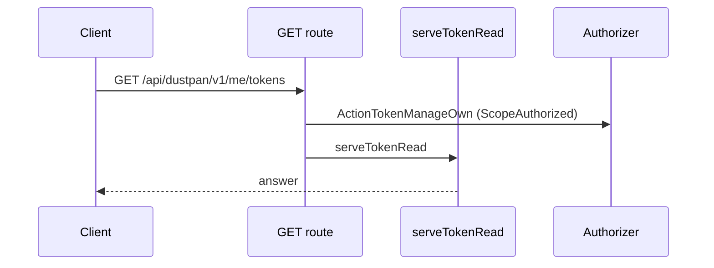
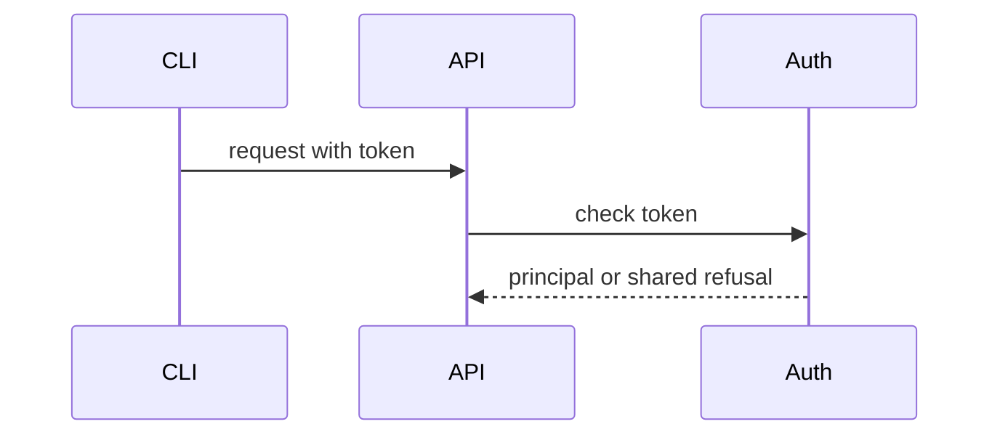
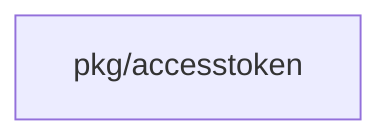
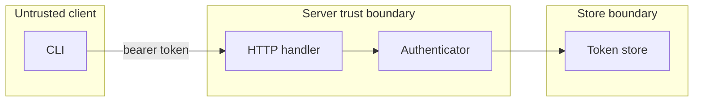

## Context

Token authentication is security code. The existing authenticator is the one place that decides. An ended token and an unknown token take the same path and the same work before the 401. This change adds one shared refusal function, tests, the audit reason, the settings view and a docs section.

## Decisions

1. **Keep one authenticator.** The Pulumi, TFE-compatible and tool-neutral handlers call the same authenticator. No handler checks expiry on its own.
2. **One refusal function.** One new unexported refusal function builds the 401 and writes the audit entry for every refusal case. No case builds its own answer.
3. **Same work for ended and unknown.** Both cases do the lookup by digest and the constant-time compare. The ended check runs after. Both cases write one audit entry on the request path.
4. **Overlap stays as main.** The rotation overlap keeps the value of main. The settings resource shows it as an effective value with its source.

## Structure

An unexported refusal function in pkg/accesstoken is the only path that builds a refusal for a token. Only it can make the refusal value, so a new case cannot skip the same bytes, headers and audit write.

## Risks

- A limit view may drift from the value the code uses; the settings read comes from the same constant.
- An audit write for an unknown token adds write load under a flood of bad tokens; it matches the existing audit of refused sign-ins.

## Layers (defense in depth)

| Layer | Guard | Hostile test |
| --- | --- | --- |
| service | The authenticator refuses ended and disabled tokens through the one refusal function | Send an idle-disabled token directly to the authenticator and check the refusal |
| HTTP handler | The handler answers 401 with no token text and the same bytes for each case | Send unknown, expired, revoked and disabled bearer tokens to the Pulumi and TFE routes and compare the bytes and headers |

## Diagrams

Today: `GET /api/dustpan/v1/me/tokens` on main (from the route table and the handler body, path constant internal/api/server/tokens.go:202, handler listOwnTokens at internal/api/server/tokens.go:789).

After this change:

Modules that the change touches, and their imports on main:

## Quality attributes

| Attribute | Target | Unit | Scope |
| --- | --- | --- | --- |
| Refusal latency of an ended token | 50 | milliseconds at the 99th percentile | token authentication on the Pulumi, TFE-compatible and tool-neutral routes |

## Threat model

Data flow and trust boundaries:

| Boundary | STRIDE | Threat | Layer | Guard | Hostile test |
| --- | --- | --- | --- | --- | --- |
| HTTP handler to authenticator | S | An ended token authenticates, or its state leaks through the answer or timing | boundary check | The authenticator refuses ended and disabled tokens | Replay an expired bearer token |
| HTTP handler to authenticator | S | An ended token authenticates, or its state leaks through the answer or timing | encode or contain | The one refusal function gives the same bytes and headers for every case and holds no token text | Compare the answers for unknown, expired, revoked and disabled tokens |
| HTTP handler to authenticator | S | An ended token authenticates, or its state leaks through the answer or timing | limit | The maximum lifetime refuses a create past the limit | Create a token with an expiry past the maximum and check token.invalid |
| HTTP handler to authenticator | S | An ended token authenticates, or its state leaks through the answer or timing | authorize at point of use | The authenticator re-reads the token status for each request, so a revoke applies at once | Revoke a token and send it in the next request and check 401 |
| HTTP handler to authenticator | S | An ended token authenticates, or its state leaks through the answer or timing | fail closed | A store read error denies the request | Make the store read fail and check 401 |

## Failure modes

| Step | Failure | Retry | State after |
| --- | --- | --- | --- |
| authenticated request | The store read fails | The client retries | No access is granted |
