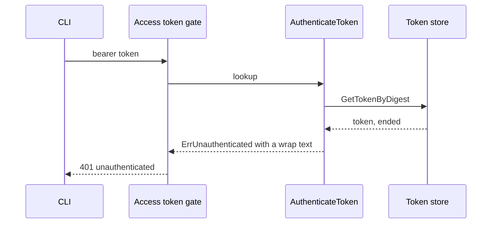
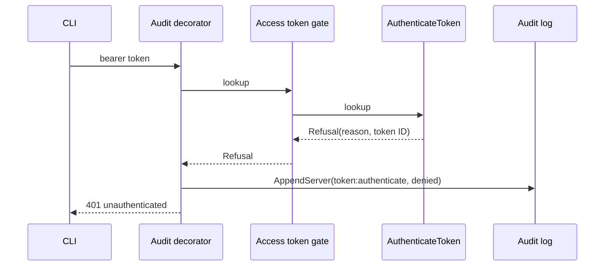
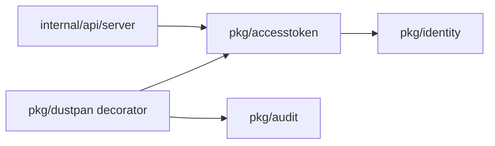
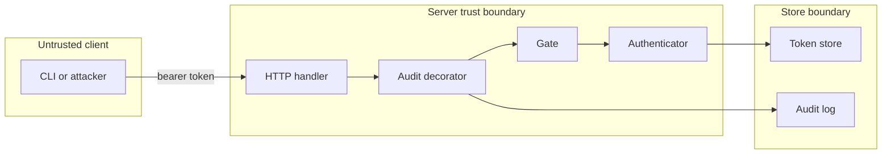

## Context

Token authentication is security code. Main already has one authenticator, `Service.AuthenticateToken`, and every route family calls it through the chain of the server. An ended token and an unknown token take the same lookup and the same compare before the refusal. The refusal is the bare sentinel `identity.ErrUnauthenticated`, wrapped with a text that differs for each case, and no audit entry exists for it. This change adds a typed refusal, an audit decorator, a status filter on the own list and one read-only policy field. It adds no new check of expiry.

## Decisions

1. **One refusal type.** `pkg/accesstoken` gets an exported type `Refusal` with the NEW fields `Reason` and `TokenID` (of the type; the audit `Entry` already has a field of the second name at pkg/audit/audit.go:417). It wraps `identity.ErrUnauthenticated` through `Unwrap`, and its `Error()` is the fixed text "unauthenticated" for every reason. One unexported function `refuse(reason, tokenID)` builds it. `AuthenticateToken`, `checkPolicyActive` and `CheckActive` return nothing else for a refusal. The reason is a value of a closed type (not a free string), so a caller cannot put text in it.
2. **The audit write is a decorator outside the service.** The service stays free of the audit and the request. A decorator in `pkg/dustpan` wraps the failure gate of the access tokens. It calls the gate, and when the error is a `*Refusal` it writes one entry. It never changes the answer. The decorator reads the source address and the request ID from the context, as `requestOf` does for the temporary administrators.
3. **Only access token values.** The chain asks the bootstrap authenticator first, and other authenticators handle values of other forms. The service refuses a value that is not a secret with the reason "not a secret", and that refusal writes no entry: the value may be a valid credential of another authenticator, and an entry would only add load. Every other reason writes an entry.
4. **Fixed content of the entry.** The entry has the action `token:authenticate`, the outcome `denied`, the server scope, the reason in `Reason`, the token ID in `TokenID` (empty for an unknown token), the subject `token:<id>` or `token:unknown`, the source address, the request ID and the channel `api`. It never holds the raw value, the digest or a prefix of the secret.
5. **A failed write never lets the request through.** The entry write is best effort for the answer, as in the sign-in service: the 401 stays, and the failure goes to the log and to a counter.
6. **Overlap stays as main.** `rotationOverlapSeconds` in the answer of the token policy is the constant `DefaultRotationOverlap`. The field is read only and has no source other than "default".
7. **Own list filter.** `status` joins the declared names of `listOwnTokens`. `ownTokenPageRequest` parses it with `accesstoken.ParseFilter`, so the own list and the administrator lists share one parser and one error text. The own list stays scoped to the person of the caller through `Service.ListOwn`, which sets the principal ID after the request is built.

## Contract

```go
// Package accesstoken (all NEW).

// Reason is the cause of a refusal. The values are a closed list.
type Reason string

const (
	ReasonNotSecret          Reason = "not a secret"
	ReasonUnknown            Reason = "unknown token"
	ReasonExpired            Reason = "expired"
	ReasonRevoked            Reason = "revoked"
	ReasonDisabled           Reason = "disabled"
	ReasonPrincipalDisabled  Reason = "principal disabled"
	ReasonNamespaceService   Reason = "namespace service principal"
	ReasonTokenInactive      Reason = "token inactive"
	ReasonAccountInactive    Reason = "account inactive"
	ReasonUnknownKind        Reason = "unknown kind"
)

// Refusal is the error of a refused access token. Unwrap answers
// identity.ErrUnauthenticated. Error answers "unauthenticated" for every Reason.
type Refusal struct {
	Reason  Reason
	TokenID string // empty for ReasonNotSecret, ReasonUnknown and ReasonUnknownKind of a row with no ID
}

// ActionAuthenticate is the audit action of a refused access token. It is not an authorization action.
const ActionAuthenticate = "token:authenticate"
```

Token policy answer, a NEW field after `exchangeLifetimeSeconds`: `"rotationOverlapSeconds": 86400` (integer, read only). The own list takes `status` (string: active, expiring, ended; absent means every token). An audit entry of a refusal: `Action` `token:authenticate`, `Outcome` `denied`, `Kind` change, `Namespace` the server scope, `Subject` `token:<id>` or `token:unknown`, `TokenID`, `Reason`, `SourceIP`, `RequestID`, `Channel` api.

## Structure

The type `Refusal` has no exported constructor. A new refusal case in `AuthenticateToken` has no other way to return a refusal than `refuse`, so it carries a reason, has the fixed text and reaches the decorator. The decorator tests the type with `errors.As`, so a refusal that a middle layer wraps still reaches the audit.

## Risks

- Audit write load under a flood of unknown tokens. The gate bounds it for each source (see the proposal). A distributed flood from many sources still writes entries, within the budget of each source. The audit log has its own retention. The decision of the owner requires the entry, so the change does not drop it.
- The reason list is a new vocabulary in the audit log. The guide lists each value, and a test checks that every `Reason` has a text in the guide.
- A client may parse the old wrap text. No such client exists: the 401 text is the fixed "unauthenticated" at each route family.

## Layers (defense in depth)

One table for each layer. Each row is a guard step. Each guard has its own test that sends the hostile input to that step as if the other layers failed.

| Layer | Guard | Hostile case | Test |
| --- | --- | --- | --- |
| port adapter (store lookup) | The store finds a token by digest only | A store double answers a match whose digest differs from the lookup digest | The service refuses it as "unknown token" (passes on main, guards the `Digest.Equal` step) |
| port adapter (store lookup) | A stored token of an unknown kind never authenticates | A row with kind "legacy" | The service refuses it (exists on main: `pkg/accesstoken/kind_closed_test.go:105`) |
| service | The status check refuses an expired, revoked or disabled token | One token of each state | The service returns a `*Refusal` with the matching reason and the token ID |
| service | The policy check refuses an inactive token and an inactive account | A token idle for longer than the inactivity period, an account idle for longer | The service refuses with the reasons "token inactive" and "account inactive" |
| service | The refusal is one type with a fixed text | Each reason in turn | `Error()` is equal for all reasons, and `errors.Is(err, identity.ErrUnauthenticated)` holds |
| service | A failed store read fails closed | The store double returns an error | The service returns no principal and an error that is not a `*Refusal` |
| audit decorator | An entry holds the reason and the token ID, and never the secret | A raw value with CR, LF, a long text and the real secret as the input | The entry text holds none of the input, and the reason is from the closed list |
| audit decorator | An unknown secret-form token writes an entry with no token ID | Fifty random values of the form of a secret | Each writes one entry with the reason "unknown token" and an empty `TokenID` |
| audit decorator | A value that is not a secret writes no entry | A bootstrap token, a job token, an empty value | No entry is written |
| audit decorator | A rate-limit answer writes no entry | The gate answers `identity.ErrRateLimited` | No entry is written, and the answer is unchanged |
| audit decorator | A failed audit write keeps the 401 | The audit store double returns an error | The caller gets the same refusal, the log has one line, the counter grows by one |
| HTTP handler (Pulumi, TFE-compatible, tool-neutral) | The 401 text is fixed | An unknown, an expired, a revoked and a disabled token on each route family | Status, headers and body are byte-identical for the four cases on each family (passes on main, guards) |
| HTTP handler (own list) | `status` allows three values | `status=gone`, `ENDED`, `ended,active`, `ended%0d%0a`, a repeated `status`, an empty `status=` | 400 `request.invalid-query` for each, except the empty value, which means every token |
| HTTP handler (own list) | The own list shows only the tokens of the caller | `status=ended` and `principal=<other person>` | The `principal` name still answers 400, and no token of another person appears |
| HTTP handler (token policy) | `rotationOverlapSeconds` is read only | `PATCH {"rotationOverlapSeconds": 1}` | 400 (the strict decode refuses the unknown field) |

## Diagrams

Today, a request with an ended token:



After this change:



Modules that the change touches:



## Quality attributes

| Attribute | Target | Unit | Scope |
| --- | --- | --- | --- |
| Extra latency of the audit write on a refusal | 25 | milliseconds at the 99th percentile on SQLite | the refusal path only; a request with a valid token adds nothing |

The target is a design goal to measure in the e2e step, not a promise. If the measure is above it, the implementer reports it, and the decision of the owner (an entry for each refusal) stays.

## Threat model



| Boundary | STRIDE | Threat | Layer | Guard | Hostile test |
| --- | --- | --- | --- | --- | --- |
| HTTP handler to authenticator | S | An ended token authenticates | boundary check | The status check refuses expired, revoked and disabled tokens | Replay one token of each state |
| HTTP handler to authenticator | I | The answer or the timing tells an ended token from an unknown token | encode or contain | One refusal type with one fixed text, and one fixed 401 text for each route family | Compare the bytes and the headers of the four cases |
| HTTP handler to authenticator | I | The timing differs because an ended token skips the compare | limit | The lookup and the constant-time compare run before the status check, for both cases (structure test, no clock) | Check the order through the store double: an ended token and an unknown token both reach the digest compare step |
| HTTP handler to authenticator | E | A revoked token keeps working | authorize at point of use | The authenticator reads the token for each request, with no cache | Revoke, then send the token in the next request and check the 401 |
| HTTP handler to authenticator | D | A flood of unknown tokens fills the audit log | limit | The gate bounds the refusals of one source | Send more refusals than the budget from one source, and count the entries |
| Audit decorator to audit log | R | A refusal leaves no record | fail closed | Each refusal writes one entry, and a failed write is logged and counted | Fail the audit store and check the log line and the counter |
| Audit decorator to audit log | I | The entry leaks the secret | encode or contain | The entry holds a reason from a closed list, the token ID and the request data, and never the raw value | Search the entry for the input |
| Own list | I | A person lists the ended tokens of another person | authorize at point of use | `ListOwn` sets the principal ID from the caller after the request is built | `status=ended` with a `principal` name answers 400 |

## Failure modes

| Step | Failure | Retry | State after |
| --- | --- | --- | --- |
| authenticate | The store read fails | The client retries | No access is granted, no entry is written |
| refusal audit | The entry write fails | None | The client gets the 401, the log and the counter show the failure |
| own list | `status` is not one of the three values | The client sends a valid value | No data is read |
