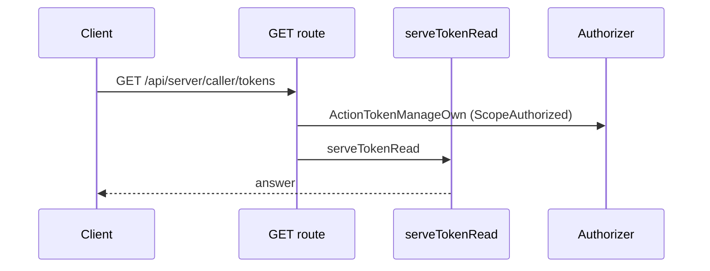
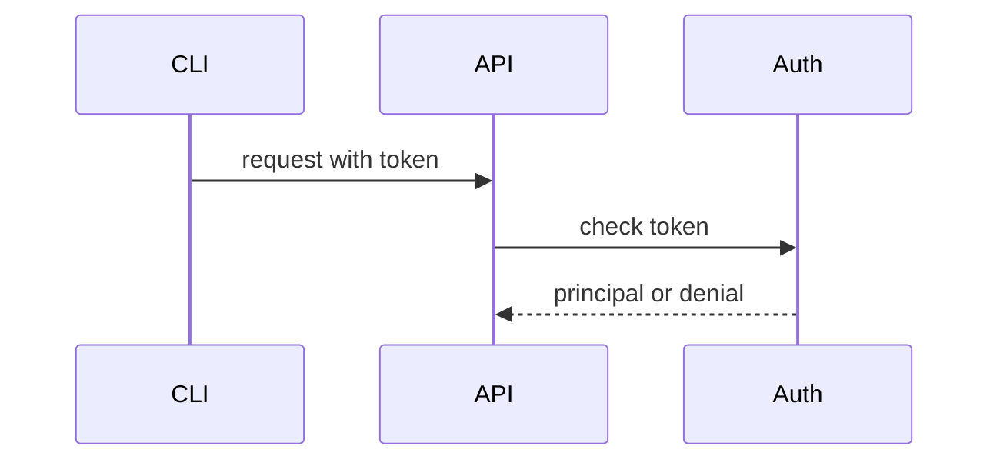
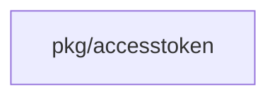
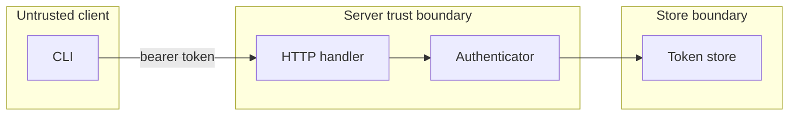

## Context

Token authentication is security code. The existing authenticator is the one place that decides. This change adds the wiring, the tests and the settings view only.

## Decisions

1. **Keep one authenticator.** The Pulumi, TFE-compatible and tool-neutral handlers call the same authenticator. No handler checks expiry on its own.
2. **Overlap stays as main.** The rotation overlap stays 24 hours. The settings resource shows it as an effective value with its source.

## Structure

The existing authenticator in pkg/accesstoken is the only path that returns a principal from a token. This change adds no new type.

## Risks

- A shared limit view may drift from the value the code uses; the settings read comes from the same constant.

## Layers (defense in depth)

| Layer | Guard | Hostile test |
| --- | --- | --- |
| service | AuthenticateToken refuses ended and disabled tokens | Send an idle-disabled token directly to the authenticator and check the refusal |
| HTTP handler | The handler maps the refusal to 401 with no token text | Send an ended bearer token to the Pulumi and TFE routes and check 401 |

## Diagrams

Today: `GET /api/server/caller/tokens` on main (from the route table and the handler body, route row internal/api/server/tokens.go:543, handler internal/api/server/tokens.go:232).

After this change:

Modules that the change touches, and their imports on main:

## Quality attributes

| Attribute | Target | Unit | Scope |
| --- | --- | --- | --- |
| Refusal latency of an ended token | 50 | milliseconds at the 99th percentile | token authentication on the Pulumi, TFE-compatible and tool-neutral routes |

## Threat model

Data flow and trust boundaries:

| Boundary | STRIDE | Threat | Layer | Guard | Hostile test |
| --- | --- | --- | --- | --- | --- |
| HTTP handler to authenticator | S | An ended token authenticates | boundary check | The authenticator refuses ended and disabled tokens | Replay an expired bearer token |
| HTTP handler to authenticator | S | An ended token authenticates | encode or contain | The handler 401 body and audit entry never hold the token text | Send an ended token and check the body and the audit entry hold no token value |
| HTTP handler to authenticator | S | An ended token authenticates | limit | The maximum lifetime refuses a create past the limit | Create a token with an expiry past the maximum and check token.invalid |
| HTTP handler to authenticator | S | An ended token authenticates | authorize at point of use | The authenticator re-reads the token status for each request, so a revoke applies at once | Revoke a token and send it in the next request and check 401 |
| HTTP handler to authenticator | S | An ended token authenticates | fail closed | A store read error denies the request | Make the store read fail and check 401 |

## Failure modes

| Step | Failure | Retry | State after |
| --- | --- | --- | --- |
| authenticated request | The store read fails | The client retries | No access is granted |
