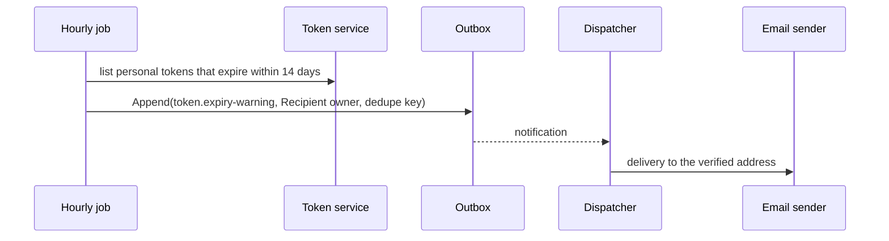
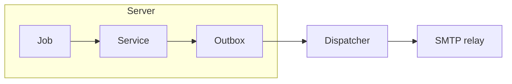

## Context

Main has a notification model in `pkg/notify`: an outbox, deliveries with leases and retries, and a port for the personal contacts of a person. It has no emitter for the expiry of a token, and the delivery to a person has gaps (see the proposal). This change adds the emitter. It adds no queue.

## Decisions

1. **Reuse the outbox.** The warning is a `notify.Notification` of the NEW type `token.expiry-warning`. Retry, state and audit of the delivery stay in `pkg/notify`. A second queue would be a second place for the same facts.
2. **One job, once for all instances.** A durable schedule kind of the service runs each hour. The interval is a constant of the package. A run that fails is run again by the schedule, and the dedupe key makes the repeat safe.
3. **Dedupe by token, level and expiry.** The key is `<token ID>:<level>:<expiry in Unix milliseconds>`. A rotation that moves the expiry makes a new key. A token that is revoked, disabled or expired between two runs is not listed, so it gets no warning.
4. **Personal tokens only.** The service lists tokens with `Kind == KindPersonal`. Other kinds are parked.
5. **No secret in the notification.** The attributes hold the token ID, the name, the expiry time (RFC 3339) and the level. The notification never holds the secret, the digest or a prefix.
6. **Fit before append.** The service calls `Notification.Fit` before `Append`, so a long token name never fails the job.
7. **The owner must be enabled.** The service skips a token whose owner is disabled or deleted, and counts it. The dispatcher also reads the contacts again before each attempt, so a person who lost access gets nothing (the port returns no contact for a disabled principal).

## Contract

```go
// Package notify (all NEW).
const TokenExpiryWarning Type = "token.expiry-warning"

// Package tokenwarnsvc (NEW), path internal/tokenwarnsvc.
type Service struct{ /* unexported */ }

// Config holds the ports of the Service.
type Config struct {
	Tokens  TokenLister
	Owners  OwnerReader
	Outbox  notify.Outbox
	Now     func() time.Time
	Logger  *slog.Logger
}

// Run appends the warnings that are due at the time of Now. It returns the number appended.
func (s *Service) Run(ctx context.Context) (int, error)

// Attributes of the notification: "token.id", "token.name", "token.expires-at", "level" ("soon" or "imminent").
```

## Structure

The service has unexported fields and a constructor that checks that each port is set. The service imports `pkg/accesstoken` and `pkg/notify`, never an adapter.

## Risks

- A person with no verified email gets no warning. The delivery record says "no contact".
- A large installation lists many tokens each hour. The list pages by (created time, ID) with a page size, and the filter keeps only the tokens that expire within 14 days.

## Layers (defense in depth)

The change handles token metadata and sends it to a person. It is security code in the sense of the project rules (tokens, notices).

| Layer | Guard | Hostile case | Test |
| --- | --- | --- | --- |
| port adapter (outbox) | The dedupe key skips a repeat | The same warning appended twice, and from two instances | One notification is stored |
| service | Only personal tokens | A service token, a jwt-exchange token and an mtls-exchange token that expire soon | No notification |
| service | Only active tokens | An expired, a revoked and a disabled token | No notification |
| service | A disabled owner gets nothing | A token of a disabled principal | No notification |
| service | The notification holds no secret | A token name with CR, LF and a long text | The text is cut by `Fit`, and no field holds the digest or a secret form |
| service | A failed outbox write fails the run, not the token list | The outbox double returns an error | `Run` returns the error and appends nothing else |
| job | One run for all instances | Two instances run the tick | One set of notifications |

## Diagrams



## Quality attributes

| Attribute | Target | Unit | Scope |
| --- | --- | --- | --- |
| Time from a due warning to its notification | 1 | hour at most | the interval of the job |

## Threat model



| Boundary | STRIDE | Threat | Layer | Guard | Hostile test |
| --- | --- | --- | --- | --- | --- |
| Service to outbox | I | The notification leaks a secret | encode or contain | Fixed attribute list, `Fit` | Name with hostile text |
| Service to outbox | S | A warning goes to the wrong person | authorize at point of use | The recipient is the owner of the token row | Token of person A gives a recipient A only |
| Service to outbox | D | A repeat floods the outbox | limit | The dedupe key | Run the job many times |
| Job | R | A sent warning leaves no record | fail closed | The delivery record of `pkg/notify` | Covered by the dispatcher change |

## Failure modes

| Step | Failure | Retry | State after |
| --- | --- | --- | --- |
| list tokens | Store error | The next tick | No notification |
| append | Store or fence error | The next tick | Nothing partial: one transaction |
| delivery | SMTP error | By `pkg/notify` | Delivery record |
