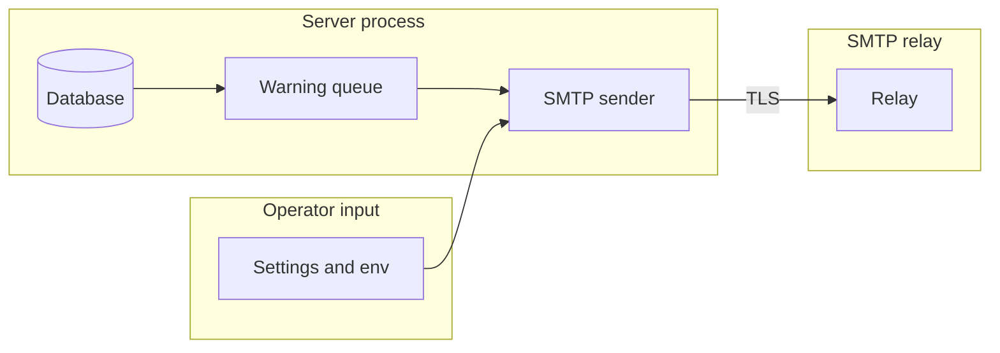

## Context

A background sender reads due token warnings from a durable queue and sends through resolved installation SMTP settings. Enforcement and display are in the other two parts of the split.

## Decisions

1. **Durable queue with one retry and fixed times.** The queue stores one row per token and warning time with the stable token ID, the warning time, the due time, a state of queued, sending, retry, sent or failed, a try count and a reason. Poll interval is 60 seconds. One sender holds a lease of 300 seconds per row. A 4xx failure moves the row to retry with a 15 minute backoff, then to failed after 1 retry. A 5xx failure moves to failed at once.
2. **Stable token ID with send-time recheck.** The token ID is the stable reference. The sender reads the owner email at send time and rechecks that the token exists, is enabled and still expires after the warning time. A stale row is marked failed with the reason and no send. A token made after a warning time queues that warning as due now. A row not sent before expiry is marked failed with reason expired.
3. **No plain-text fallback.** SMTP dial uses resolved installation settings and the TLS rule of ADR 292. A refused plain connection marks the row failed with reason refused. No fallback changes to plain text. Certificate checks stay on. Delivery is at-least-once after accept: a crash after accept can resend after lease expiry.

## Structure

Unexported type warningQueue with constructor newWarningQueue that checks poll interval 60 seconds, lease 300 seconds and retry limit 1; only the constructor makes a sender, and rows move only through queued, sending, retry, sent and failed.

## Risks

- Duplicate email on sender restart after SMTP accept.
- Password leak into queue row or log.
- Plain SMTP to a non-loopback host.
- Late warning sent after token expiry.

## Quality attributes

| Attribute | Target | Unit | Scope |
| --- | --- | --- | --- |
| Warning send latency after due time | 60 | seconds | warning sender poll, one installation |
| Retry delay after a temporary failure | 15 | minutes | each queue row, 1 retry |

## Threat model

Data flow and trust boundaries:

| Boundary | STRIDE | Threat | Layer | Guard | Hostile test |
| --- | --- | --- | --- | --- | --- |
| Server process to SMTP relay | I | Plain SMTP sends the warning text and exposes the password or address. | boundary check | The adapter checks that the relay is not empty and the sender holds no CR or LF. | TestPlainRefused sends a sender with CR LF and an empty relay and expects a refusal with no network call. |
| Server process to SMTP relay | I | Plain SMTP sends the warning text and exposes the password or address. | fail closed | The dialer refuses non-loopback plain SMTP unless the opt-in is on; a missing or not valid value is off. | TestPlainRefused uses a missing and a not valid opt-in value and expects a refusal. |
| Server process to SMTP relay | I | Plain SMTP sends the warning text and exposes the password or address. | limit | Certificate checks stay on for TLS. | TestPlainRefused presents a bad certificate and expects a refusal. |
| Operator input to server process | T | A header injection in the sender value adds a recipient. | encode or contain | The message builder removes CR and LF and never takes a header from a token name. | TestWarningEmailContent uses a token name with CR LF and expects no extra header. |
| Server process to database | I | The SMTP password or a token secret reaches a queue row, log or audit entry. | limit | The queue row holds only the token ID, times, state and reason. | TestWarningAudit checks that rows, log lines and entries hold no password or token secret. |
| Server process to database | E | A replica sends a row for a token that the owner revoked. | authorize at point of use | The sender rechecks the token and owner at send time under the lease. | TestQueueWarningAtWarningTime revokes a token before the send and expects failed with token-not-usable. |

## Failure modes

| Step | Failure | Retry | State after |
| --- | --- | --- | --- |
| Take the row lease | The sender ends while it holds the lease | Another sender takes the row after the 300 second lease ends | sending, then queued for the next holder |
| SMTP send | Temporary 4xx error or relay unreachable | One retry after 15 minutes | retry, then failed with the reason after the second failure |
| SMTP send | Permanent 5xx error | none | failed with the reason |
| Mark row sent | The process ends after SMTP accept | The row can resend after the lease ends | sending, then sent after the resend |
