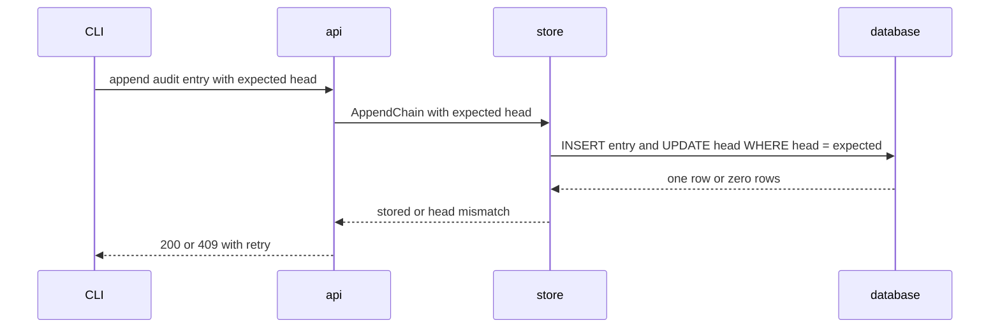

## Context

Two or more instances share one PostgreSQL database. Each instance has its own process clock. Audit append and lease, session, and sign-in expiry must agree across instances. Main already has chain append concurrency tests and a DatabaseClock port with a store test.

## Decisions

1. **Compare-and-swap for audit append.** Audit append keeps the current entry row and head value with no new table and adds a conditional UPDATE with WHERE head equal to the expected head in the same transaction as the entry insert. A mismatch changes zero rows and returns the stored head. The API layer returns 409 with the new head, and the calling client reads again and sends again. No retry loop lives in the store.
2. **Shared clock for expiry.** Expiry reads the database clock in the same statement that reads the row, with NOW and CURRENT_TIMESTAMP on PostgreSQL and the same-statement read on SQLite. The process clock never decides expiry. The hash input of ADR 72 decision 6 and ADR 240 stays unchanged. Tests fix the clock through the store DatabaseClock port.

## Structure

The unexported audit head checker lives behind the store port constructor; only the constructor makes a valid checker and it checks the expected head invariant. No new tool. No custom analyzer.

## Risks

- Process clock skew causes one instance to expire early when the guard reads the wrong clock.
- Lost update of the audit head breaks the hash chain check.

## Layers (defense in depth)

| Layer | Guard | Hostile test |
| --- | --- | --- |
| boundary check | Store checks expected head with WHERE head equal to expected in the same transaction as the fence check. | Two concurrent appends with the same expected head; one stores and one gets a mismatch with no partial write. |
| limit | Store bounds the entry bytes and the service bounds one failure write per sign-in attempt. | Append of an entry above the bound fails before the chain write. |
| authorize at point of use | Append checks the grant on the namespace at point of use in the same transaction. | Caller without the grant gets a refusal and no head move. |

## Diagrams

After this change:



## Quality attributes

| Attribute | Target | Unit | Scope |
| --- | --- | --- | --- |
| latency | p99 below 150 ms at 10 appends per second | ms | audit append transaction on PostgreSQL |
| storage | 0 new tables and 1 new row per append | rows | audit chain rows per append |

## Threat model

Data flow and trust boundaries:

```mermaid
flowchart LR
subgraph client[untrusted client]
C[CLI or console]
end
subgraph server[server process]
A[api handler]
S[store port]
end
subgraph db[(shared PostgreSQL)]
H[audit head]
E[expiry rows]
end
C-->A-->S-->H
S-->E
```

| Boundary | STRIDE | Threat | Layer | Guard | Hostile test |
| --- | --- | --- | --- | --- | --- |
| client to server | T | Tamper with the audit head from a second instance to overwrite an entry. | boundary check | Allowlist for scope and head format; reject unknown values. | Send a malformed head; server refuses with no state change. |
| client to server | T | Tamper with the audit head from a second instance to overwrite an entry. | encode or contain | Placeholders only in SQL; no string-built query. | Send a head with SQL text; query treats it as a value and matches no row. |
| client to server | T | Tamper with the audit head from a second instance to overwrite an entry. | limit | Bound entry bytes and one failure write per attempt. | Send a large entry and a burst of failures; server bounds and counts once each. |
| client to server | T | Tamper with the audit head from a second instance to overwrite an entry. | authorize at point of use | Check the grant on the namespace at the append and read. | Call append without the grant; server refuses and moves no head. |
| client to server | T | Tamper with the audit head from a second instance to overwrite an entry. | fail closed | Mismatch and clock read error fail closed with no head move. | Force a mismatch and a database gap; server answers mismatch or 503 and writes nothing. |
| server to database | E | Extend a lease or session past expiry from a stale instance. | boundary check | Read the database clock in the same statement as the row. | Skew the process clock by 60 s; expiry answer stays the same on both instances. |
| server to database | E | Extend a lease or session past expiry from a stale instance. | encode or contain | Use a typed timestamp value with no string mix. | Send a crafted timestamp string; server parses by allowlist or refuses. |
| server to database | E | Extend a lease or session past expiry from a stale instance. | limit | Bound renewal interval and budget window with stored values. | Flood renewals; server applies rate and window bounds. |
| server to database | E | Extend a lease or session past expiry from a stale instance. | authorize at point of use | Check the claim token in the same transaction as the write. | Write with a stale token after takeover; transaction changes zero rows. |
| server to database | E | Extend a lease or session past expiry from a stale instance. | fail closed | Stale token and expired lease deny the write. | Replay a stale renewal; server refuses and leaves the new claim in place. |

## Contracts

**audit chain**

- Invariant: One head per scope. Append moves the head forward by one.
- Invariant: Concurrent appends never overwrite each other.
- Invariant: The hash input is unchanged by the head check.
- `AppendChain`: pre: Caller holds the expected head read from the database.; Caller holds the namespace fence of the scope.. Post: If the expected head matches, the entry is stored and the head moves by one.; If the expected head does not match, no row changes and the caller gets the new head..

**expiry**

- Invariant: Expiry compares against the shared database clock in the same statement.
- `IsExpired`: pre: Caller passes a stored expiry timestamp.. Post: Answer uses the database clock value read in the same statement.; A clock read error denies and reports 503 with Retry-After 5..

## Failure modes

| Step | Failure | Retry | State after |
| --- | --- | --- | --- |
| Audit chain append | Two instances append to one audit chain with the same expected head. | Loser reads the new head from the 409 body and calls AppendChain again. | Chain head moves by two, with both entries stored in order. |
| Lease renewal | Database gap spans the lease. | Worker reclaims after the gap; the step checks the token again. | Expired claim is taken over or the operation fails closed. |
| Shared clock read | Database clock read fails. | No retry in the server; the client retries after Retry-After 5. | No head move and no expiry decision. |

## Change impact (computed from main)

Tests:

- `internal/removalalertsvc/fakes_test.go` names `namespace.Fence`
- `pkg/manuallock/manuallock_test.go` names `namespace.Fence`
- `pkg/outputshare/outputsharetest/mem_test.go` names `namespace.Fence`

ADRs:

- `docs/adr/0239-force-unlock-needs-unit-write-forced-on-every-opentofu-route.md` names `namespace.Fence`
- `docs/adr/0265-a-unit-shows-all-its-states-with-one-fixed-set-of-words.md` names `namespace.Fence`
- `docs/adr/0004-namespaces-regions-and-fencing.md` names `namespace.Fence`
