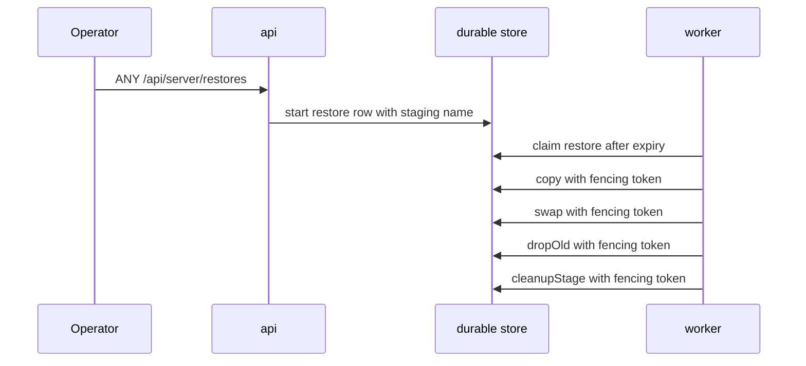
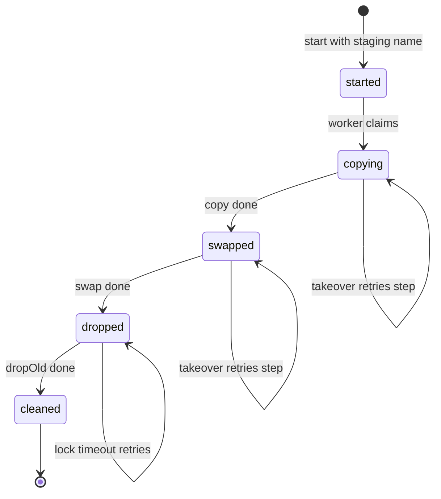
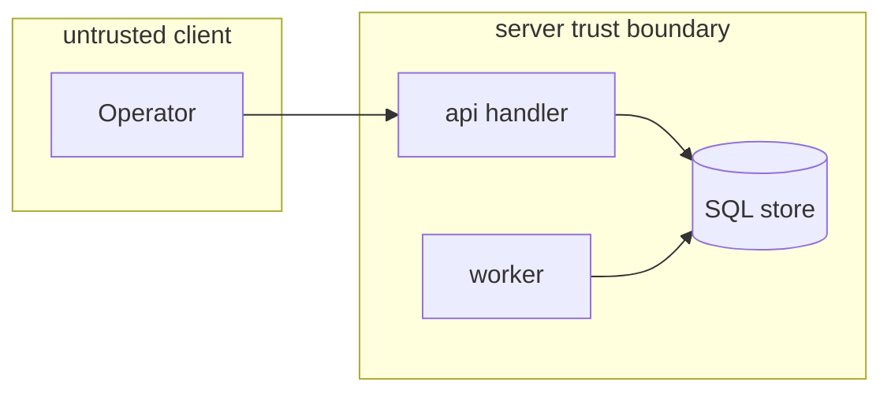

## Context

Restore must survive kill of the worker that holds it and run again on another worker with no operator action.

## Decisions

1. **Fenced restore steps with staging name in the row.** Restore kind restore runs steps copy, swap, drop-old, and cleanupStage in order. Each step carries the namespace fence and the claim fencing token and checks the token in its own transaction, and copy renews the lease while it runs. Start inserts the row with staging name restore-staging-<restore-id> and bumps the failover version. Start of the same restore ID reuses its staging name and never fails for leftover staging; staging of a finished restore ID is removed only by its own cleanupStage. Swap records swapped=true plus old-data name in the row in the same transaction that swaps, then starts one projection rebuild operation per namespace from that transaction. Drop-old uses a 5 s lock wait, 12 attempts with backoff, then ends the restore as failed with code restore.lock-wait. Audit guards, shared clocks, sink lag, and readiness stay in the other two parts.
2. **No 503 for background lock wait.** Drop-old keeps the last error on the restore row for the operator poll. No request answers 503 for a background lock wait; the restore state stays running until the bound, then failed.

## Structure

Unexported type restoreClaim with constructor newRestoreClaim that binds restore ID, staging name, old-data name, fence, and fencing token; only the constructor makes a value and each step method checks the token before any write.

## Risks

- Stale holder deletes a finished backup or live data without fence check.
- Two workers swap at once without token check.
- Staging name collision across restores.

## Layers (defense in depth)

| Layer | Guard | Hostile test |
| --- | --- | --- |
| boundary check | Handler checks restore right and worker presence before insert; store checks fence and token at each step. | Start restore with no right and with worker absent; replay a stale token at copy, swap, and drop-old. |
| encode or contain | Staging names are fixed form restore-staging-<restore-id> bound to the restore ID; SQL uses placeholders; no shell. | Send staging name with path separators and SQL text; check it is refused and never used as path or SQL. |
| limit | Drop-old lock wait is 5 s per attempt, 12 attempts with backoff; copy bounded by attempt deadline of 30 minutes with lease renewal. | Hold the lock during drop-old and check attempts stop within bound and restore ends failed with lock-wait. |
| authorize at point of use | Each step rechecks authorization at point of use in its transaction; cancel rechecks the restore right. | Revoke right after start and check cancel refuses. |
| fail closed | Lock timeout, lost token, or missing staging answers retryable worker error and keeps restore running; unknown state fails closed. | Kill holder mid-swap and check taker either resumes or fails closed with no half swap. |

## Diagrams

After this change:

Modules that the change touches, and their imports on main:

States and transitions after this change:

## Quality attributes

| Attribute | Target | Unit | Scope |
| --- | --- | --- | --- |
| latency | 5 | s | drop-old lock wait per attempt |
| latency | 30 | s | restore claim lease renewal |
| durability | 12 | attempts | drop-old bounded attempts per restore |

## Threat model

Data flow and trust boundaries:

| Boundary | STRIDE | Threat | Layer | Guard | Hostile test |
| --- | --- | --- | --- | --- | --- |
| client to api handler | T | Stale holder commits swap after takeover and corrupts live data. | boundary check | Allowlist restore input; refuse unknown fields; check right before insert. | Send bad staging name and missing right; check refusal. |
| client to api handler | T | Stale holder commits swap after takeover and corrupts live data. | encode or contain | Fixed staging name form bound to restore ID; placeholders in SQL; no shell. | Send SQL text in restore ID; check stored name stays fixed form. |
| client to api handler | T | Stale holder commits swap after takeover and corrupts live data. | limit | One running restore per installation; second start answers 409 without new work. | Start two restores at once; check one runs and one gets 409. |
| client to api handler | T | Stale holder commits swap after takeover and corrupts live data. | authorize at point of use | Recheck restore right at start and cancel in its transaction. | Revoke right mid-restore; check cancel refuses. |
| client to api handler | T | Stale holder commits swap after takeover and corrupts live data. | fail closed | Stale token and unknown restore fail closed with no write. | Replay old token; check no write commits. |
| worker to SQL store | I | Partial swap leaves half-written live tables. | boundary check | Check fencing token and fence in same statement as write. | Write with old token; check zero rows and retryable error. |
| worker to SQL store | I | Partial swap leaves half-written live tables. | encode or contain | Staging names bound to restore ID; swap renames fixed names only. | Point staging at control table; check refusal. |
| worker to SQL store | I | Partial swap leaves half-written live tables. | limit | Attempt deadline 30 minutes bounds copy with lease renewal; drop-old bounded to 12 attempts. | Stall copy past deadline; check expiry and takeover. |
| worker to SQL store | I | Partial swap leaves half-written live tables. | authorize at point of use | Fence and token checked at point of write for each step. | Bump failover version mid-step; check step refuses. |
| worker to SQL store | I | Partial swap leaves half-written live tables. | fail closed | Broken connection rolls back; no resend after commit; swapped flag keeps swap single. | Break connection before commit; check no half swap. |

## Contracts

**restore**

- Invariant: Restore row holds one staging name and one old-data name per restore ID.
- Invariant: Only the holder of the live fencing token writes step state.
- Invariant: Control rows are never swapped.
- Invariant: Swap commits at most once per restore ID.
- `start`: pre: Caller holds installation restore right.. Post: Restore row exists with staging name and started failover version bump..
- `copy`: pre: Claim holds live fencing token.. Post: Staged copy is complete under staging name..
- `swap`: pre: Claim holds live fencing token and copy is complete.. Post: Live data points at staged copy and failover version increased..
- `drop-old`: pre: Claim holds live fencing token and swap committed.. Post: Old data is dropped and staging state is cleaned..
- `cleanupStage`: pre: Claim holds live fencing token and drop-old is done or swap never ran.. Post: Staging objects of the restore ID are removed and the row reads cleaned..
- `cancel`: pre: Caller holds installation restore right and restore is not in cleaned.. Post: Restore row reads canceled and no further step writes commit..

## Failure modes

| Step | Failure | Retry | State after |
| --- | --- | --- | --- |
| copy | Worker killed during copy. | Taker claims after expiry and reruns copy with new token; copy renews the lease. | copying with new fencing token. |
| swap | Worker killed during swap. | Taker reads swapped flag in row; when false it reruns fenced swap once, when true it moves to drop-old. | swapped once; second swap refused by token and swapped flag. |
| drop-old | Drop-old blocked by live lock. | 5 s lock wait then backoff retry, 12 attempts; then restore ends failed with restore.lock-wait (NEW: no catalog code names a restore step that waited for a lock; restore.ended names a restore that already ended). | dropped after lock frees, else failed with lock-wait on the row. |
| cleanupStage | Worker killed during cleanupStage. | Taker reruns cleanupStage; removal is idempotent by restore ID. | cleaned. |
| cancel | Cancel during copy, swap, or drop-old. | Next step checks canceled flag with token and stops without further writes. | canceled. |
