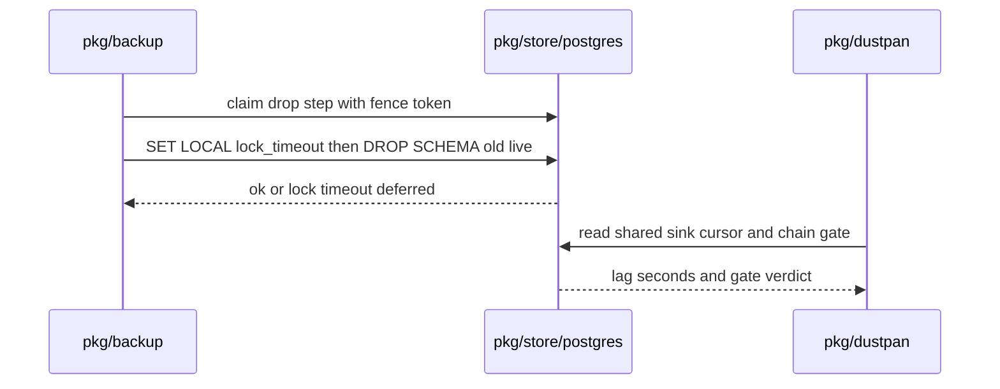
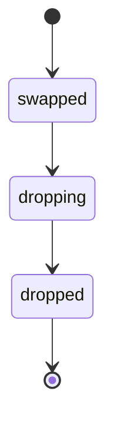
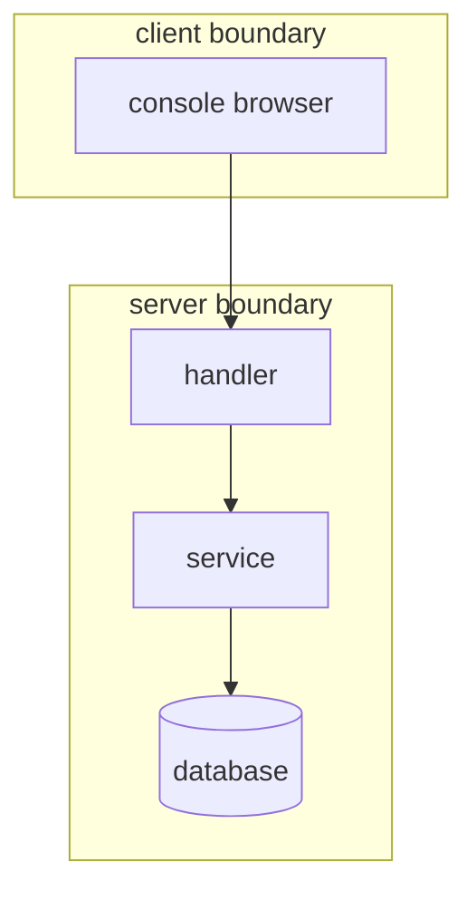

## Context

Several `opendustpan serve` instances share one PostgreSQL database. Restore swap must not hold locks for DROP, audit sinks must not drift per process, and readiness must reflect chain gate.

## Decisions

1. **Own drop step with lock timeout.** Store staging schema name in restores row in NEW field `staging_schema`, then drop old live schema in its own step with SET LOCAL lock_timeout of 5000 ms. Held lock returns deferred with backoff, not failure; second run changes nothing; missing name fails closed with no DROP.
2. **Shared cursor lag and readiness gate.** Read sink lag from shared cursor row on database clock, not process memory. Bound is 300 s per installation from the NEW setting `audit-sink-max-lag-seconds`, shown as effective value in capabilities. Readiness debounces 30 s before leaving not ready. Chain gate invalid marks not ready.

## Structure

Unexported `dropLiveStep` with constructor `newDropLiveStep(store, timeoutMs)`; constructor rejects empty schema name and non-positive timeout so no caller builds an unbounded DROP.

## Risks

- Lock wait blocks worker slot during contention
- Readiness flap when chain check runs long

## Diagrams

After this change:

States and transitions after this change:

## Quality attributes

| Attribute | Target | Unit | Scope |
| --- | --- | --- | --- |
| none affected | No new latency budget; drop step bounded by lock_timeout and retry |  |  |

## Threat model

Data flow and trust boundaries:

| Boundary | STRIDE | Threat | Layer | Guard | Hostile test |
| --- | --- | --- | --- | --- | --- |
| client boundary | S | Spoofed readiness reason hides lag or chain failure | boundary check | Allowlist of readiness reasons `sink-lag` and `chain-gate` at boundary; unknown reason fails closed | Send forged readiness reason direct to console path, expect refusal |
| client boundary | S | Spoofed readiness reason hides lag or chain failure | encode or contain | Encode reason text with no input echo in 503 shape | Send reason with CR LF direct to handler, expect no header split |
| client boundary | S | Spoofed readiness reason hides lag or chain failure | limit | 30 s debounce on leaving not ready bounds flap | Flap lag across bound each second, expect stable not ready |
| client boundary | S | Spoofed readiness reason hides lag or chain failure | authorize at point of use | Readiness checks chain gate at point of use before answering ready | Mark chain invalid then query readiness, expect not ready |
| client boundary | S | Spoofed readiness reason hides lag or chain failure | fail closed | Any chain read error answers not ready with audit entry | Drop database mid-read, expect not ready and no ready answer |
| server boundary | T | Wrong-schema DROP or replayed stale fence deletes live data | boundary check | Allowlist schema name pattern and NEW field `staging_schema` check at boundary; missing name fails closed | Send empty and traversal schema names direct to step, expect refusal with no DROP |
| server boundary | T | Wrong-schema DROP or replayed stale fence deletes live data | encode or contain | Quoted identifiers and placeholders with no string-built SQL | Send schema name with quote and semicolon direct to store, expect no execution |
| server boundary | T | Wrong-schema DROP or replayed stale fence deletes live data | limit | 5000 ms lock_timeout and 10 deferred tries per restore | Hold lock through 11 ticks, expect hold in dropping with audit entry |
| server boundary | T | Wrong-schema DROP or replayed stale fence deletes live data | authorize at point of use | Fence token check on drop step and audit chain gate check at point of use | Replay stale fence token, expect refusal; forge invalid chain, expect not ready |
| server boundary | T | Wrong-schema DROP or replayed stale fence deletes live data | fail closed | Missing name, stale fence, and gap fail closed with audit entry | Drop database mid-step, expect not ready and no half DROP |

## Contracts

**restore**

- Invariant: Control tables never enter swap
- Invariant: Each fenced step is idempotent
- `DropOldLiveSchema`: pre: Swap committed and staging name stored in restores row. Post: Old live schema absent or step reports deferred.
- `RestoreSteps`: pre: Restore row exists. Post: Step list holds drop step after swap step.
- `FinalizeOpenTofuRetry`: pre: OpenTofu state write reached finalize. Post: Retry happens in finalize step with no other retry path.

## Failure modes

| Step | Failure | Retry | State after |
| --- | --- | --- | --- |
| drop-old-live-schema | Lock timeout on DROP | Defer step with backoff capped at 10 tries then hold `dropping` with audit entry, keep swapped state | dropping |
| drop-old-live-schema | Worker killed mid-drop | Next worker reclaims after lease expiry and re-runs idempotent DROP | dropping |
| readiness-gate | Database gap during sink read | Fail closed to not ready, retry on next tick | not-ready |

## Change impact (computed from main)

Tests:

- `pkg/dustpan/audit_required_test.go` names `checkAuditStores`
