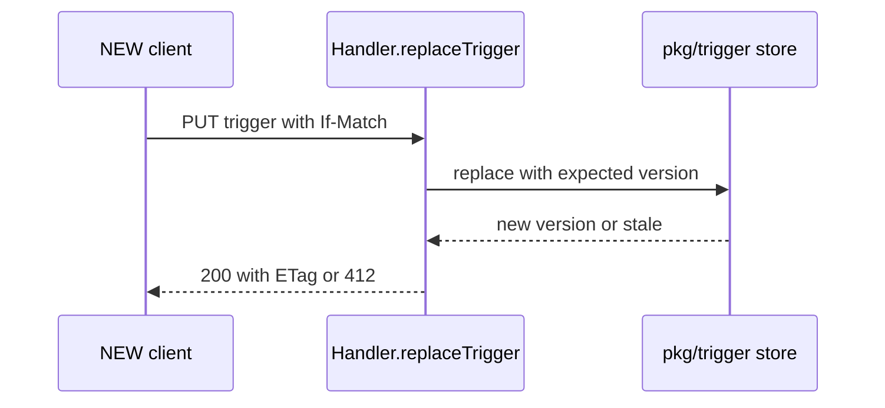
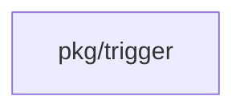

## Context

PUT replace of one trigger is last-write-wins and moves the last saver to the last writer, so a concurrent replace loses one rule without a notice.

## Decisions

1. **Optimistic concurrency on trigger replace.** Add an unexported trigger version that rises by one on each replace, exposed only through an ETag accessor. The read of one trigger answers it as a strong ETag header. The list answers it as a per-item version member. PUT takes one exact strong If-Match value and the store compares the version in the same write. A stale version fails with 412 and changes nothing, including the last saver.
2. **First version without a migration.** Edit the single baseline of each dialect in place with a version column that defaults to 1, with no numbered migration and no conversion code. A store test reads version 1 on a row that the baseline made.
3. **Replace version moves only on replace.** Fire, enable, disable and last-fired writes do not raise the replace version, so a fire never causes a 412 on the next replace.

## Structure

An unexported version field on the trigger record in pkg/trigger, set to 1 by its constructor and read through the exported ETag method; only the store replace path raises it.

## Risks

- Two writers with the same ETag still race; the store compare in one write keeps one winner and the loser gets 412.

## Diagrams

After this change:

Modules that the change touches, and their imports on main:

## Quality attributes

| Attribute | Target | Unit | Scope |
| --- | --- | --- | --- |
| none affected | One version compare on one PUT and one ETag header on one read; no latency or storage target changes. |  |  |
