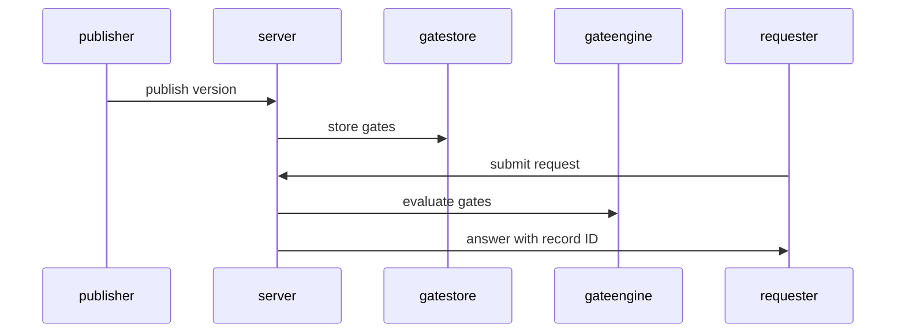
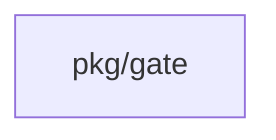
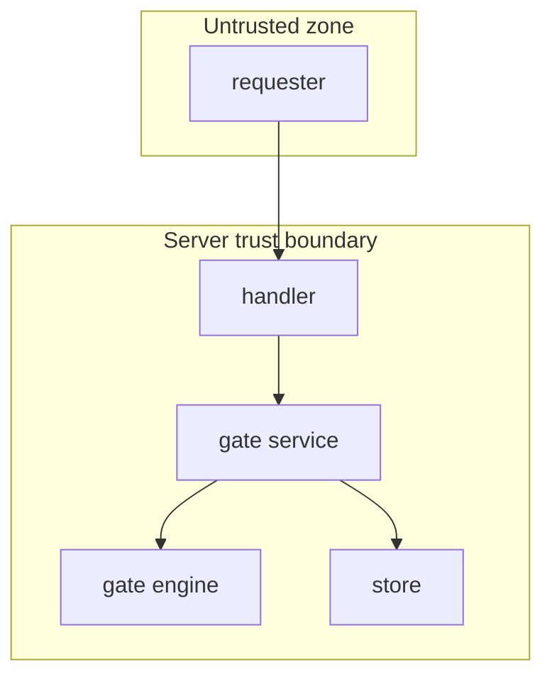

## Context

Self-service requests are evaluated through gates. Each blueprint rule is a stored gate over typed facts. The server stores each completed evaluation in a decision record.

## Decisions

1. **Blueprint rules are version-linked gates.** At publish of a blueprint version, the server translates each rule into one stored gate linked to the blueprint version ID. The namespace owns the gate. A republish replaces the gates of that version. Evaluation loads the gates by the blueprint version ID of the revision at change.propose. The job carries that ID so change.planned and change.apply load the same gates.
2. **Delete the old package fully.** Delete the old rule-engine package, its four adapters, its conformance suite, its depguard entry and its docs mentions, where each exists. Remove the name from CLAUDE.md and GLOSSARY.md where it remains.

## Structure

Gate evaluation goes through an unexported type gateEvaluator that only NewGateEvaluator builds. The constructor checks the fact schema, the scope IDs and the engine handle. A mutation test removes the fail-closed branch and the suite must fail.

## Risks

- Self-service code not yet on main leaves part of the work for a later pull request.
- Stale docs or layout text still names the old package after deletion.

## Layers (defense in depth)

| Layer | Guard | Hostile test |
| --- | --- | --- |
| service | The gate service validates the fact document against the fact schema. | Send a fact with a wrong type directly to the service and check the refusal. |
| port adapter | The engine denies on error, timeout and empty answer. | Force an engine error on a fake engine and check the deny. |
| HTTP handler | The handler checks the request actions on the unit object and audits in the same transaction. | Call the request route without the grant and check the 403 answer. |

## Diagrams

After this change:

Modules that the change touches, and their imports on main:

## Quality attributes

| Attribute | Target | Unit | Scope |
| --- | --- | --- | --- |
| absence | 0 | matches | old package mentions in code, CLAUDE.md, GLOSSARY.md and docs |

## Threat model

Data flow and trust boundaries:

| Boundary | STRIDE | Threat | Layer | Guard | Hostile test |
| --- | --- | --- | --- | --- | --- |
| HTTP API | S | Forged request uses a blueprint of another namespace | boundary check | Handler answers 404 for a blueprint of another namespace. | Request a foreign blueprint and check 404. |
| HTTP API | S | Forged request uses a blueprint of another namespace | encode or contain | Handler encodes reasons in JSON. | Publish a reason with CR and LF and check the encoded answer. |
| HTTP API | S | Forged request uses a blueprint of another namespace | limit | Handler enforces the document size limit. | Send an oversize request and check the refusal. |
| HTTP API | S | Forged request uses a blueprint of another namespace | authorize at point of use | Handler checks actions on the unit object. | Call without the grant and check 403. |
| HTTP API | S | Forged request uses a blueprint of another namespace | fail closed | Handler denies on unknown gate state and audits. | Force an unknown answer and check the deny. |

## Contracts

**gate evaluation**

- Invariant: One decision record for each completed evaluation
- `evaluate`: pre: Fact document matches the fact schema. Post: One decision record exists for the revision.

## Failure modes

| Step | Failure | Retry | State after |
| --- | --- | --- | --- |
| Evaluate gates at change.propose | Gate engine times out | Retry with the same idempotency key | Request denied with a decision record |
