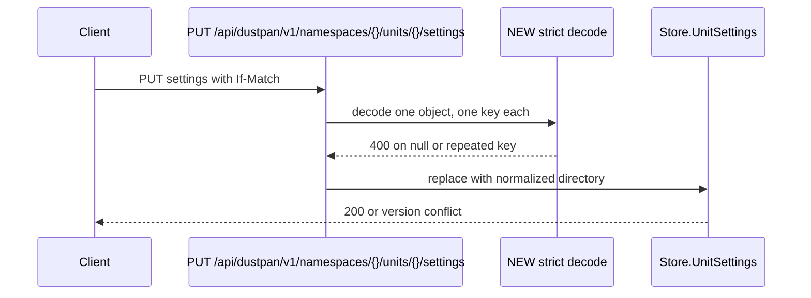

## Context

PUT copies the effective directory value back into the request and fails, accepts a null document, and accepts a repeated key while PATCH refuses it.

## Decisions

1. **Directory dot.** Normalize an explicit directory of exactly "." to unset at decode on the single-unit PUT only; every other directory value keeps its current accept or refuse behavior.
2. **Strict document.** Refuse a null document and a document with a repeated object key at any object level before validation on the single-unit PUT only; two keys count as repeated only when their bytes match exactly, with no case or Unicode-escape folding; refuse nesting deeper than 32 levels; the per-request body limit of 262144 bytes bounds memory before decode.
3. **Guard in place of structure.** No unexported type forces the call; the guard is a NEW strict-decode helper used only by the single-unit PUT path, with a mutation test that removes the duplicate-key check and the null check so the tests fail; PATCH keeps its own existing check and does not reuse the helper.
4. **Replay identity.** Idempotency replay compares the raw request body bytes; a body with directory "." and a body with the key omitted are different bodies.

## Structure

No structure makes a skipped normalization impossible; the NEW strict-decode helper plus a mutation test guards the PUT path instead.

## Risks

- A client that sends null or a repeated key and relies on 200 gets 400 after the fix.

## Diagrams

After this change:

## Quality attributes

| Attribute | Target | Unit | Scope |
| --- | --- | --- | --- |
| none affected | Fix changes validation only with no latency or storage target change. |  |  |

## Contracts

**Unit settings record**

- Invariant: One record per unit with a version that only moves on a real change.
- `Replace`: pre: The caller holds If-Match for the current version.. Post: A directory of exactly "." is stored as unset.; A null document is refused with no store write.; A document with a repeated key is refused with no store write..

**Effective value view**

- Invariant: An unset directory reads as ".".
- `EffectiveDirectory`: pre: The settings record was read for the unit.. Post: An unset directory returns "."..
