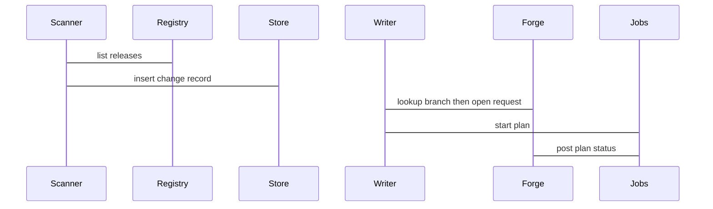
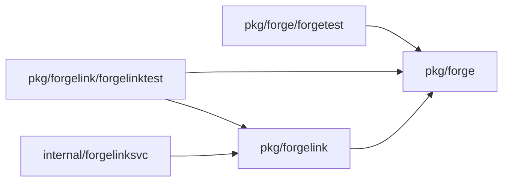

## Context

A unit stores fixed provider and module pins in its unit settings. The registry holds a newer stable release. A daily scanner with jitter compares pins with private registry releases, opens one forge review request per stale pin through the Forge port, and starts one plan through the milestone 5 plan path. The plan result returns to the forge request as a status check. Polling closes the request. No manual open route and no automatic merge exist.

## Decisions

1. **Scanner creates one change record per stale pin.** A scanner runs once per day per namespace with jitter and compares fixed-version pins from unit settings with private registry releases. It picks the newest stable release above the pinned version and ignores ranges, branches, and prereleases. On a stale pin it inserts one change record per unit stable ID, pin, and new version under a stored unique key.
2. **Writer opens one review request per unit with branch lookup.** The writer derives a deterministic branch name from unit stable ID, pin, and new version, looks up the branch and open request by that key before open, and opens one review request per unit through the Forge port as one commit on a new branch. It never writes git directly. A lookup hit reuses the existing request instead of opening a second one.
3. **Crash-safe open with forge-side lookup.** The writer passes the branch name and the change record key to the Forge port. The Forge port looks up an open request by branch name before create. If the process dies after forge create and before the reference is stored, the next run finds the request by branch lookup and stores the reference without a second open.
4. **Scanner polls forge state to close requests.** The scanner polls the forge state of each open request on each scheduled run and closes the change record when the forge request merges or closes, or when the pin in unit settings changes by hand. A request closed without merge suppresses reopen of the same unit, pin, and new version for 7 days. No webhook is required.
5. **Plan result returns to the forge request.** The plan runner posts the plan result to the forge request as a status check through the Forge port and links the result to the change record. A missing link, revoked credential, rate limit, branch collision, moved base, or pin absent from settings produces a stored refusal and no retry storm.

## Structure

Unexported type upgradePlan with constructor newUpgradePlan that checks namespace ID, unit stable ID, old version, and new version. Only the constructor makes a value.

## Risks

- The scanner opens duplicate pull requests for the same pin.
- A plan result never returns to the pull request.
- The close poll misses a merge and leaves a request open.

## Diagrams

After this change:



Modules that the change touches, and their imports on main:



## Quality attributes

| Attribute | Target | Unit | Scope |
| --- | --- | --- | --- |
| scan duration | 300 | s | one namespace with 1000 units |
| duplicate opens | 0 | count | concurrent daily scans on same pin |

## Threat model

Data flow and trust boundaries:

```mermaid
Scanner reads registry releases and unit pins, writer calls Forge port to open a review request, runner runs a plan for the changed pin.
```

| Boundary | STRIDE | Threat | Layer | Guard | Hostile test |
| --- | --- | --- | --- | --- | --- |
| Forge credential use | S | An attacker tricks the scanner into opening a pull request with a malicious pin or exfiltrating a forge secret. | authorize at point of use | Writer passes only a credential reference; the Forge port loads the secret at point of use and never logs it. | Call the writer with a raw secret in place of a reference and prove the Forge port refuses it. |
| Forge credential use | S | An attacker tricks the scanner into opening a pull request with a malicious pin or exfiltrating a forge secret. | fail closed | Open is refused when the audit write fails; no forge request stays unrecorded. | Fail the audit store during open and prove no forge request is created. |
| Registry metadata and version string | T | A hostile registry release poisons the pin change in the forge commit. | boundary check | Scanner allowlists version characters and rejects overlong or hostile version strings at the boundary. | Feed a hostile version string with path separators and prove the scanner refuses it. |
| Registry metadata and version string | T | A hostile registry release poisons the pin change in the forge commit. | encode or contain | Writer encodes the version into the commit diff only after signature and checksum checks on the registry release. | Serve a release with a bad signature and prove the writer refuses the pin change. |

## Failure modes

| Step | Failure | Retry | State after |
| --- | --- | --- | --- |
| Open upgrade request | Forge open succeeds then process dies before reference stored | Next scan looks up forge request by deterministic branch name and stores reference without second open | One open request for unit stable ID, pin, and new version. |
| Daily scan | Two scans race on same pin | One insert wins unique key; loser reads winner; forge lookup by branch name guards double create | One open request for unit stable ID, pin, and new version. |
| Poll forge state | Poll misses merge event | Next daily poll reads forge state again until merged or closed | Request stays open until poll confirms merged, closed, or superseded. |
