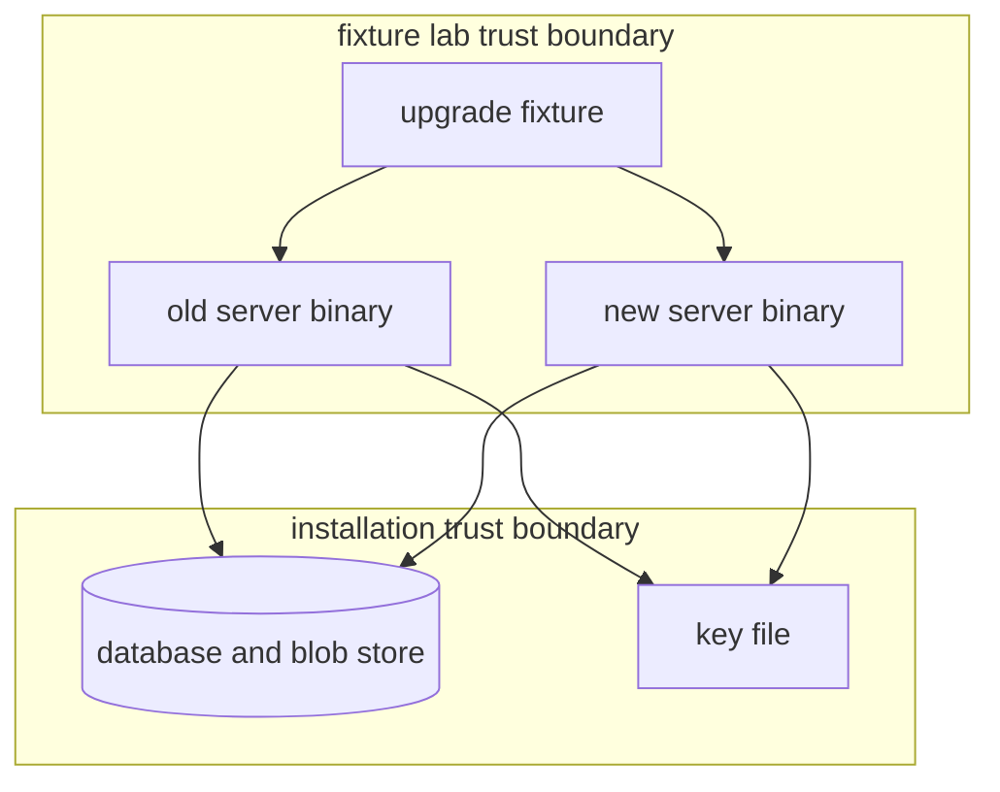

## Context

The upgrade path must prove that real data from an old binary survives a direct start of the new binary, with no tag tooling.

## Decisions

1. **Go fixture outside the server.** A Go e2e fixture builds the old binary from `e2e/upgrade/pinned-commit.txt`, seeds data with the real CLIs, stops it, starts the new binary on the same data directory and key file, and verifies reads plus one more write per CLI. Stable IDs link objects across the restart. SeedOldRelease and VerifyAfterUpgrade are the two steps of the fixture.
2. **Serve key and pin ownership.** The fixture runs opendustpan serve with one generated key file for both binaries, never a dev key file. The pin file holds one commit digest. The CI build refuses an unknown digest. The pin is set only after agent-shapes-before-first-tag and key-encryption-key-rotation merge, so the old binary already holds agent-block audit entries and finished key rotations. The old binary is built with the release-build target of release-artifacts-binary-archives. The pull request that edits a baseline refreshes the pin in the same request.
3. **Docs page drives the fixture.** The operator upgrade docs page holds the backup, stop, start new binary and check steps. The fixture runs those exact commands through the docs-commands corpus, so the docs steps and the test steps stay the same.

## Structure

The unexported type `upgradeFixture` holds only stable IDs and digests. Only the NEW constructor `newUpgradeFixture` makes it.

## Risks

- The pinned commit drifts until a tag exists.
- Flaky CLI traffic hides a schema loss.

## Quality attributes

| Attribute | Target | Unit | Scope |
| --- | --- | --- | --- |
| duration | 600 | seconds | upgrade fixture per dialect |
| storage growth | 500 | megabytes | fixture database per run |

## Threat model

Data flow and trust boundaries:

| Boundary | STRIDE | Threat | Layer | Guard | Hostile test |
| --- | --- | --- | --- | --- | --- |
| fixture lab trust boundary | T | An altered old binary or pin digest plants rows that the new binary then trusts. | boundary check | Fixture allows only the pin digest in e2e/upgrade/pinned-commit.txt and refuses any other digest. | Point the pin at an unknown digest and check the build stops before any database write. |
| fixture lab trust boundary | T | An altered old binary or pin digest plants rows that the new binary then trusts. | encode or contain | Fixture passes the key file path and database URL as fixed values and never logs secret bytes. | Inject shell metacharacters in the pin file and check the build takes no shell path. |
| fixture lab trust boundary | T | An altered old binary or pin digest plants rows that the new binary then trusts. | limit | Fixture limits one old binary and one new binary on one data directory per run. | Start two old binaries on one directory and check the second fails to claim the database. |
| fixture lab trust boundary | T | An altered old binary or pin digest plants rows that the new binary then trusts. | authorize at point of use | Seed and verify calls use a bootstrap admin access token on the seeded namespace only. | Replay the seed token on another namespace and check the server denies it. |
| fixture lab trust boundary | T | An altered old binary or pin digest plants rows that the new binary then trusts. | fail closed | On digest mismatch or seed failure the fixture stops with no upgrade verdict. | Corrupt one seeded secret digest and check VerifyAfterUpgrade fails closed. |
| installation trust boundary | I | Upgrade leaks secret plain text or drops the held lock and grants access to a second writer. | boundary check | New binary checks the serve key header and refuses a dev key file at start. | Start the new binary with a dev key file and check it refuses before migrations. |
| installation trust boundary | I | Upgrade leaks secret plain text or drops the held lock and grants access to a second writer. | encode or contain | Secrets stay sealed; VerifyAfterUpgrade compares plain text only in memory. | Read the fixture log and check no secret plain text is present. |
| installation trust boundary | I | Upgrade leaks secret plain text or drops the held lock and grants access to a second writer. | limit | Fixture database is capped at 500 megabytes per run and one held lock. | Seed beyond the cap and check the fixture stops. |
| installation trust boundary | I | Upgrade leaks secret plain text or drops the held lock and grants access to a second writer. | authorize at point of use | Post-upgrade reads check the grant on the object, including the held lock holder. | Read a secret as a principal with no grant after upgrade and check denial. |
| installation trust boundary | I | Upgrade leaks secret plain text or drops the held lock and grants access to a second writer. | fail closed | On failed migration the server exits, serves no traffic, and keeps the pre-upgrade backup for restore. | Fail a migration and check the process serves nothing and the database stays rolled back. |

## Contracts

**upgrade fixture**

- Invariant: Rows use stable IDs.
- Invariant: Both binaries share one data directory and one serve key file.
- `SeedOldRelease`: pre: Old binary runs on an empty database.. Post: The database holds the fixture..
- `VerifyAfterUpgrade`: pre: New binary started on the same database.. Post: Each fixture object reads back equal..

## Failure modes

| Step | Failure | Retry | State after |
| --- | --- | --- | --- |
| Start new binary on old database | The new binary stops midway through a migration | Start the fixed binary again on the same database | Committed migrations stay; the uncommitted migration rolls back |
| Apply missing migrations | A migration fails | Fix the binary and start again with the same key file | The process exits, serves no traffic and logs the failed migration |
