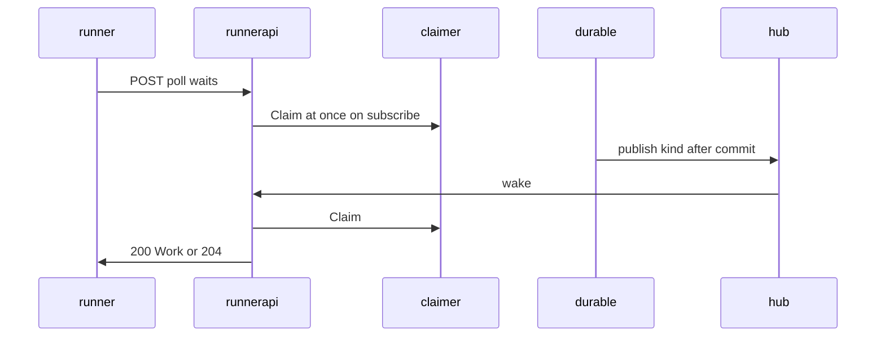
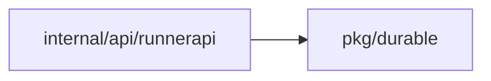
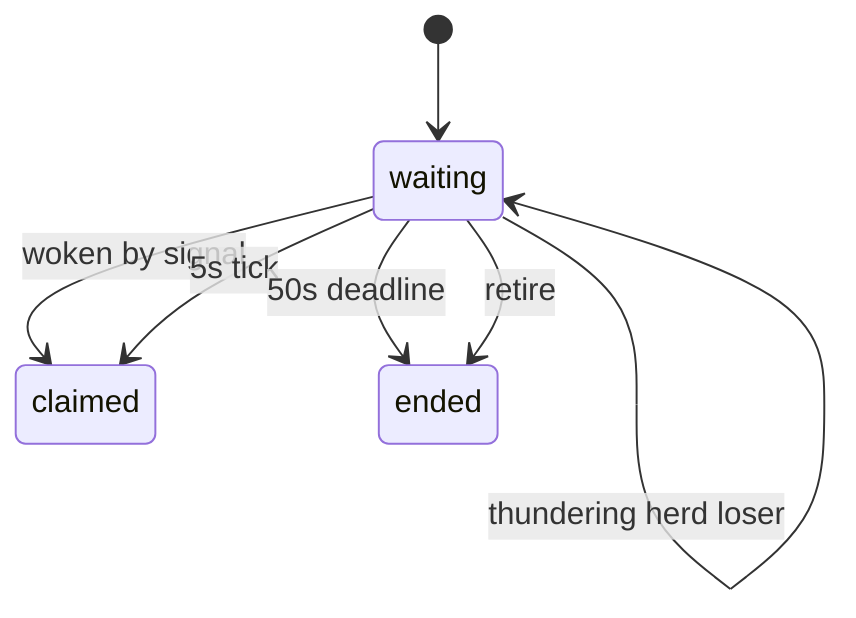
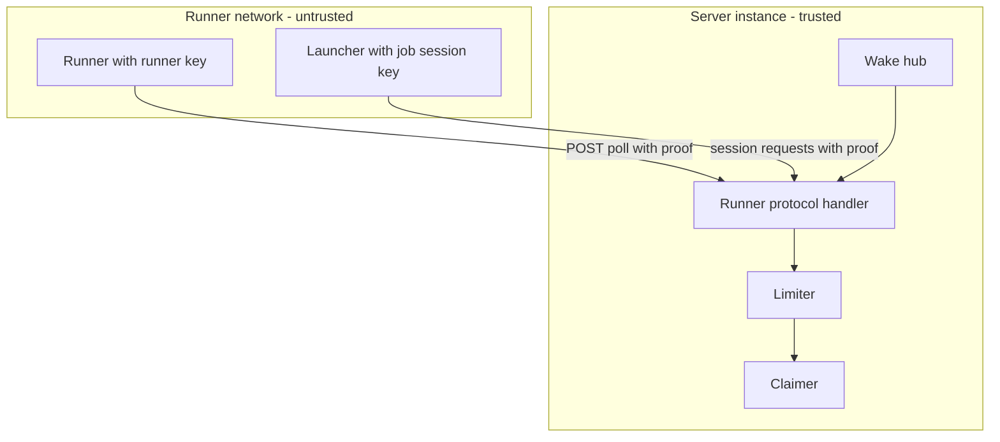

## Context

Poll waits in internal/api/runnerapi against job.Claimer.Claim on the existing route ANY /runner/v1. Starts commit in pkg/durable and in job dispatch. Rate checks guard the poll and session paths under /runner/v1 per runner ID and per session ID.

## Decisions

1. **Instance-local wake hub with Claim on subscribe.** Add an instance-local hub in the server process that maps each durable kind to waiting polls. Start paths publish the kind only after commit. Each poll subscribes for its pool kinds, runs Claim at once on subscribe, then retries on signal, on the 5 s tick for operations that other instances start, or on the 50 s deadline. The at-once Claim closes the subscribe and publish race and the 5 s tick bounds a lost signal.
2. **Per-instance rate limiter after authentication.** Add a fixed-window limiter with the standard library only, keyed by authenticated runner ID on poll and by session ID on session paths. Order each request as proof and authentication, then nonce check, then limiter allow, then the one-poll rule and Claim or session work. A limiter refusal does not store the nonce so a retry with a new proof works. Evict keys idle for 5 minutes. Answer 429 rate-limited with Retry-After: 1. A limiter refusal creates no open poll and closes no open poll.

## Structure

Unexported type wakeHub with constructor newWakeHub and methods subscribe(kinds) and publish(kind after commit). Only durable commit paths hold the publisher. Unexported type limiter with constructor newLimiter and method allow(key) with mutex-guarded map. No new tool and no custom analyzer.

## Risks

- Hub publish before commit wakes a poll that finds no work.
- Limiter table grows without bound without eviction.
- Fake clock tests hide the subscribe and publish race.

## Layers (defense in depth)

| Layer | Guard | Hostile test |
| --- | --- | --- |
| Port adapter | Proof and authentication run first; the limiter counts only authenticated runner IDs and session IDs. | Flood poll with bad proofs; the server answers 401 and holds no limiter entry for unknown IDs. |
| HTTP handler | Limiter runs after authentication and nonce check and before Claim and session work and answers 429 rate-limited with Retry-After: 1 without storing the nonce. | Send 11 polls in one second from one runner and 51 requests in one second from one session; each excess gets 429 rate-limited and the other runner still gets 200 or 204, and a retry with a new nonce is accepted. |
| Service | One-poll-at-a-time rule stays independent under the rate: a second concurrent poll gets 429 with the existing one-poll code. | Open two concurrent polls of one runner under the rate; the second gets 429 without code rate-limited and the first keeps waiting. |

## Diagrams

After this change:

Modules that the change touches, and their imports on main:

States on main in the touched packages:

States and transitions after this change:

## Quality attributes

| Attribute | Target | Unit | Scope |
| --- | --- | --- | --- |
| latency | 1 | seconds | poll wake on same instance |
| latency | 5 | seconds | poll fallback retry for other instances |
| latency | 50 | seconds | poll max wait deadline |
| throughput | 10 | requests per second | per-runner poll limit per instance |
| throughput | 50 | requests per second | per-session request limit per instance |

## Threat model

Data flow and trust boundaries:

| Boundary | STRIDE | Threat | Layer | Guard | Hostile test |
| --- | --- | --- | --- | --- | --- |
| Runner network to server instance on poll path | D | Runner floods poll to overload Claim or to steal work of another pool | boundary check | Handler checks Dustpan-Proof signature, time, and nonce before limiter and Claim | Replay a poll proof and send proofs with bad time; server answers bad-proof and runs no Claim |
| Runner network to server instance on poll path | D | Runner floods poll to overload Claim or to steal work of another pool | encode or contain | Poll body decoded with strict limits and 4 MiB cap | Send oversize poll body; server refuses 400 without Claim |
| Runner network to server instance on poll path | D | Runner floods poll to overload Claim or to steal work of another pool | limit | Per-runner limiter at 10 polls per second with Retry-After 1 and one-poll rule | Send 11 polls in one second and two concurrent polls; excess gets 429 |
| Runner network to server instance on poll path | D | Runner floods poll to overload Claim or to steal work of another pool | authorize at point of use | Claim checks pool membership and runner key rights at point of use | Poll for a pool the runner is not in; server refuses without work |
| Runner network to server instance on poll path | D | Runner floods poll to overload Claim or to steal work of another pool | fail closed | Auth or limiter errors fail closed to 401 or 429 with no wake and no open poll | Flood with bad and over-rate polls; no work leaks and no poll stays open |
| Launcher session to server instance on session paths | S | Caller spoofs a job session to read or write work of another claim | boundary check | Handler checks session proof and claim liveness before session work | Send session request with bad signature or dead claim; server refuses 401 |
| Launcher session to server instance on session paths | S | Caller spoofs a job session to read or write work of another claim | encode or contain | Chunk and part sizes enforced before streaming to blob store | Send chunk above 1 MiB; server refuses before store write |
| Launcher session to server instance on session paths | S | Caller spoofs a job session to read or write work of another claim | limit | Per-session limiter at 50 requests per second with Retry-After 1 | Send 51 session requests in one second; 51st gets 429 rate-limited |
| Launcher session to server instance on session paths | S | Caller spoofs a job session to read or write work of another claim | authorize at point of use | Session may act only on its own claim at point of use | Use session of claim A to write claim B; server refuses |
| Launcher session to server instance on session paths | S | Caller spoofs a job session to read or write work of another claim | fail closed | Errors fail closed to 401 or 429 with no state change and audit denial where required | Flood session with bad proofs; server holds no limiter entry for unknown session |

## Contracts

**wakeHub**

- Invariant: publish fires only after commit
- Invariant: subscribe runs Claim at once before wait
- `subscribe`: pre: pool kinds known. Post: Claim ran once at once.
- `publish`: pre: start committed. Post: waiting polls of kind woken.

**limiter**

- Invariant: counts only authenticated IDs
- Invariant: idle entries evicted after 5 minutes
- `allow`: pre: proof and authentication passed. Post: excess returns false with Retry-After 1.

## Failure modes

| Step | Failure | Retry | State after |
| --- | --- | --- | --- |
| durable start publish | publish before commit | no retry; fix order to publish after commit | poll wakes, finds no work, waits again |
| poll wait | lost instance-local signal | next 5 s tick retries Claim | work claimed at tick |
| rate limit check | limiter store grows | evict entries idle 5 minutes | bounded memory |
| poll wait | server restart during wait | new poll claims at once or at next tick | work claimed |

## Change impact (computed from main)

Tests:

- `internal/servertest/roundtrips_test.go` names `Claimer.Claim`
- `internal/servertest/backup_test.go` names `Claimer.Claim`
- `internal/servertest/restore_lease_test.go` names `Claimer.Claim`

ADRs:

- `docs/adr/0166-context-and-graph-gaps-found-before-the-implementation.md` names `Claimer.Claim`
- `docs/adr/0131-the-runner-protocol.md` names `Claimer.Claim`
- `docs/adr/0205-the-claims-of-an-issued-token-and-the-subject.md` names `Claimer.Claim`
- `docs/adr/0131-the-runner-protocol.md` names `protocol.NoncePaths`
