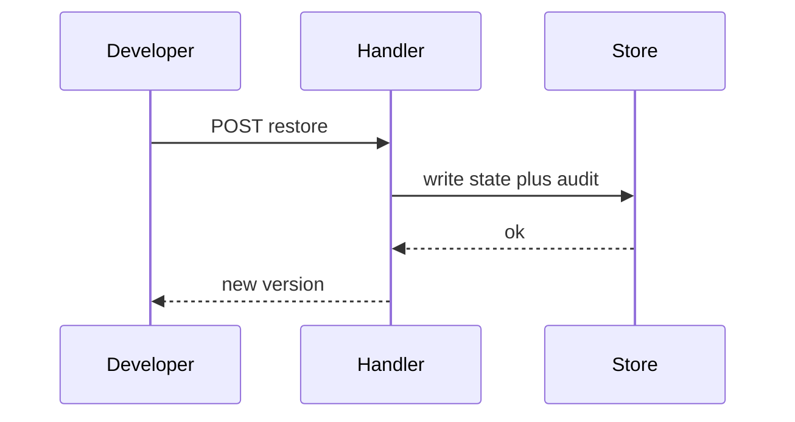
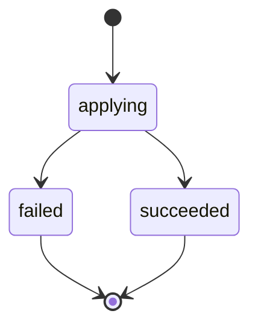
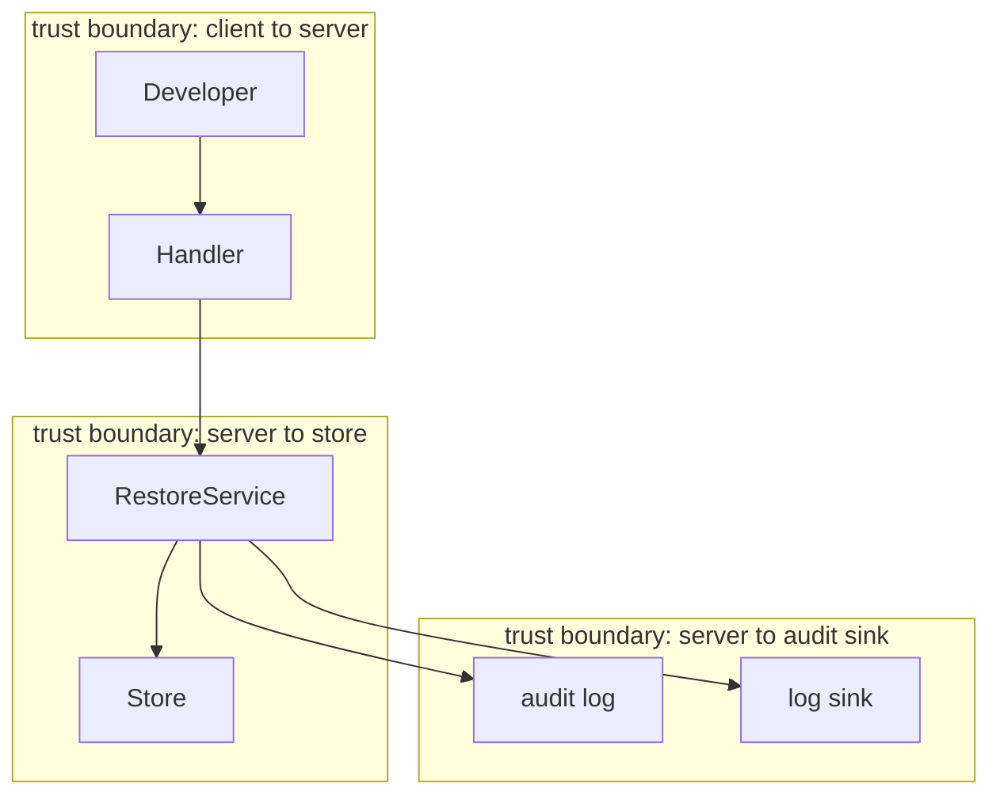

## Context

A person restores an earlier state of a stack or workspace and later asks why the live state changed. An operator asks why an installation restore ended without changing live data. Both paths must leave one true audit record.

## Decisions

1. **Unit restore entry in same transaction.** Write the unit restore audit entry in the same SQL transaction as the state row, with actor, credential kind, unit reference, restored-from version, new version, reason of at most 500 characters and the state.write decision record id when a gate ran else null with reason no-gate-ran. Serialize concurrent restores on one unit in the store. A longer reason is refused with audit.reason-invalid and no echo. A duplicate restore that writes no new version still writes one entry with equal versions and outcome duplicate. No field is added to the Pulumi or TFE routes. The entry holds no secret values.
2. **End entry always attempted and retried once.** Always attempt the installation restore end entry through appendEvents after FinishRestore, also when RestoreEvents or readRestoreInput fails or the op is missing from ops. Enforce one end entry per restore id with a unique constraint and an atomic insert. The next sweep through FailEndedRestores writes a missing entry once with the recorded actor of the operation, or system actor and the crash cause when absent. If the retry fails the row stays failed and only the entry is retried. A later failure appends an entry that states it supersedes the earlier success and never edits it.

## Structure

The unexported restore audit writer takes only a RestoreAuditEntry made by its constructor, so an entry without actor, unit reference, both versions and outcome cannot be made.

## Risks

- Two tools mean two state paths must share one audit shape.
- The sweep retry must not write a duplicate end entry.

## Layers (defense in depth)

| Layer | Guard | Hostile test |
| --- | --- | --- |
| boundary check | The handler checks the grant and the version fields before the store write. | Call the handler with a forged version id and no grant; the store sees no write. |
| encode or contain | The store uses placeholders and refuses a reason over 500 characters without echo. | Submit SQL text and a 10 KB reason; check refusal with no echo. |
| limit | RestoreEvents keeps at most 1000 events and one end entry per restore id. | Run a restore with 1200 events; check the bound and one end entry. |
| authorize at point of use | The store write checks the grant for the unit. | Revoke the grant after the start; check the write is refused. |
| fail closed | An audit error rolls back the unit state row; an end entry error leaves the row failed and logs the cause. | Fail the audit store; check no success entry stays. |

## Diagrams

After this change:

States and transitions after this change:

## Quality attributes

| Attribute | Target | Unit | Scope |
| --- | --- | --- | --- |
| latency | 0 added round trips outside the state transaction | round-trips | unit state restore request in internal/servertest |
| storage growth | 1 new audit entry | entries | one unit state restore |

## Threat model

Data flow and trust boundaries:

| Boundary | STRIDE | Threat | Layer | Guard | Hostile test |
| --- | --- | --- | --- | --- | --- |
| client to server | S | Spoofed actor restores unit state with forged credentials or version. | boundary check | Handler allows only known restore routes and valid version ids. | Send unknown path and forged version id; check refusal before store write. |
| client to server | S | Spoofed actor restores unit state with forged credentials or version. | encode or contain | Handler treats reason as opaque text and never echoes over-limit input. | Send script text and 10 KB reason; check stored entry holds safe text and refusal has no echo. |
| client to server | S | Spoofed actor restores unit state with forged credentials or version. | limit | Handler limits reason to 500 characters and one restore per request. | Send 501 character reason; check audit.reason-invalid. |
| client to server | S | Spoofed actor restores unit state with forged credentials or version. | authorize at point of use | Handler checks state write grant for the unit at point of use. | Call without grant; check refusal and no store write. |
| client to server | S | Spoofed actor restores unit state with forged credentials or version. | fail closed | Handler denies on auth or decode error and writes refusal to audit log. | Fail auth decode; check denial and audit record. |
| client to server | T | Tampered restore request changes live state without true audit versions. | boundary check | Handler checks grant and version chain before state write. | Tamper version id in flight; check refusal. |
| client to server | T | Tampered restore request changes live state without true audit versions. | encode or contain | Store uses placeholders for versions and reason. | Send SQL text in reason; check it is stored as text. |
| client to server | T | Tampered restore request changes live state without true audit versions. | limit | One audit entry per accepted restore; duplicate restore writes equal versions with outcome duplicate. | Send duplicate restore; check one entry with equal versions. |
| client to server | T | Tampered restore request changes live state without true audit versions. | authorize at point of use | Store rechecks grant inside the state transaction. | Revoke grant after handler check; check transaction refuses. |
| client to server | T | Tampered restore request changes live state without true audit versions. | fail closed | Audit failure rolls back the state row. | Fail audit insert; check state unchanged. |
| server to store | R | Restore denies the action because start has no matching end entry. | boundary check | RestoreService records actor, credential kind, both versions, and decision record id in the entry. | Restore and read entry; check all fields present. |
| server to store | R | Restore denies the action because start has no matching end entry. | encode or contain | Entry holds references only, never secret values. | Restore state with secrets; check entry has no plain secret. |
| server to store | R | Restore denies the action because start has no matching end entry. | limit | Exactly one entry per restore id via unique constraint and atomic insert. | Retry end entry twice; check one row. |
| server to store | R | Restore denies the action because start has no matching end entry. | authorize at point of use | FailEndedRestores retry uses recorded actor or system actor with no caller grant. | Run sweep with no caller; check entry uses recorded actor. |
| server to store | R | Restore denies the action because start has no matching end entry. | fail closed | Missing end entry leaves row failed with cause until retry succeeds. | Fail end entry insert; check row stays failed. |
| server to store | I | Disclosure or corruption of state through forged restore versions. | boundary check | State and entry commit in one transaction with fence check. | Write with stale fence; check refusal of both. |
| server to store | I | Disclosure or corruption of state through forged restore versions. | encode or contain | Versions come from stored state chain, not client text. | Send mismatched version labels; check stored versions win. |
| server to store | I | Disclosure or corruption of state through forged restore versions. | limit | Serialized restores on one unit; MaxRestoreEvents 1000 bounds event read. | Run concurrent restores; check each entry has true versions. |
| server to store | I | Disclosure or corruption of state through forged restore versions. | authorize at point of use | Write checks state write grant for the unit. | Restore with read-only grant; check denial. |
| server to store | I | Disclosure or corruption of state through forged restore versions. | fail closed | Any store error denies the restore with no partial state. | Inject store fault; check no new version. |
| server to audit sink | D | Crash or later failure leaves missing or stale restore end entry. | boundary check | appendEvents attempts end entry also when RestoreEvents or readRestoreInput fails. | Fail events read; check end entry still attempted. |
| server to audit sink | D | Crash or later failure leaves missing or stale restore end entry. | encode or contain | Log line keeps restore id, error class, and cause via faultlog.Cause. | Fail audit append; check log line holds id and cause. |
| server to audit sink | D | Crash or later failure leaves missing or stale restore end entry. | limit | One end entry per restore id; sweep writes missing entry once. | Run two sweepers; check one end entry. |
| server to audit sink | D | Crash or later failure leaves missing or stale restore end entry. | authorize at point of use | Superseding failure appends new entry and never edits success. | Fail after success; check success unchanged plus superseding failure. |
| server to audit sink | D | Crash or later failure leaves missing or stale restore end entry. | fail closed | Failed append leaves row failed and retries only the entry. | Fail entry write; check row failed and retry writes entry only. |
| client to server | E | Privilege gain by restoring a unit without state write grant. | boundary check | Restore routes require grant; unauthenticated calls are refused. | Call restore with no token; check refusal. |
| client to server | E | Privilege gain by restoring a unit without state write grant. | encode or contain | Error bodies carry code only, never reason text or state. | Trigger audit.reason-invalid; check body has no reason echo. |
| client to server | E | Privilege gain by restoring a unit without state write grant. | limit | Fixed work per restore; no bulk restore route. | Send bulk restore; check refusal. |
| client to server | E | Privilege gain by restoring a unit without state write grant. | authorize at point of use | Each restore checks grant for its unit. | Restore second unit with first unit grant; check denial. |
| client to server | E | Privilege gain by restoring a unit without state write grant. | fail closed | All errors deny and record refusal. | Send malformed restore; check denial with audit record. |

## Contracts

**Unit state restore**

- Invariant: Each accepted restore of a live unit writes exactly one audit entry.
- Invariant: An audit failure rolls back the state row.
- `restoreUnitState`: pre: Caller holds the state write grant.. Post: The entry and the new state commit together or neither..
- `FinalizeStateVersion`: pre: Caller holds the state write grant.. Post: The entry and the new state version commit together or neither..

**Installation restore operation**

- Invariant: Each ended restore has exactly one end entry.
- Invariant: A later failure never edits an earlier success entry.
- `FinishRestore`: pre: Row is checking or applying.. Post: Row is ended and the end entry is attempted..
- `FailEndedRestores`: pre: Row has no live claim.. Post: Stale rows are failed and a missing end entry is written once..
- `appendEvents`: pre: Restore input decoded or the decode cause recorded.. Post: The end entry is attempted also when RestoreEvents fails..

## Failure modes

| Step | Failure | Retry | State after |
| --- | --- | --- | --- |
| End installation restore | Crash between FinishRestore and appendEvents. | The next sweep writes the missing end entry once. | failed with one end entry |
| Restore unit state | Audit write fails. | The transaction rolls back and returns the error. | state unchanged |
| FailEndedRestores retry | Two sweepers race. | Atomic insert under the unique constraint. | one end entry |
