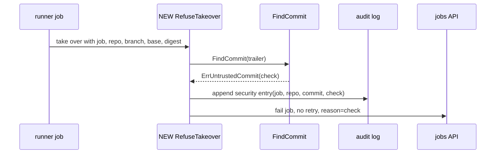
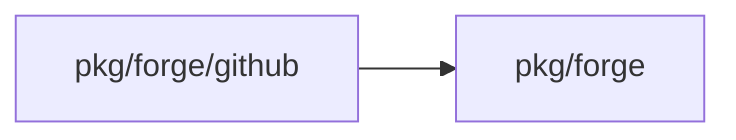
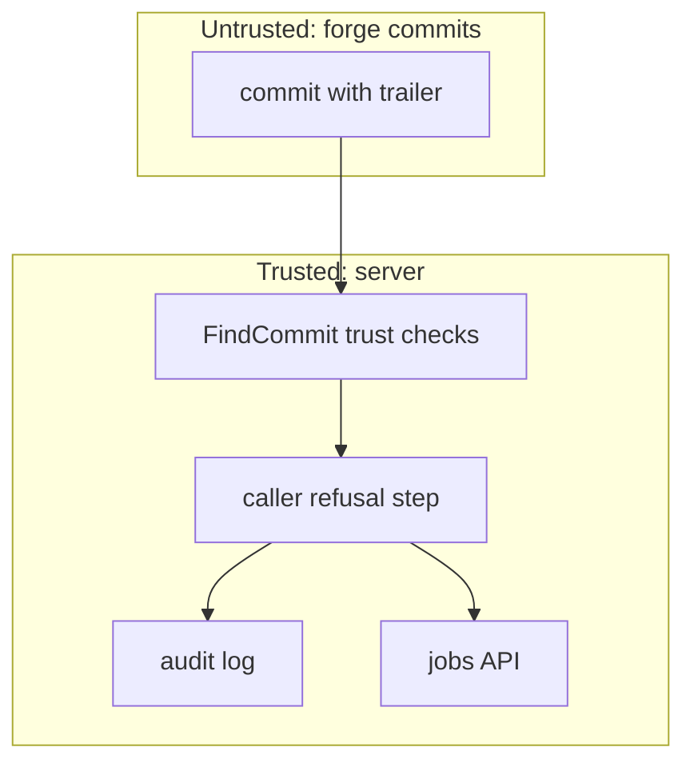

## Context

FindCommit already refuses with forge.ErrUntrustedCommit. No caller records the refusal because the write-back executor M5-39 is not built. This change builds only the refusal record path that M5-39 will call: a NEW pure refusal constructor plus a service step that appends the audit entry then marks the job failed. FindCommit stays a pure trust check and writes no audit entry.

## Decisions

1. **Record at caller step.** Keep FindCommit pure. The NEW RefuseTakeover constructor in NEW pkg/forge/takeover_refusal.go builds the refusal value, and the caller service step appends the audit entry and fails the job, so pkg/forge imports no audit or jobs package.
2. **Digest branch parent rule.** Digest is SHA-256 over the concatenation of each changed path sorted byte-wise plus its bytes, then the exact branch name bytes as UTF-8 with no normalization. The allowlist is non-empty repository ID, non-empty job trailer line, non-empty base commit, non-empty digest, non-empty branch name. Other content, another branch, or a parent that does not equal base gives forge.ErrUntrustedCommit.
3. **Pre-tag proof rule.** Pre-tag there is no rotation. Only the new binding seals. A commit sealed with the old binding opens as forge.ErrUntrustedCommit because the proof format has not shipped in a tag. The user docs page states this rule.
4. **Order and dedup.** Order is audit append then job fail, keyed by job ID and commit ID. On resume the step reads the log first and skips a second append. If the append fails the job still moves to failed, and the step retries only the audit append on resume with no job retry.

## Structure

Unexported NEW refusal type with a constructor that requires job ID, repository ID, branch, base commit, and change digest; only the constructor builds the proof binding, so a caller cannot seal a proof without digest and branch.

## Risks

- Audit write failure must not mark the commit trusted.
- Digest input set, ordering, and encoding must stay stable across tries.

## Diagrams

After this change:

Modules that the change touches, and their imports on main:

## Quality attributes

| Attribute | Target | Unit | Scope |
| --- | --- | --- | --- |
| latency | 500 | ms p95 | write-back takeover refusal path |
| storage growth | 1 | audit entry | one refusal |

## Threat model

Data flow and trust boundaries:

| Boundary | STRIDE | Threat | Layer | Guard | Hostile test |
| --- | --- | --- | --- | --- | --- |
| Untrusted forge commits to FindCommit | S | Spoofed delivery commit claims the job as delivered. | boundary check | Allowlist trust checks on author, committer, verification, trailer line, and keyed proof with at most 100 listed commits. | Submit forged trailer commit with copied proof and wrong content; assert refusal with forge.ErrUntrustedCommit. |
| Untrusted forge commits to FindCommit | S | Spoofed delivery commit claims the job as delivered. | encode or contain | Contained commit ID handling; no host text enters the audit entry. | Submit commit with control characters in trailer; assert stored entry holds no host text. |
| Untrusted forge commits to FindCommit | S | Spoofed delivery commit claims the job as delivered. | limit | Bounded commit list read of 100 and stable SHA-256 digest comparison. | Submit oversize commit list with forged trailer past 100; assert bounded read and refusal. |
| Untrusted forge commits to FindCommit | S | Spoofed delivery commit claims the job as delivered. | authorize at point of use | Existing jobs read route enforces its authorization actions at point of use before showing the reason. | Read a refused job with another namespace credential; assert denial. |
| Untrusted forge commits to FindCommit | S | Spoofed delivery commit claims the job as delivered. | fail closed | Unknown or failed check denies delivery and moves the job to terminal failed with no retry edge. | Send a commit sealed with the old binding without digest and branch; assert failed job and no delivered record. |

## Contracts

**forge commit delivery**

- Invariant: A commit with a failed trust check is never recorded as delivered.
- Invariant: A proof binds repository, trailer line, base commit, change digest, and branch.
- `FindCommit`: pre: The candidate list holds at most 100 commits with the job trailer.. Post: If the trust check fails the call returns forge.ErrUntrustedCommit with the failed check name.; The found commit parent equals the base commit or the call returns forge.ErrUntrustedCommit..
- `SealBound`: pre: The binding inputs are allowlisted non-empty values.. Post: SealBound seals a proof that binds repository, trailer line, base commit, change digest, and branch..

**write-back takeover refusal**

- Invariant: A refused takeover ends in terminal failed state with no retry edge.
- Invariant: One security audit entry records each job and commit pair.
- `RefuseTakeover`: pre: The job holds repository, branch, base commit, and change digest.. Post: On forge.ErrUntrustedCommit the method returns a refusal with job ID, repository, commit ID, and failed check.; A second call with the same job ID and commit ID returns the same refusal without a second audit entry..
