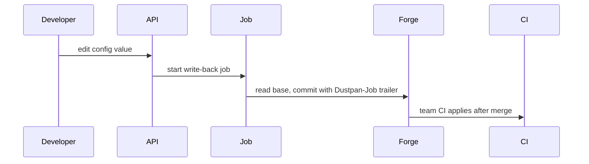
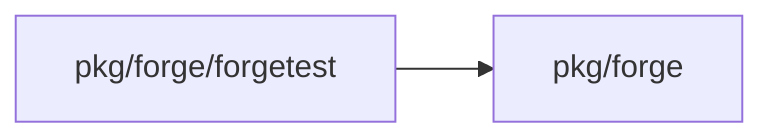
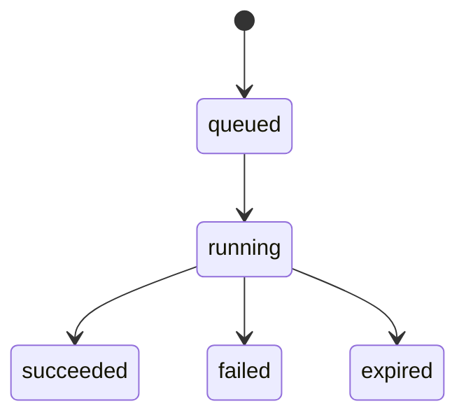
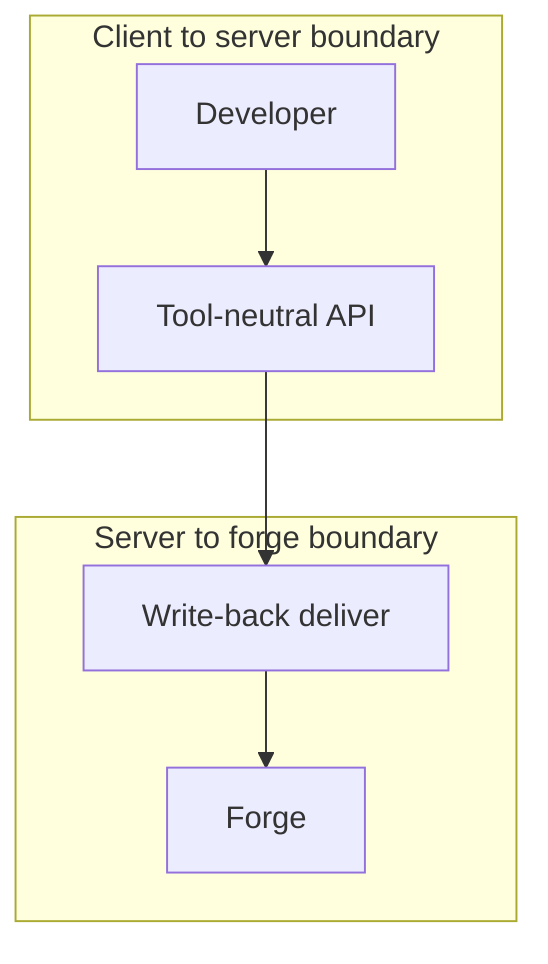

## Context

Write-back is the executor that commits API config edits to the git host. It runs in the server on the durable runner, uses the Forge port, and the team CI applies the change.

## Decisions

1. **Base-commit write-back with job trailer and head scan.** The write-back deliver phase reads each edited file at the base commit, applies only the keys of the edits, creates a missing editable file, checks the base is still the branch head at commit time, writes one direct-push commit with the trailer Dustpan-Job holding the job ID under the server forge identity, and refuses edits outside the editable config files of the tool StepPlanner. Idempotence keys on the job ID: before pushing, the deliver phase reads the branch head and scans at most 20 head commits for the trailer Dustpan-Job holding the job ID; on a match it records that commit and pushes nothing.

## Structure

An unexported writeBackApplier built only by NewWriteBackApplier, which holds the base commit, the checked edits, and the job trailer. No other constructor can make it.

## Risks

- A commit with a wrong base overwrites a team push.
- A forge secret reaches the job log.

## Diagrams

After this change:

Modules that the change touches, and their imports on main:

States on main in the touched packages:

States and transitions after this change:

## Quality attributes

| Attribute | Target | Unit | Scope |
| --- | --- | --- | --- |
| deliver retry bound | 5 | attempts | one write-back deliver phase |
| job expiry | 14 | days | one write-back job with no final state version |
| commit count | 1 | commits | one write-back job including retries |

## Threat model

Data flow and trust boundaries:

| Boundary | STRIDE | Threat | Layer | Guard | Hostile test |
| --- | --- | --- | --- | --- | --- |
| Client to server boundary | T | A caller edits a file outside the unit config or reads a secret from the job log. | authorize at point of use | Handler checks unit write grant and writes denial to audit log. | Edit without grant gets 403 and an audit entry. |
| Client to server boundary | T | A caller edits a file outside the unit config or reads a secret from the job log. | boundary check | Service refuses paths outside editable config files and outside the code location before any forge call. | Edit with dot-dot path is refused with no forge call. |
| Client to server boundary | T | A caller edits a file outside the unit config or reads a secret from the job log. | encode or contain | Job log writer strips secret values and writes only the error class. | Forge error with secret leaves no secret in the job log. |
| Client to server boundary | T | A caller edits a file outside the unit config or reads a secret from the job log. | limit | ValidateEdits caps edit count and value size before the forge call. | Oversize edit batch is refused with no forge call. |
| Client to server boundary | T | A caller edits a file outside the unit config or reads a secret from the job log. | fail closed | Validation failure fails closed with no job and no forge call. | Invalid edit leaves no job and no commit. |

## Failure modes

| Step | Failure | Retry | State after |
| --- | --- | --- | --- |
| Validate edit | Edit fails validation | No retry. Caller fixes the path or value and sends a new edit. | No job starts. No forge call. |
| Read files at base commit | Base file read fails with retryable forge error | Retry with backoff within 5 attempts of the deliver phase. | Job stays running. No commit. |
| Check base against branch head | Key changed after base or head moved | No retry. Caller rebases on the latest commit and sends a new edit. | Job is failed. No commit pushed. |
| Push commit with job trailer | Forge answers 4xx on commit | No retry. Job fails with the refused class. | Job is failed. No commit pushed. |
| Push commit with job trailer | Forge answers transport error, timeout, 429, or 5xx on commit | Retry with backoff. Fail after 5 attempts. | Job stays running during retries, then failed. At most 1 commit for the job. |
| Record commit in job | Server crashes after forge commit and before job record names the commit | Durable retry scans the branch head for the trailer Dustpan-Job holding the job ID and records it. No second commit. | Job is succeeded with 1 commit recorded. |
| Close job on next final state version | No final state version arrives | No retry of the commit. Job expires. | Job expires after 14 days. |
