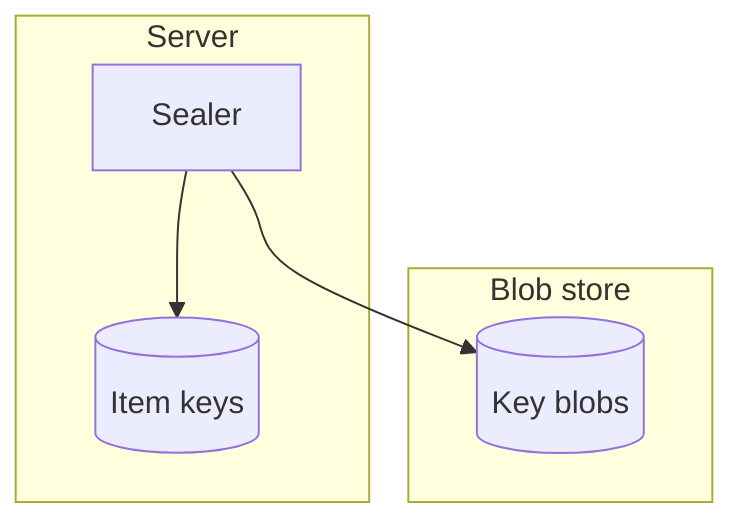

## Context

The ports ItemSealer, ItemKeyIndex and ItemKeyBlobs exist with test doubles and SQL adapters. No production code joins them.

## Decisions

1. **One sealer over ItemKeyBlobs.** secret.NewItemKeySealer takes the ItemKeyBlobs, the ItemKeyIndex and the NEW recorder. It refuses a nil argument.
2. **Shred then delete.** ItemKeySealer.Shred calls ItemKeyIndex.ShredItemKey, then ItemKeyBlobs.Versions and ItemKeyBlobs.Delete. A missing record returns the not-found error and deletes no blob.
3. **Retry.** A second Shred call on a shredded row deletes the blob versions that remain. A failed delete returns an error and writes an audit entry through the recorder.
4. **No new blob after shred.** The sealer refuses to write a blob for a shredded item key.

## Structure

The ItemKeySealer fields are unexported and only the constructor sets them. ItemKeyBlobs builds blob keys from the namespace ID, so a name cannot reach a key.

## Risks

- A read in flight during a shred sees a missing blob. The sealer returns the shred error because the row has shredded_at_ms set.
- A restore of a backup that predates the shred brings the blob back.

## Layers (defense in depth)

| Layer | Guard | Hostile test |
| --- | --- | --- |
| fail closed | The constructor refuses a nil blob store, index or recorder. | TestNewItemKeySealerRefusesNil |

## Quality attributes

| Attribute | Target | Unit | Scope |
| --- | --- | --- | --- |
| storage growth | 0 wrapped key blobs remain after a shred | blobs | each shredded item key |

## Threat model

Data flow and trust boundaries:

| Boundary | STRIDE | Threat | Layer | Guard | Hostile test |
| --- | --- | --- | --- | --- | --- |
| Server to blob store | I | A shred keeps the wrapped key, so a holder of the key-encryption key opens shredded content | boundary check | The blob key comes from the namespace ID and the item key ID only. | TestItemKeyBlobKeyIgnoresName |
| Server to blob store | I | A shred keeps the wrapped key, so a holder of the key-encryption key opens shredded content | encode or contain | ItemKeyBlobs builds the key from fixed segments. | TestItemKeyBlobKeyRejectsSlash |
| Server to blob store | I | A shred keeps the wrapped key, so a holder of the key-encryption key opens shredded content | limit | The delete lists the versions of one item key only. | TestItemKeyShredDeletesOneKey |
| Server to blob store | I | A shred keeps the wrapped key, so a holder of the key-encryption key opens shredded content | authorize at point of use | The sealer reads the record by namespace ID and item key ID, so a key of another namespace is not found. | TestItemKeyShredOtherNamespace |
| Server to blob store | I | A shred keeps the wrapped key, so a holder of the key-encryption key opens shredded content | fail closed | A missing record or a failed delete returns an error and writes an audit entry. | TestItemKeyShredMissingRecord |

## Contracts

**ItemKeySealer**

- Invariant: The blob key holds the namespace ID and the version segment.
- Invariant: A shredded item key has no blob after Shred returns without error.
- `Shred`: pre: The item key record exists in the namespace.. Post: The row has shredded_at_ms set and no blob version remains..
- `ItemKeyBlobs.Versions`: pre: The namespace ID comes from the resolved row.. Post: The caller gets each stored version of the key..
- `ItemKeyBlobs.Delete`: pre: The shred record is committed.. Post: No version of the key remains..

## Failure modes

| Step | Failure | Retry | State after |
| --- | --- | --- | --- |
| Blob delete after the shred commit | The server stops or the blob store refuses | The caller runs Shred again. It deletes the remaining versions. | The row is shredded and the blob may remain until the retry |
