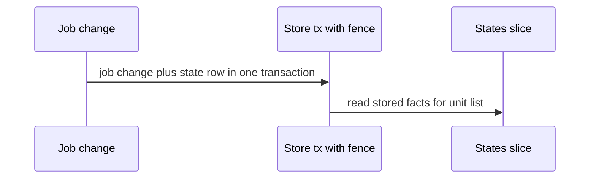
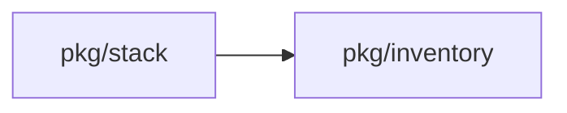

## Context

Inventory shows per-unit states from several writers. This change adds the job-model writes and the stack-package write of failed, each in the transaction of its own write with the fence. The states slice owns the states field, the filter and the badge order.

## Decisions

1. **One stored fact per unit per state kind in the writer transaction.** Store one row per unit stable ID per state kind with unit ID, state kind, change identity, server end time and since time. Each domain service calls a shared store helper WriteUnitStatesInTx inside its own transaction with the fence checked there, so pkg/stack never imports pkg/inventory. A fence failure rolls back the whole transaction.
2. **End-time ordering with defined change identity and fail-closed disagreement.** For a Pulumi job the job end and the update end carry the same job ID; for a CLI update outside a job the identity is the update ID; for other jobs it is the job ID. Server time at write is the end time. On tie the greater identity wins. When two ends of one identity disagree, failed stays until a later identity with success clears it. Cancelled, timed out, lost-claim, superseded, rejected and denied ends clear live states and leave failed unchanged. Reconcile runs at start and on namespace takeover under the fence in one transaction against the live claim table.

## Structure

Unexported unit state writer with constructor that takes the store, clock and fence reader; only the constructor makes valid state rows and each write method checks the fence before the upsert.

## Risks

- Two writers of failed can disagree on success; the fail-closed rule keeps failed until a later success clears it.
- A stale plan can keep apply-needed; supersede, expiry and invalid-plan clears bound its life.

## Diagrams

After this change:



Modules that the change touches, and their imports on main:



States on main in the touched packages:


States and transitions after this change:

```mermaid
stateDiagram-v2
[*] --> queued
queued --> running
running --> awaiting-approval
awaiting-approval --> running
queued --> [*]
running --> [*]
```

## Quality attributes

| Attribute | Target | Unit | Scope |
| --- | --- | --- | --- |
| durability | 0 | lost state rows per committed job change | state rows written with each job change |
| correctness | 100 | percent of reads that show the end with the latest server end time | failed row under out-of-order ends |

## Threat model

Data flow and trust boundaries:

```mermaid
Job API and tool APIs write state rows; inventory reads them under unit:read.
```

| Boundary | STRIDE | Threat | Layer | Guard | Hostile test |
| --- | --- | --- | --- | --- | --- |
| API to store | T | A caller writes or reads the states of a unit in another namespace or after failover. | authorize at point of use | Handler checks unit:read on each unit before showing states. | Caller without the grant reads the unit list and gets no states. |
| API to store | T | A caller writes or reads the states of a unit in another namespace or after failover. | fail closed | Store checks namespace.Fence in the same transaction as the state write. | Write with a stale failover version rolls back with no row kept. |

## Contracts

**UnitStates**

- Invariant: One stored row per unit per state kind for running, queued, awaiting-approval, failed and apply-needed.
- Invariant: Only the named writer writes its kinds, in the transaction of its own write with the fence.
- Invariant: Only a later sort key overwrites the failed row.
- `set-failed-on-failed-change`: pre: End belongs to an apply or destroy job or a Pulumi update of kind update, destroy or import.. Post: Failed row holds the change identity and server end time of the latest ended change..
- `clear-failed-on-later-change`: pre: Later change identity has a greater server end time or a greater identity on tie.. Post: Failed row cleared when a later change identity ends with success..
- `fence-failure-rolls-back`: pre: Fence check fails in the transaction.. Post: No job change and no state row kept..

## Failure modes

| Step | Failure | Retry | State after |
| --- | --- | --- | --- |
| Job change with state write | Fence check fails after failover. | Caller retries the job change after reading the new primary; no state row is kept. | Transaction rolled back; no job change and no state write. |
| Reconcile live states | Server restarts while live-state rows exist. | Reconcile runs at start and on namespace takeover under the fence against the live claim table. | Rows for terminal or unknown jobs cleared; rows for live jobs kept. |
