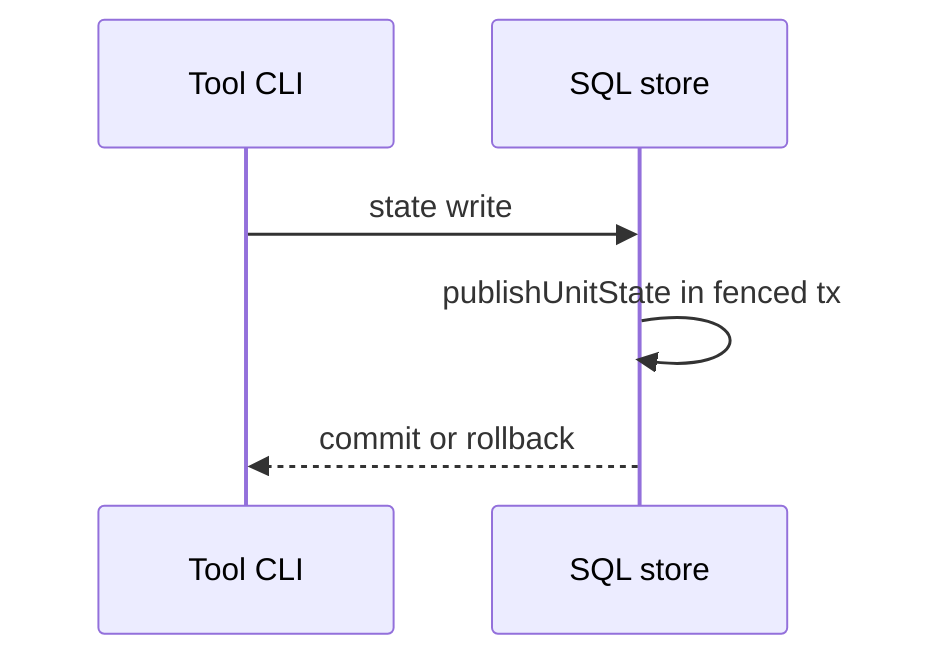
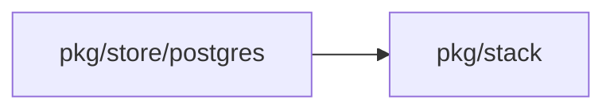
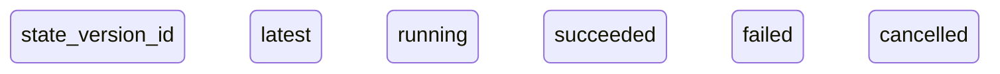
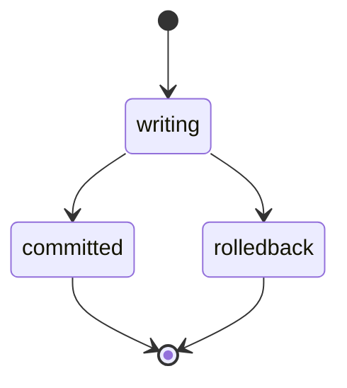

## Context

Main already writes the current and final versions and closes awaiting jobs in the fenced transaction. This part adds proof and docs only.

## Decisions

1. **Keep the direct close of main.** publishUnitState in each SQL store writes both versions and calls CloseAwaiting in the same fenced transaction. No code path changes.
2. **Prove it with tests at each layer.** Store tests cover current, final, idempotent and rollback cases on SQLite and PostgreSQL. One e2e step covers both real CLIs.

## Structure

The guard test unitStateWriteQueries makes publishUnitState the only writer of unit_state. No new type is added.

## Risks

- A test that passes on main proves no new behavior, so each test must also fail when the write is removed.

## Diagrams

After this change:

Modules that the change touches, and their imports on main:

States on main in the touched packages:

States and transitions after this change:

## Quality attributes

| Attribute | Target | Unit | Scope |
| --- | --- | --- | --- |
| State write overhead of the version rows | 0 extra transactions and 0 extra round trips from the client | transactions per state write | Pulumi checkpoint and OpenTofu finalize writes on SQLite and PostgreSQL; no code path changes in this part |

## Failure modes

| Step | Failure | Retry | State after |
| --- | --- | --- | --- |
| State write | The version write fails inside the transaction | The client pushes the state again | Neither state nor version rows commit |

## Change impact (computed from main)

Tests:

- `internal/selfservice/selfservicetest/mem_test.go` names `Store.ObserveStateVersion`

ADRs:

- `docs/adr/0116-request-states-jobs-approvals-and-freezes.md` names `Store.ObserveStateVersion`
- `docs/adr/0100-a-shared-job-model-on-durable-operations.md` names `Store.ObserveStateVersion`
