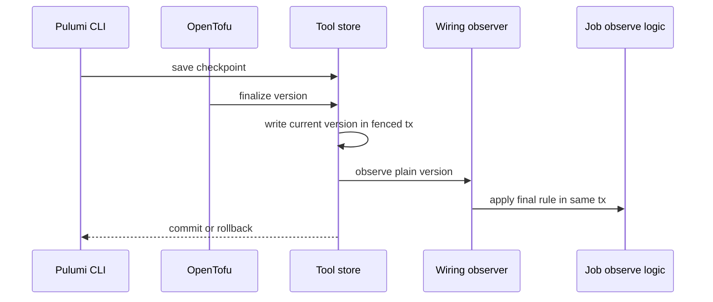
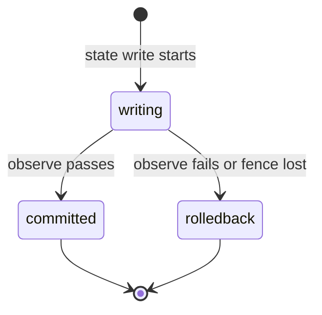

## Context

The job store needs current and last-final versions, but no tool package writes them. This part adds the writes and the same-transaction observe call. Later parts use the versions to start follows plans.

## Decisions

1. **Wiring adapter maps to job.StateVersion.** Each tool store defines a local unexported observer field of a local Observer port type with plain fields (unit ID, version ID, commit, final flag). The internal wiring implements the port and maps the plain fields to job.StateVersion outside the tool package. The tool package never imports job. The job-store observe logic runs through the wiring delegate in the same transaction handle.
2. **Same-transaction observe with order guard.** Current-version write and final-version observe run in the fenced transaction of the state write, keyed by stable unit ID, ordered by commit order with a monotonic guard. A failure or fence loss rolls back state and version rows. A store built without an observer refuses a final write at run time. No compile-time guarantee is claimed.

## Structure

Unexported field observer in each tool SQL store struct, set only by constructor NewStoreWithObserver. A store built without an observer refuses a final write at run time with a 500 error.

## Risks

- A missed final flag leaves a write-back job open until a later final write closes it.
- A stale concurrent commit could move the current version backwards without the monotonic guard.

## Diagrams

After this change:

States and transitions after this change:

## Quality attributes

| Attribute | Target | Unit | Scope |
| --- | --- | --- | --- |
| correctness | 100 | percent | each tool state write transaction |

## Failure modes

| Step | Failure | Retry | State after |
| --- | --- | --- | --- |
| Final state write | Observe call fails inside the transaction | Return the error and roll back the state write; client pushes state again | Neither state nor version rows commit |
| Concurrent state writes | Two state writes of one unit commit out of order | Monotonic guard keeps the newer committed version; loser retries its push | Current version equals the highest committed version |
| Fenced state write | Fence lost during the write | Abort the transaction and return a fence error; client re-reads and retries | Neither state nor version rows commit |
