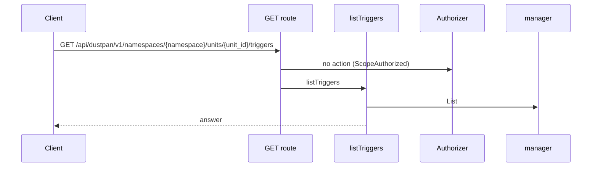
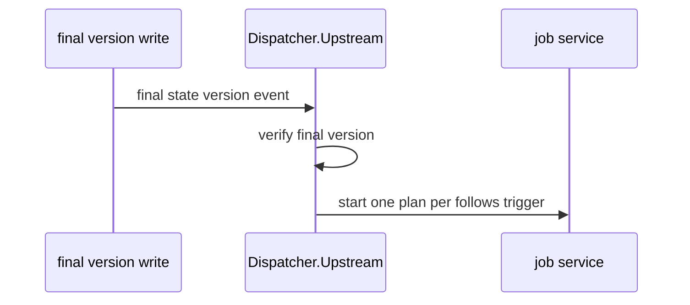
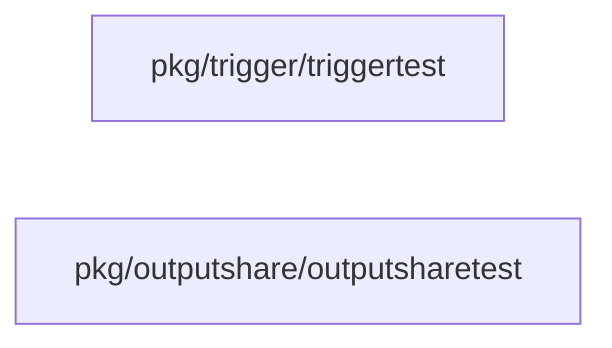

## Context

Final state versions exist in the job store. Dispatcher.Upstream fans out to followers of the source unit.

## Decisions

1. **One verified version, one plan per follower.** Upstream verifies the final version, then starts one plan per follows trigger with when applied, with an idempotency key per trigger and version. A refusal for one trigger is recorded and does not stop others.
2. **Saver check at each read.** The job carries the trigger ID. The read handler resolves the last saver by stable ID at each read and checks current grants. Deny on missing, deleted or disabled.
3. **Newer version wins.** An older version returns ErrVersionMismatch. A skipped version gets no backfill; a manual fire starts it.

## Structure

Unexported type followsKey with a constructor that takes the trigger ID and the checked version ID and yields the idempotency key. The trigger keeps the saver by stable ID (LastSaverID).

## Risks

- A missed event leaves a follower behind until a manual fire.
- A stored row that no longer validates must start nothing.

## Diagrams

Today: `GET /api/dustpan/v1/namespaces/{namespace}/units/{unit_id}/triggers` on main (from the route table and the handler body, route row internal/api/triggers/routes.go:93, handler internal/api/triggers/serve.go:123).



After this change:



Modules that the change touches, and their imports on main:



## Quality attributes

| Attribute | Target | Unit | Scope |
| --- | --- | --- | --- |
| reliability | 0 | extra plan jobs per duplicate version event | follows trigger fan-out |

## Threat model

Data flow and trust boundaries:

```mermaid
Upstream event -> Dispatcher.Upstream -> job service plan start -> source output read with saver check.
```

| Boundary | STRIDE | Threat | Layer | Guard | Hostile test |
| --- | --- | --- | --- | --- | --- |
| State-version write and fire route to Dispatcher.Upstream | T | A hostile event or row starts a plan or reads an output without permission. | boundary check | Reject version IDs outside the allowed bytes and versions that are not final. | Send path characters and an older version; each is refused. |
| State-version write and fire route to Dispatcher.Upstream | T | A hostile event or row starts a plan or reads an output without permission. | limit | One idempotency key per trigger and version. | Replay a concurrent duplicate; one plan per follower exists. |
| State-version write and fire route to Dispatcher.Upstream | T | A hostile event or row starts a plan or reads an output without permission. | authorize at point of use | Check the last saver grants at each output read. | Read after the saver loses unit:read-outputs; denied. |
| State-version write and fire route to Dispatcher.Upstream | T | A hostile event or row starts a plan or reads an output without permission. | fail closed | Deny on missing, deleted or disabled saver. | Read after the saver is disabled; denied. |

## Contracts

**Trigger**

- Invariant: A follows trigger names one source unit in the same namespace.
- Invariant: when is applied in this slice.
- Invariant: LastSaverID names the principal that saved the trigger last.
- `Dispatcher.Upstream`: pre: The event carries a valid version ID of a final state version.. Post: One plan per matching follows trigger and version.; A duplicate event starts nothing new..

## Failure modes

| Step | Failure | Retry | State after |
| --- | --- | --- | --- |
| Fan-out | The sender retries the event after a crash. | Replay the same idempotency key. | One plan per follower for the version. |
| Job start | The job service refuses one follower. | Record the error; a manual fire retries it. | Other followers run. |
| Source output read | The last saver is missing or disabled. | No retry; deny and audit. | The plan runs without the source output. |
