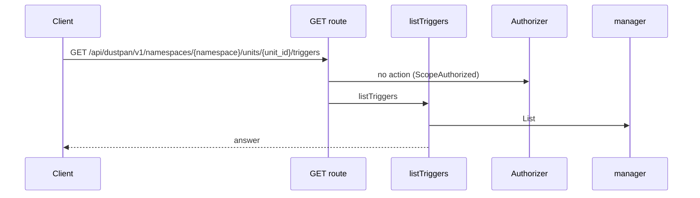
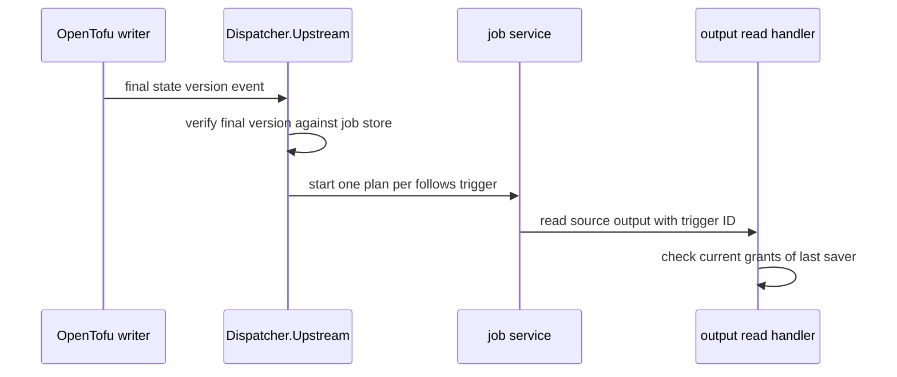
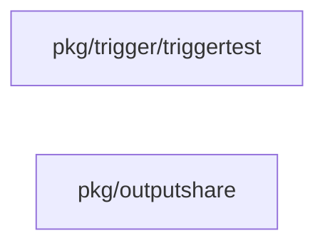

## Context

OpenTofu final state versions already exist in the job store. The OpenTofu writer is the single sender of upstream events in this slice. Dispatcher.Upstream fans out to followers of the source unit.

## Decisions

1. **One verified version fans out to one plan per follower.** Dispatcher.Upstream takes a final state version, verifies it against the job store, then starts one plan per matching follows trigger with when applied, with an idempotency key per trigger and version, and records per-trigger errors without stopping other followers. The save-time cycle check and the save-time limit of 50 followers already exist; this slice reuses them.
2. **Saver check at each read, not at start.** The job carries the trigger ID; the output read handler resolves the last saver at each read and checks unit:read-outputs plus unit:read-secrets against current grants, with deny on missing, deleted, or disabled saver. The start runs as the namespace service principal.
3. **Newer version wins on concurrent delivery.** The first verified newer version wins and an older version returns ErrVersionMismatch. A follower that skipped a version gets no backfill; only a manual refire starts that version.

## Structure

Unexported followsCursor with constructor newFollowsCursor that loads the last fired final version per trigger and only yields versions after it; Upstream binds each job start to one idempotency key per trigger and version, so a retry replays the same key and starts nothing new.

## Risks

- A missed event leaves a follower behind until the next apply; the manual refire path covers it.
- A stored trigger row that no longer validates must start nothing.

## Diagrams

Today: `GET /api/dustpan/v1/namespaces/{namespace}/units/{unit_id}/triggers` on main (from the route table and the handler body, route row internal/api/triggers/routes.go:93, handler internal/api/triggers/serve.go:123).



After this change:



Modules that the change touches, and their imports on main:



## Quality attributes

| Attribute | Target | Unit | Scope |
| --- | --- | --- | --- |
| reliability | 0 | extra plan jobs per duplicate version event | follows trigger fan-out |
| reliability | 0 | silently skipped follower plans per verified final version | follows trigger fan-out |

## Threat model

Data flow and trust boundaries:

```mermaid
Upstream event -> Dispatcher.Upstream -> job service plan start -> source output read with saver check; graph edge read path.
```

| Boundary | STRIDE | Threat | Layer | Guard | Hostile test |
| --- | --- | --- | --- | --- | --- |
| TFE state-version write and trigger fire route to Dispatcher.Upstream | T | A hostile upstream event or a hostile trigger row starts a plan or reads a source output without permission. | boundary check | Reject version IDs outside a-z A-Z 0-9 dash underscore dot and reject versions that are not final for the unit. | Send an event with path characters and an older version; each is refused with no plan start. |
| TFE state-version write and trigger fire route to Dispatcher.Upstream | T | A hostile upstream event or a hostile trigger row starts a plan or reads a source output without permission. | limit | Bind each fan-out to one idempotency key per trigger and version for the life of the version record. | Replay the same event and a concurrent duplicate; only one plan per follower exists. |
| TFE state-version write and trigger fire route to Dispatcher.Upstream | T | A hostile upstream event or a hostile trigger row starts a plan or reads a source output without permission. | authorize at point of use | Check unit:manage-triggers on trigger routes and start the plan as the namespace service principal with only its stored plan-start grant. | Call the fire route without the action; the call is denied. |
| TFE state-version write and trigger fire route to Dispatcher.Upstream | T | A hostile upstream event or a hostile trigger row starts a plan or reads a source output without permission. | fail closed | Resolve the last saver at each source output read and deny on missing, deleted, or disabled saver. | Read a source output after the saver is disabled or deleted; the read is denied. |

## Contracts

**Trigger**

- Invariant: One follows trigger names one source unit reference in the same namespace.
- Invariant: when is applied in this slice; outputs-changed is refused until the filter slice ships.
- Invariant: LastSaver and LastSaverID name the principal that saved the trigger last.
- `Dispatcher.Upstream`: pre: The event carries a final state version with a charset-valid version ID.; The stored trigger row validates at fan-out time.. Post: A verified final version fans out to one plan per matching follows trigger with one idempotency key per trigger and version.; A duplicate version event on the intake path returns the first job and starts nothing new.; A manual refire of an already fired version answers 409 with code trigger.version-mismatch..

## Failure modes

| Step | Failure | Retry | State after |
| --- | --- | --- | --- |
| Dispatcher.Upstream fan-out | Sender retries the same version event after a crash. | Replay the same per-trigger idempotency key; return the first job and start nothing new. | One plan per follower for the version. |
| Per-trigger job start | Job service refuses one follower plan. | Record the error on that trigger and continue; manual refire retries it. | Other followers run; the failed trigger holds the error. |
| Source output read | Last saver is missing, deleted, or disabled at read time. | No retry; deny the read, write an audit entry, and fail the reading step. | Plan runs without the source output. |
| Concurrent version intake | Two versions arrive out of order. | The first verified newer version wins; the older event returns ErrVersionMismatch with no backfill. | Followers hold plans for the newer version only. |
