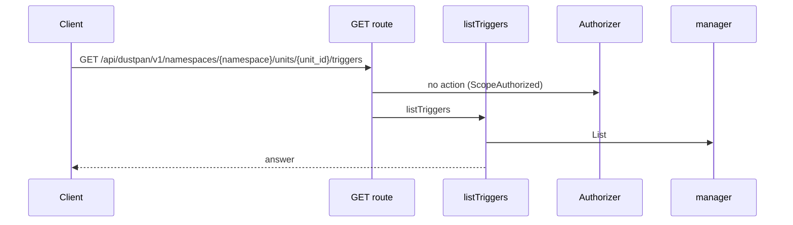
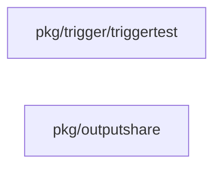

## Context

OpenTofu final state versions exist in the job store. The sender hooks into publishUnitState. Dispatcher.Upstream fans out to followers of the source unit.

## Decisions

1. **One verified version fans out to one plan per follower.** Upstream verifies the final version, then starts one plan per matching follows trigger with when applied, with an idempotency key per trigger and version, and records per-trigger errors without stopping other followers.
2. **Saver check at each read.** The job carries the trigger ID; the read handler resolves the last saver at each read and checks unit:read-outputs plus unit:read-secrets, deny on missing, deleted or disabled saver.
3. **Newer version wins.** An older version returns ErrVersionMismatch. A skipped version gets no backfill; only a manual refire starts it.

## Structure

Unexported followsCursor with constructor newFollowsCursor that yields only versions after the last fired one; each job start binds one idempotency key per trigger and version.

## Risks

- A missed event leaves a follower behind until a manual refire.
- A stored trigger row that no longer validates must start nothing.

## Diagrams

Today: `GET /api/dustpan/v1/namespaces/{namespace}/units/{unit_id}/triggers` on main (from the route table and the handler body, route row internal/api/triggers/routes.go:93, handler internal/api/triggers/serve.go:123).



After this change:


Modules that the change touches, and their imports on main:



## Quality attributes

| Attribute | Target | Unit | Scope |
| --- | --- | --- | --- |
| reliability | 0 | extra plan jobs per duplicate version event | follows trigger fan-out |
| reliability | 0 | silently skipped follower plans per verified final version | follows trigger fan-out |

## Threat model

Data flow and trust boundaries:

```mermaid
Upstream event -> Dispatcher.Upstream -> job service plan start -> source output read with saver check.
```

| Boundary | STRIDE | Threat | Layer | Guard | Hostile test |
| --- | --- | --- | --- | --- | --- |
| State-version write and trigger fire route to Dispatcher.Upstream | T | A hostile event or trigger row starts a plan or reads a source output without permission. | boundary check | Reject version IDs outside the allowed bytes and versions that are not final for the unit. | Send path characters and an older version; each is refused. |
| State-version write and trigger fire route to Dispatcher.Upstream | T | A hostile event or trigger row starts a plan or reads a source output without permission. | limit | One idempotency key per trigger and version. | Replay the event and a concurrent duplicate; one plan per follower exists. |
| State-version write and trigger fire route to Dispatcher.Upstream | T | A hostile event or trigger row starts a plan or reads a source output without permission. | authorize at point of use | Check unit:manage-triggers on trigger routes; start as the namespace service principal. | Call the fire route without the action; denied. |
| State-version write and trigger fire route to Dispatcher.Upstream | T | A hostile event or trigger row starts a plan or reads a source output without permission. | fail closed | Resolve the last saver at each read and deny on missing, deleted or disabled. | Read after the saver is disabled; denied. |

## Contracts

**Trigger**

- Invariant: One follows trigger names one source unit in the same namespace.
- Invariant: when is applied in this slice.
- Invariant: LastSaver and LastSaverID name the principal that saved the trigger last.
- `Dispatcher.Upstream`: pre: The event carries a final state version with a valid version ID.; The stored trigger row validates at fan-out time.. Post: One plan per matching follows trigger with one idempotency key per trigger and version.; A duplicate intake event returns the first job.; A manual refire of a fired version answers 409 with code trigger.version-mismatch..

## Failure modes

| Step | Failure | Retry | State after |
| --- | --- | --- | --- |
| Dispatcher.Upstream fan-out | Sender retries the same event after a crash. | Replay the same idempotency key; return the first job. | One plan per follower for the version. |
| Per-trigger job start | Job service refuses one follower plan. | Record the error on that trigger; manual refire retries it. | Other followers run. |
| Source output read | Last saver is missing, deleted or disabled. | No retry; deny and audit. | Plan runs without the source output. |
| Concurrent version intake | Two versions arrive out of order. | The newer wins; the older returns ErrVersionMismatch. | Followers hold plans for the newer version only. |
