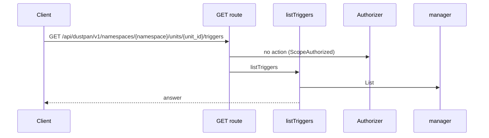
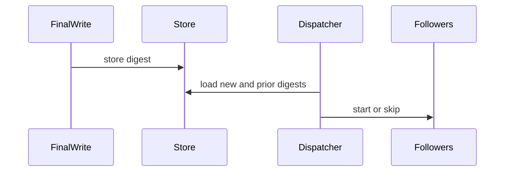
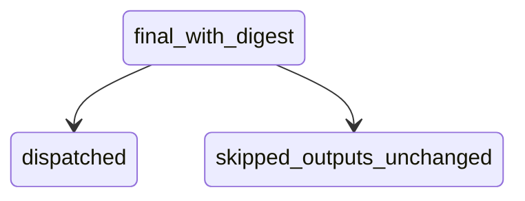

## Context

A follows trigger with when applied starts after each apply. This part adds a digest compare before dispatch so only a changed root-outputs set starts follower plans.

## Decisions

1. **Digest at final write.** Store one opaque root-outputs digest with each apply-counting final state version, over canonical root outputs sorted by name with name, type tag, secret mark and plain value for non-secret outputs only. Pulumi stack outputs and OpenTofu root outputs map to this shape.
2. **Compare in Dispatcher.Upstream.** Dispatcher.Upstream compares the new apply-counting final version with the immediate previous apply-counting final version of the same source. It skips followers with when outputs-changed when the digests match. A missing digest counts as changed. Refresh, preview and destroy versions never move the prior pointer.
3. **No digest leaves the server.** No API field, log value or notification holds the digest; the skipped outcome carries the reason outputs-unchanged and the version pair only.

## Structure

Unexported type outputsDigest with constructor newOutputsDigest(canonicalRootOutputs) that rejects secret plain text; only the constructor builds the stored bytes.

## Risks

- Canonicalization drifts between Pulumi and OpenTofu shapes.
- Versions without a digest start one extra round of follower plans.
- Two applies serialize on the source unit write, so compares read committed digests in version order; a restart replays dispatch with the same version pair.

## Diagrams

Today: `GET /api/dustpan/v1/namespaces/{namespace}/units/{unit_id}/triggers` on main (from the route table and the handler body, route row internal/api/triggers/routes.go:93, handler internal/api/triggers/serve.go:123).



After this change:



States and transitions after this change:



## Quality attributes

| Attribute | Target | Unit | Scope |
| --- | --- | --- | --- |
| correctness | 100 | percent of unchanged-output applies that start zero plans | follows dispatch with when outputs-changed |
| confidentiality | 0 | secret values exposed in API, logs, or notifications | digest storage and skipped outcomes |

## Threat model

Data flow and trust boundaries:

```mermaid
Tool CLI to tool API to final-version store to Dispatcher.Upstream to job service; the digest stays in the store.
```

| Boundary | STRIDE | Threat | Layer | Guard | Hostile test |
| --- | --- | --- | --- | --- | --- |
| final-version store | I | Digest leaks a secret output value to a reader of versions or triggers. | encode or contain | Replace secret output plain values with a fixed marker before the digest. | Finalize a version with a changed secret value only and show the digest stays equal. |
| final-version store | I | Digest leaks a secret output value to a reader of versions or triggers. | fail closed | Keep the digest in a server-only column that no API answer reads. | Call each outputs and trigger route and search the answers for digest bytes. |

## Contracts

**final state version**

- Invariant: Each apply-counting final version carries one root-outputs digest with secret plain values replaced by a fixed marker.
- Invariant: The digest never leaves the server.
- `outputs-changed gate`: pre: New and prior apply-counting final versions are readable.. Post: Followers with when outputs-changed start only when digests differ.; Skipped followers record reason outputs-unchanged..

## Failure modes

| Step | Failure | Retry | State after |
| --- | --- | --- | --- |
| Store digest at final write | Digest write fails. | Fail the finalize transaction; no dispatch runs. | No new final version; followers start nothing. |
| Compare in Dispatcher.Upstream | Prior digest missing. | Treat as changed once; store digest on next final write. | One extra round of follower plans, then filtered. |
| Compare in Dispatcher.Upstream | Restart between final write and dispatch. | Replay dispatch from the stored final version with the same version pair. | No double start and no missed start for that pair. |
