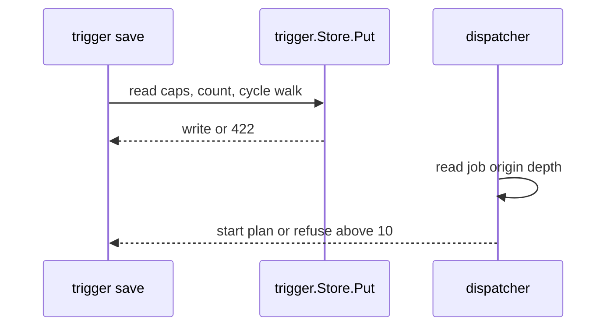

## Context

Follows triggers fan out from one source and chain from unit to unit. The store serializes trigger writes per namespace. The job origin carries a depth counter so a loop made outside a save still stops. This part builds on the state write in publishUnitState and adds no observer.

## Decisions

1. **Caps and cycle check at save.** Inside trigger.Store.Put, in one serialized namespace transaction: read both caps from settings, count triggers of the unit and followers of the source, check the cycle, then write. Rows above a lowered cap stay. References use the stable unit ID.
2. **Depth counter in job origin.** A trigger start sets depth to parent depth plus one. A missing origin is zero. A manual fire resets to zero. The dispatcher refuses above 10, writes one audit entry and one log line, and keeps the refusal if the audit write fails.
3. **Serialization on each adapter.** Each adapter serializes trigger writes of one namespace in a write transaction. The conformance suite runs the concurrent closing-save case on each adapter.

## Structure

Unexported capped trigger writer made only by its constructor; only Put writes a trigger, and Put reads caps from settings, holds the namespace transaction, then checks caps and cycle before the write.

## Risks

- A concurrent save skips the cycle check when an adapter does not serialize.
- A changed cap does not apply when an old value is cached.

## Diagrams

After this change:



## Quality attributes

| Attribute | Target | Unit | Scope |
| --- | --- | --- | --- |
| depth refusal fan-out | 0 | plans started past depth 10 | one trigger chain deeper than 10 |

## Threat model

Data flow and trust boundaries:

```mermaid
Namespace administrator saves a follows trigger via REST API -> trigger store; dispatcher starts plan jobs with the job origin depth.
```

| Boundary | STRIDE | Threat | Layer | Guard | Hostile test |
| --- | --- | --- | --- | --- | --- |
| namespace | D | One source or one loop starts an unbounded number of plans and blocks runners. | limit | Caps and cycle check inside the serialized Put transaction. | Two concurrent closing saves of one namespace; one is refused with the loop path. |
| namespace | D | One source or one loop starts an unbounded number of plans and blocks runners. | fail closed | Depth counter in the job origin, refused above 10 with an audit entry. | Replay a loop with a missing origin; the chain still stops at depth 10. |

## Contracts

**trigger**

- Invariant: A follows trigger names one source unit by stable unit ID in the same namespace.
- Invariant: Trigger count of one unit stays at or below the per-unit cap after each save.
- Invariant: Follower count of one source stays at or below the per-source cap after each save.
- `Put`: pre: Caller holds unit:manage on the unit.; Caps are read from settings inside the call.. Post: Refuses above either cap with trigger.invalid and the cap number.; Refuses a cycle with trigger.cycle and the loop path in order..

## Failure modes

| Step | Failure | Retry | State after |
| --- | --- | --- | --- |
| Trigger save checks caps and cycle. | Store fails inside the serialized write. | Return the store error with no retry. | No trigger row is written. |
| Dispatcher refuses a chain deeper than 10. | Audit write fails. | No retry from the source apply. | The start stays refused with one log line and no new plan. |
