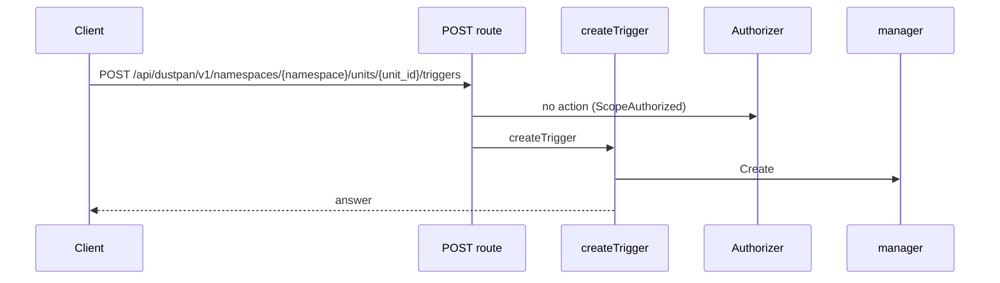
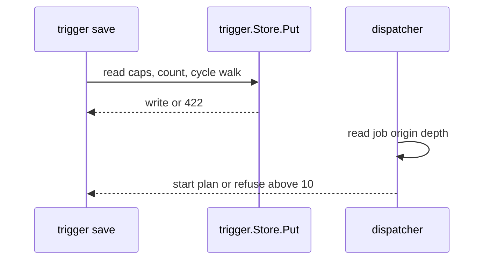
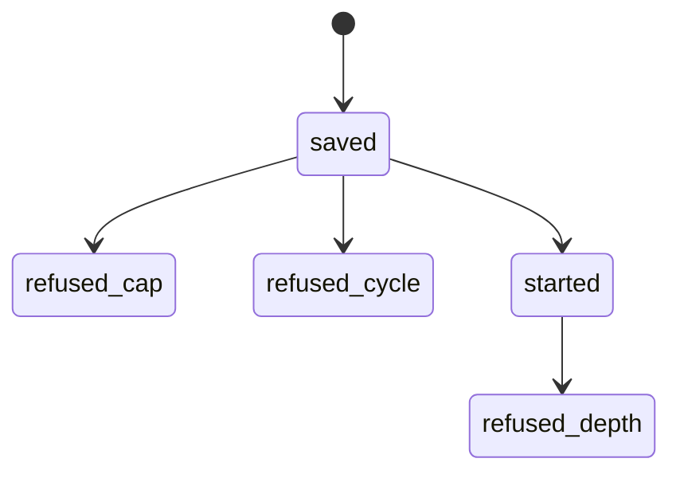

## Context

Follows triggers fan out from one source and chain unit to unit. The store serializes trigger writes per namespace in one transaction so two saves check current rows, and the dispatcher carries a depth counter in the job origin so a loop made outside a save still stops.

## Decisions

1. **Caps and cycle check at save.** Check both caps inside trigger.Store.Put in one serialized namespace transaction: count triggers of the unit and followers of the source, then check the cycle, then write. Read both caps from the installation settings inside Put at each save with no cached copy, so an administrator change applies to the next save. Existing rows above a lowered cap stay; only a save that adds above the new cap is refused. A delete drops the counts. A rename keeps the stable unit ID so counts follow the ID.
2. **Depth counter in job origin.** Carry depth in the job origin: a trigger start sets depth to parent depth plus one, a missing origin starts at zero, and a manual fire resets to zero. The dispatcher refuses above depth 10, writes at most one audit entry per refused start, writes one log line even when the audit write fails, starts no retry from the source apply, and keeps the start refused when the audit write fails.
3. **Serialization on each adapter.** Each store adapter serializes trigger writes of one namespace with the same lock: in-memory with a mutex, SQLite and PostgreSQL with a write transaction that holds the namespace trigger rows. The trigger conformance suite runs the concurrent closing-save case on each adapter.

## Structure

Unexported triggerStore with constructor newTriggerStore that holds no cap copy; only Put writes a trigger, and Put reads caps from settings, holds the per-namespace serialized transaction, then checks caps and cycle before the write.

## Risks

- A concurrent save skips the cycle check when the adapter does not serialize writes of one namespace.
- A changed cap does not apply because the old value is cached past the save.

## Diagrams

Today: `POST /api/dustpan/v1/namespaces/{namespace}/units/{unit_id}/triggers` on main (from the route table and the handler body, route row internal/api/triggers/routes.go:97, handler internal/api/triggers/serve.go:171).



After this change:



States and transitions after this change:



## Quality attributes

| Attribute | Target | Unit | Scope |
| --- | --- | --- | --- |
| save refusal latency | 200 | ms | trigger save that hits a cap or a cycle |
| depth refusal fan-out | 0 | plans started past depth 10 | one trigger chain deeper than 10 |

## Threat model

Data flow and trust boundaries:

```mermaid
Namespace administrator saves follows trigger via REST API -> trigger service -> trigger store; dispatcher starts plan jobs with job origin depth.
```

| Boundary | STRIDE | Threat | Layer | Guard | Hostile test |
| --- | --- | --- | --- | --- | --- |
| namespace | D | One source or one loop starts an unbounded number of plans and blocks runners. | limit | Caps and cycle check inside serialized Put transaction. | Two concurrent closing saves of one namespace; one must be refused with the loop path. |
| namespace | D | One source or one loop starts an unbounded number of plans and blocks runners. | fail closed | Depth counter in job origin refused above 10 with audit entry. | Replay a loop made by restore with missing origin; chain still stops at depth 10. |

## Contracts

**trigger**

- Invariant: One follows trigger names one source unit by stable unit ID in the same namespace.
- Invariant: Trigger count of one unit stays at or below the configured per-unit cap after each save.
- Invariant: Follower count of one source stays at or below the configured per-source cap after each save.
- `Put`: pre: Caller holds unit:manage on the unit.; Caps are read from installation settings inside the call.. Post: Refuses above either cap with error code trigger.invalid and the cap number.; Refuses a cycle with error code trigger.cycle and the loop path in order..

## Failure modes

| Step | Failure | Retry | State after |
| --- | --- | --- | --- |
| Trigger save checks caps and cycle. | Store fails inside the serialized write. | Return the store error with no retry of the write. | No trigger row is written. |
| Dispatcher refuses a chain deeper than 10. | Audit write for a refused deep start fails. | Report the store error with no start of the job and no retry from the source apply. | The trigger start stays refused with one log line and no new plan. |
