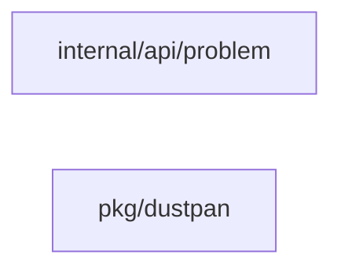

## Context

The writer gate is a test-time check on main that guards two contracts: each adapter error body carries a machine code and each 500 writes one fault-log line. Issue #2403 reports four open bypasses: the exported generic writer at internal/api/problem/problem.go:539, variable WriteHeader values such as internal/api/runnerapi/errors.go:285, map or anonymous-struct bodies missed by internal/errcode/errcodetest/bodies.go:24, and a count-only pin of the exception list.

## Decisions

1. **Close the WriteJSON bypass at the source.** Unexport the generic writer at internal/api/problem/problem.go:539. Keep two narrow writers: the NEW WriteSuccess writer for status below 400 with no code field, and the NEW WriteProblem writer for status 400 or more. The NEW WriteSuccess writer fails closed through the NEW WriteProblem writer with code internal and one fault-log line. The NEW WriteSuccess writer refuses status 400 or more and any body with a code field; it allows 1xx and 3xx only when called through the problem path. The allowlist for non-constant WriteHeader holds only the two writers in internal/api/problem/problem.go.
2. **Close the gate detection bypasses.** Extend internal/api/problem/writer_gate_test.go: flag each non-constant WriteHeader argument outside the allowlist of the two writers, including int conversions and constant expressions, flag each encode of a map type, named map type, anonymous struct, json Marshal then Write, map held in any, helper-built struct, and embedded body, and pin the exception list by exact sorted-key set match. Extend BodyTypes in internal/errcode/errcodetest/bodies.go to report named map types and anonymous struct encodes. internal/api/runnerapi/errors.go:285 migrates and is not allowlisted.

## Structure

Unexported generic writer in internal/api/problem plus a run-time guard in the NEW WriteSuccess writer that accepts only status below 400 and a body with no code field. No structure removes the run-time check because status is a run-time int and the body is a run-time any, so the guard with a mutation test takes its place.

## Risks

- The 13 non-test WriteJSON call sites under internal/ need migration.
- A strict variable-status rule can flag a valid write; the allowlist holds only the two writers and each other site migrates.

## Diagrams

Modules that the change touches, and their imports on main:

## Quality attributes

| Attribute | Target | Unit | Scope |
| --- | --- | --- | --- |
| none affected | Test-time gate only with no request path change |  |  |

## Contracts

**Problem writer**

- Invariant: Each error body with status 400 or more carries a machine code and each 500 writes one fault-log line.
- `NEW WriteProblem`: pre: Caller holds a problem body with a code.. Post: The response carries a code field and a 500 writes one fault-log line..
- `NEW WriteSuccess`: pre: Caller holds a success body with no code field and a status below 400 for the NEW WriteSuccess method.. Post: When status is 400 or more the call fails closed through the NEW WriteProblem method with code internal and one fault-log line.; When the body holds a code field the call fails closed through the NEW WriteProblem method..

**Writer gate**

- Invariant: The pinned exception set matches exactly by sorted keys.
- `BodyTypes`: pre: Caller passes a gated adapter directory.. Post: The returned set holds named struct types, named map types, and flags for anonymous struct encodes..
